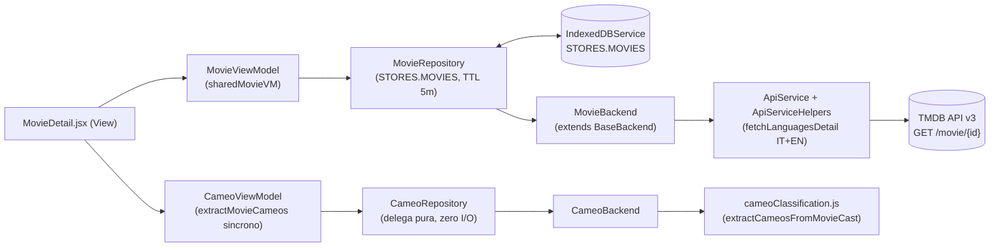
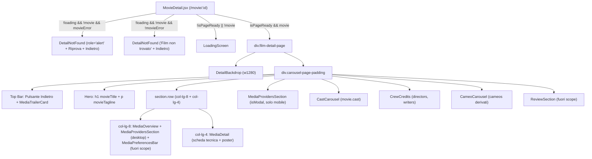

# Documentazione Pagina `MovieDetail.jsx`

Documentazione tecnica della pagina [MovieDetail.jsx](file:///C:/GitHub_Repositories/Cameos/src/pages/MovieDetail.jsx), responsabile della scheda di dettaglio di un singolo film (`/movie/:id`).

> **Nota di perimetro:** la barra preferenze utente ([MediaPreferencesBar.jsx](file:///C:/GitHub_Repositories/Cameos/src/components/media/MediaPreferencesBar.jsx)) e la sezione Recensioni ([ReviewSection.jsx](file:///C:/GitHub_Repositories/Cameos/src/components/ReviewSection.jsx), `getReviewsForTarget` da `catalogData.js`, `ReviewViewModel` / `UserViewModel`) sono sviluppate su un branch separato e sono trattate qui solo come segnaposto strutturale.

---

## Parte 1 — Fetch dei Dati (Architettura, Repository, Backend e Parametri)

### 1.1 Architettura e interazione tra i layer

La pagina applica rigorosamente l'architettura **MVVM unidirezionale** (`View -> ViewModel -> Repository -> Backend -> ApiService / IndexedDB -> Models`): `MovieDetail.jsx` non importa né interroga mai Repository, Backend, `ApiService` o `IndexedDBService`.

Al mount su `/movie/:id`, `MovieDetail.jsx` esegue **un solo flusso di rete** e **una derivazione sincrona in memoria**:

1. **Dettagli completi del film (`selectedMovie`)**: `MovieViewModel.loadMovieDetails({ movieId: id, appendCredits: true, language: normalizedLang })` scarica in parallelo le versioni `it-IT` ed `en-US` di `/movie/{id}?append_to_response=credits,watch/providers,videos,images` (2 richieste HTTP totali) e restituisce un modello bilingue [Movie](file:///C:/GitHub_Repositories/Cameos/src/models/Movie.js) completo di cast, crew, provider streaming e trailer.
2. **Camei del film (`cameos`)**: invece di effettuare un'ulteriore coppia di GET su `/movie/{id}`, la pagina deriva i camei in modo sincrono dal modello `movie` già caricato tramite `CameoViewModel.extractMovieCameos(movie, { minPopularity: 8, language: normalizedLang })` → `CameoRepository.extractCameosFromMovie` → `CameoBackend.extractCameosFromMovie` → `extractCameosFromMovieCast` ([cameoClassification.js](file:///C:/GitHub_Repositories/Cameos/src/backend/cameos/cameoClassification.js#L122-L153)). Questo garantisce **0 richieste HTTP aggiuntive**, **0 scritture ridondanti in `STORES.CAMEOS`** e piena disponibilità offline dei camei ogni volta che il film è presente in `STORES.MOVIES`.

---

### 1.2 Layer ViewModel (`MovieViewModel`, `CameoViewModel`, `BaseViewModel`)

- **Istanziazione e sottoscrizione**:
  - `useMovieViewModel({ language: normalizedLang })` sottoscrive il singleton di sessione `sharedMovieVM` ([useViewModel.js](file:///C:/GitHub_Repositories/Cameos/src/viewmodel/useViewModel.js#L54-L91)) tramite `useSyncExternalStore`.
  - `useCameoViewModel({ language: normalizedLang })` fornisce l'azione `extractMovieCameos` con identità stabile (bound method del ViewModel), senza accoppiare la logica euristica dei camei al modello [Movie](file:///C:/GitHub_Repositories/Cameos/src/models/Movie.js).
- **Caricamento dettagli (`MovieViewModel.loadMovieDetails`)** ([MovieViewModel.js](file:///C:/GitHub_Repositories/Cameos/src/viewmodel/movies/MovieViewModel.js#L254-L293)):
  - Mantiene deliberatamente l'operazione isolata in `MovieViewModel` (senza un wrapper generico condiviso con `SeriesViewModel`), così da poter evolvere logiche specifiche del dominio film senza accoppiamenti rigidi, rispettando però la stessa pipeline difensiva in 5 stadi.
- **Derivazione camei (`CameoViewModel.extractMovieCameos`)** ([CameoViewModel.js](file:///C:/GitHub_Repositories/Cameos/src/viewmodel/cameos/CameoViewModel.js#L151-L158)):
  - Funzione sincrona pura sul ViewModel: se `movie` è `null` restituisce `[]`, altrimenti delega a `this.repository.extractCameosFromMovie(movie, { minPopularity, language, excludeMainCast })` senza modificare lo stato osservabile né attivare `loading`.

#### Struttura in 5 stadi del recupero dettagli (`loadMovieDetails`)

| Passo | Responsabilità | Implementazione in `MovieViewModel` | Problema prevenuto |
| :--- | :--- | :--- | :--- |
| **1. Normalizzazione argomenti** | Adattatore dual-signature (oggetto opzioni + posizionale legacy) | Risolve `movieId = movieIdOrParams.movieId ?? movieIdOrParams.id` (o argomento posizionale) e costruisce `params = { movieId, appendCredits, language, force? }`. | Retrocompatibilità con test/chiamanti legacy e supporto uniforme a `force: true` su retry. |
| **2. Validazione route (early exit)** | Guard numerico prima di ogni stato o I/O | Verifica `isValidNumericParam(movieId)` ([BaseViewModel.js](file:///C:/GitHub_Repositories/Cameos/src/viewmodel/BaseViewModel.js#L10-L17), intero positivo `> 0`); su ID assenti o malformati (es. `/movie/abc`, `0`, `-1`) ritorna subito `null`. | Evita chiamate TMDB invalide (`/movie/abc`) e impedisce che `isMovieLoading` resti bloccato su `<LoadingScreen />`. |
| **3. Tracking richiesta & loading isolato** | Identità della richiesta su singleton condiviso | Crea `requestToken = {}`, lo assegna a `this._latestMovieRequest` e imposta `{ requestedMovieId: params.movieId, movieError: null }`. Il selettore `isMovieLoading(id)` ([MovieViewModel.js](file:///C:/GitHub_Repositories/Cameos/src/viewmodel/movies/MovieViewModel.js#L296)) delega a `_isRouteEntityLoading` ([BaseViewModel.js](file:///C:/GitHub_Repositories/Cameos/src/viewmodel/BaseViewModel.js#L244-L247)). | Isola il caricamento del film dalle altre operazioni di `sharedMovieVM` (catalogo/ricerca) ed elimina il flash `"Film non trovato"` prima del mount effect. |
| **4. Esecuzione protetta (`runAsync`)** | Concorrenza, immutabilità e gestione errori non-throwing | Esegue `this.runAsync('loadMovieDetails', ..., (selectedMovie) => ({ selectedMovie, movieError: null }))` ([BaseViewModel.js](file:///C:/GitHub_Repositories/Cameos/src/viewmodel/BaseViewModel.js#L201-L241)). | Il contatore `_requestCounters` scarta risposte out-of-order; `setState` congela lo stato (`Object.freeze`) e notifica solo su diff reale; gli errori non generano unhandled rejection. |
| **5. Isolamento errore & guard anti-stale** | Commit condizionale di `movieError` | Cattura `requestError` nel `try/catch` locale e fa `setState({ movieError: requestError })` solo se `movie === null && this._latestMovieRequest === requestToken && requestError !== null`. In `clearSelection()` ([MovieViewModel.js](file:///C:/GitHub_Repositories/Cameos/src/viewmodel/movies/MovieViewModel.js#L301-L304)) azzera `_latestMovieRequest`, `requestedMovieId` e `movieError`. | Impedisce che una lista/ricerca parallela azzeri l'errore del film (`state.error`), che un fallimento lento sovrascriva un retry riuscito sullo stesso `movieId` o dopo `clearSelection()`, e distingue vero not-found (`null`) da errore rete. |

> **Perché serve `requestToken` (`{}`):** `requestedMovieId` è salvato in stato come valore primitivo (`number | string`), quindi due chiamate ravvicinate sullo **stesso** `movieId` (es. primo fetch lento + retry veloce o remount) avrebbero entrambe `requestedMovieId === id`. Creando un nuovo oggetto `const requestToken = {}` ad ogni invocazione (in JavaScript `{}` è uguale con `===` solo a se stesso), `this._latestMovieRequest === requestToken` identifica in modo univoco la singola esecuzione: se la richiesta più vecchia va in timeout dopo il successo della seconda — o dopo `clearSelection()`, che imposta `_latestMovieRequest = null` — il confronto fallisce e l'errore obsoleto viene scartato.

---

### 1.3 Snodo Centrale: Layer Repository (`BaseRepository`, `MovieRepository`, `CameoRepository`)

#### Dettagli film (`MovieRepository.getMovieDetails`)
[MovieRepository.js](file:///C:/GitHub_Repositories/Cameos/src/repository/movies/MovieRepository.js#L197-L210) delega a [BaseRepository._executeEntityDetails](file:///C:/GitHub_Repositories/Cameos/src/repository/BaseRepository.js#L343-L382):

1. **Separazione record completi vs sommari**:
   - Store IndexedDB: `STORES.MOVIES` (`cameos_pwa_db` v3, [IndexedDBService.js](file:///C:/GitHub_Repositories/Cameos/src/storage/IndexedDBService.js)).
   - Chiave di cache per dettagli completi (`appendCredits !== false`): `movie:<id>:<lang>` con flag `isComplete: true` e `cachedAt`.
   - Chiave per richieste parziali (`appendCredits === false`): `movie:<id>:<lang>:basic` con `isComplete: false`.
   - I record sommari salvati dalle liste catalogo (`isComplete: false`) non soddisfano mai `isRecordValid` per una richiesta completa e non possono mai sovrascrivere un record completo (`shouldReplace: (existing) => !existing`).
2. **Deduplicazione in-flight e TTL 5 minuti (`executeCatalogQuery`)**:
   - Richieste concorrenti per la stessa chiave (es. StrictMode in dev) condividono la stessa `Promise` in `this._catalogRequests`.
   - Con `force: false`, un record completo con `Date.now() - cachedAt < 300_000 ms` viene servito subito da IndexedDB re-idratato in `new Movie(record.data)` (incluse istanze [WatchProvider](file:///C:/GitHub_Repositories/Cameos/src/models/WatchProvider.js) e [Trailer](file:///C:/GitHub_Repositories/Cameos/src/models/Trailer.js)).
3. **Network-First con fallback offline e cross-lingua (`_getEntityWithIndexFallback`)** ([BaseRepository.js](file:///C:/GitHub_Repositories/Cameos/src/repository/BaseRepository.js#L184-L196)):
   - Online: interroga `MovieBackend.getMovieDetails`, salva il record `isComplete: true` e lo restituisce. Su errore di rete o quando offline (anche con `force: true`), cerca prima la chiave esatta `movie:<id>:<lang>` e poi sull'indice secondario `id` per preferire un record `isComplete: true` eventualmente salvato nell'altra lingua (già bilingue) rispetto a un record sommario.
   - Se offline e nessuna cache locale è presente, rilancia un errore controllato che fa mostrare a `MovieDetail.jsx` lo stato di errore con pulsante `Riprova`.

#### Derivazione camei (`CameoRepository.extractCameosFromMovie`)
[CameoRepository.js](file:///C:/GitHub_Repositories/Cameos/src/repository/cameos/CameoRepository.js#L115-L117) espone un delegato sincrono privo di I/O (`this.backend.extractCameosFromMovie(movie, options)`), speculare al già esistente `extractCameosFromGuestStars`.

---

### 1.4 Layer Backend, Classificazione Camei & Sorgente Remota

- **`MovieBackend.getMovieDetails`** ([MovieBackend.js](file:///C:/GitHub_Repositories/Cameos/src/backend/movies/MovieBackend.js#L139-L148)) → **`ApiService.getMovieDetails`** ([ApiService.js](file:///C:/GitHub_Repositories/Cameos/src/service/ApiService.js#L317-L319)) → **`fetchLanguagesDetail`** ([ApiServiceHelpers.js](file:///C:/GitHub_Repositories/Cameos/src/service/ApiServiceHelpers.js)):
  - Esegue in parallelo 2 GET verso `GET /movie/{id}` in `it-IT` ed `en-US` con `append_to_response=credits,watch/providers,videos,images` e `include_image_language=it,en,null`.
  - Tollera il fallimento parziale di una lingua (`Promise.allSettled`) fondendo in un unico payload bilingue `titles`, `overviews`, `taglines`, `posterUrl`, `backdropUrl`, `videosByLanguage`, `credits` (`cast` e `crew`) e `watch/providers`.
  - Restituisce `new Movie(data)`, in cui `formatWatchProviders` ([formatters.js](file:///C:/GitHub_Repositories/Cameos/src/utils/formatters.js#L221-L256)) normalizza e reidrata le piattaforme streaming in istanze `WatchProvider` e `formatTrailers` ([formatters.js](file:///C:/GitHub_Repositories/Cameos/src/utils/formatters.js#L264-L294)) normalizza i trailer YouTube/Vimeo bilingue.
- **Classificazione pura camei (`cameoClassification.js`)** ([cameoClassification.js](file:///C:/GitHub_Repositories/Cameos/src/backend/cameos/cameoClassification.js#L1-L153)):
  - `MAIN_CAST_CUTOFF = 8`: soglia che separa il cast principale (primi 8 attori accreditati) dai ruoli secondari.
  - `extractCameosFromMovieCast(movieData, { minPopularity = 8, language, excludeMainCast = false })`:
    1. Analizza ogni attore di `cast` tramite `analyzeCameoRole` (rileva ruoli espliciti `self`/`himself`/`herself`/`se stesso`/`cameo`/`uncredited` o corrispondenza col nome dell'attore) e verifica `isFamousGuest = (order || 0) >= 8 && popularity >= minPopularity`.
    2. Costruisce istanze [Cameo](file:///C:/GitHub_Repositories/Cameos/src/models/Cameo.js) complete di `cameoBadge` (`VIP (Se stesso)`, `Cameo`, `Special Guest Star`), `mediaTitles` bilingue e `mediaTitle`.
    3. Ordina gli elementi evidenziati per popolarità decrescente.
    4. Quando `excludeMainCast: true` (default di `CameoBackend.extractCameosFromMovie`), applica `excludeMainCastCameos` per rimuovere i primi 8 attori del cast principale anche se accreditati come `"Himself"`/`"Self"`, evitando duplicati tra `CastCarousel` e `CameoCarousel`.

---

### 1.5 Giustificazione dei parametri impiegati

| Parametro | Layer / Chiamata | Valore in `MovieDetail.jsx` | Motivazione tecnica |
| :--- | :--- | :--- | :--- |
| `movieId` / `id` | `useParams()` → `loadMovieDetails` | `:id` dalla route `/movie/:id` | Identifica univocamente il film su TMDB, isola `isMovieLoading(id)` e compone la chiave IndexedDB `movie:<id>:<lang>`. |
| `appendCredits` | `loadMovieDetails` → `MovieRepository` | `true` | Richiede `credits,watch/providers,videos` in un'unica coppia di GET bilingue e marca il record IndexedDB come `isComplete: true`. |
| `language` / `normalizedLang` | Hook → VM → Repo / `extractMovieCameos` | `'it-IT'` o `'en-US'` | Determina lingua primaria di cache e `mediaTitle` dei camei; il cambio lingua sullo stesso film **non** rilancia il fetch perché il modello `Movie` in memoria è già bilingue. |
| `force` | `handleRetryMovie` → `loadMovieDetails` | `true` (solo su Retry) | Su errore rete/cache, forza il bypass del TTL di 5 minuti se online, mantenendo il fallback automatico su IndexedDB se offline. |
| `minPopularity` | `extractMovieCameos` | `8` | Soglia di popolarità TMDB per promuovere a `Special Guest Star` gli attori accreditati oltre le prime 8 posizioni (`order >= 8`). |
| `excludeMainCast` | `extractMovieCameos` (default) | `true` | Evita che protagonisti già in cima a `CastCarousel` compaiano anche in `CameoCarousel` (es. attori che interpretano se stessi in meta-film). |
| `size` | `movie.getBackdropUrl(langKey, 'w1280')` | `'w1280'` | Richiede direttamente al modello la variante HD del backdrop tramite `resolveLocalizedImage`, evitando manipolazioni di stringhe URL nella View. |
| `langKey` | Getter di `Movie` in `MovieDetail`, `MediaOverview`, `MediaDetail` | `'it'` o `'en'` | Parametro esplicito su `getTitle`, `getTagline`, `getOverview`, `getGenres`, `getRuntime`, `getBudget`, `getRevenue`, `getStatusLabel`, `getPosterUrl`, `getBackdropUrl` per tradurre live senza dipendere da `localStorage`. |

---

## Parte 2 — Visualizzazione (Struttura, Componenti, Hooks e Props)

### 2.1 Struttura della pagina e gestione degli stati (Loading, Errore, Not-Found, Cambio lingua)

La route `/movie/:id` in `App.jsx` monta `<MovieDetail key={pathname} />`, garantendo un reset pulito di stati locali e modali al passaggio da un film a un altro.

#### Stati di visualizzazione
- **Loading iniziale**: mostra [LoadingScreen](file:///C:/GitHub_Repositories/Cameos/src/components/LoadingScreen.jsx) finché `movie` non corrisponde a `id`, `!loading` è vero e `useMovieImagesReady(movieId, backdropSrc)` ha decodificato il backdrop (con timeout di sicurezza `1200 ms`).
- **Rivelazione sticky al cambio lingua (`revealedMovieId`)**: una volta che `isReadyNow` diventa `true` per `movieId === String(id)`, `revealedMovieId` memorizza `movieId`. Al cambio lingua `IT <-> EN`, anche se cambia l'URL localizzato del backdrop, la pagina **resta montata senza mostrare `LoadingScreen`** e traduce immediatamente titolo, tagline, trama, generi, durata, budget, incassi, stato, provider, trailer e camei in memoria.
- **Errore di rete/offline vs Film non trovato e route malformate**: la pagina filtra `activeMovieError = String(requestedMovieId) === String(id) ? movieError : null`. Quando `!loading && !movie`, se `activeMovieError` è valorizzato renderizza [DetailNotFound](file:///C:/GitHub_Repositories/Cameos/src/components/media/MediaDetailLayout.jsx#L39-L86) con `role="alert"`, titolo `t('common.error')` e pulsante `common.retry` (`handleRetryMovie`); altrimenti (inclusi URL malformati non numerici come `/movie/abc`, bloccati a 0 chiamate di rete) mostra `t('detail.movieNotFound')` con sottotitolo `t('common.noResults')` e solo il pulsante indietro.

---

### 2.2 Utilizzo degli Hooks e motivazioni

#### Hook usati direttamente in [MovieDetail.jsx](file:///C:/GitHub_Repositories/Cameos/src/pages/MovieDetail.jsx)

| Hook | Codice / Dipendenze | Come funziona e perché viene usato |
| :--- | :--- | :--- |
| `useParams()` | `const { id } = useParams()` | Estrae l'identificativo film dal segmento `:id` di React Router. |
| `useTranslation()` | `const { t, langKey, normalizedLang } = useTranslation()` | Legge dizionario, chiave corta (`'it'` / `'en'`) per i getter del modello e tag esteso (`'it-IT'` / `'en-US'`) per il ViewModel. |
| `useDevice()` | `const { isMobile } = useDevice()` | Alterna `MediaProvidersSection` inline (desktop) vs modale + pulsante mobile nella barra azioni, e adatta spaziatura/titolo sezione recensioni. |
| `useMovieViewModel({ language })` | Destrutturati `selectedMovie`, `requestedMovieId`, `movieError`, `isMovieLoading`, `loadMovieDetails` | Sottoscrive `sharedMovieVM` in modo tearing-safe, filtrando `movieError` rispetto a `requestedMovieId === id` e passando solo i campi usati alle dipendenze di hook e callback. |
| `useCameoViewModel({ language })` | Destrutturato `extractMovieCameos` | Espone la derivazione sincrona dei camei mantenendo separato il dominio film dall'algoritmo di estrazione camei. |
| `useState` | `isReviewModalOpen`, `isProvidersModalOpen`, `revealedMovieId` | Controlla apertura modali e stato sticky di avvenuta rivelazione della pagina per il film corrente. |
| `useEffectEvent` (`fetchMovieData`) | Invoca `loadMovieDetails({ movieId: targetId, appendCredits: true, language: normalizedLang })` | Legge sempre `normalizedLang` corrente senza aggiungerla alle dipendenze di `useEffect`: evita re-fetch inutili quando l'utente cambia lingua sullo stesso film. |
| `useEffect` (fetch iniziale) | Deps: `[id]` | Avvia il caricamento solo al mount o al cambio di `id`. |
| `useCallback` (`handleRetryMovie`) | Deps: `[id, normalizedLang, loadMovieDetails]` | Callback stabile passata a `DetailNotFound.onRetry` per forzare il ricaricamento (`force: true`). |
| `useMemo` (`cameos`) | Deps: `[movie, normalizedLang, extractMovieCameos]` | Ricalcola in memoria i camei derivati solo quando cambia `movie` o la lingua attiva. |
| `useMovieImagesReady(movieId, backdropSrc)` | [imageUtils.js](file:///C:/GitHub_Repositories/Cameos/src/utils/imageUtils.js#L70-L74) | Precarica e decodifica il backdrop HTTP con timeout `1200 ms` e cleanup anti-stale prima del reveal iniziale. |
| `useScrollToTop(id, isPageReady)` | [domUtils.js](file:///C:/GitHub_Repositories/Cameos/src/utils/domUtils.js#L71-L86) | Imposta `history.scrollRestoration = 'manual'` (ripristinandolo all'unmount) e porta lo scroll a `(0, 0)` a pagina pronta. |
| `useGoBack(APP_ROUTES.movies)` | [domUtils.js](file:///C:/GitHub_Repositories/Cameos/src/utils/domUtils.js#L55-L60) | Torna alla route precedente nella cronologia interna oppure ripiega su `/movies` in caso di ingresso diretto via URL. |

#### Hook chiave nei componenti figli di `MovieDetail.jsx`

- **`useModal(isOpen, onClose)`** ([domUtils.js](file:///C:/GitHub_Repositories/Cameos/src/utils/domUtils.js#L16-L51)): gestisce `<dialog>` nativo (`showModal()`, focus trap del browser, chiusura su `Escape` e click sul backdrop, lock coordinato di `document.body.style.overflow` via `openDialogs` Set condiviso e ripristino del focus al chiamante). Usato da `MediaTrailerCard` e `MediaProvidersSection` (modalità mobile).
- **`useNetwork()`** ([NetworkContext.jsx](file:///C:/GitHub_Repositories/Cameos/src/contexts/NetworkContext.jsx#L50-L61)): usato da `MediaTrailerCard` per rilevare lo stato offline e azzerare `isOpen` / `showOfflineNotice` sulle transizioni online ↔ offline tramite pattern `prevIsOffline` in render.
- **`useCarouselNavigation`** ([useCarouselNavigation.js](file:///C:/GitHub_Repositories/Cameos/src/utils/use/useCarouselNavigation.js)) e **`useSingleLineFit`** ([domUtils.js](file:///C:/GitHub_Repositories/Cameos/src/utils/domUtils.js#L137-L161)): usati da `CastCarousel` e `CameoCarousel` tramite `Carousel` e `CarouselHeading`.

---

### 2.3 Componenti e Parametri (Props)

#### 1. `DetailBackdrop` e `DetailNotFound` ([MediaDetailLayout.jsx](file:///C:/GitHub_Repositories/Cameos/src/components/media/MediaDetailLayout.jsx))
Componenti condivisi tra `MovieDetail.jsx`, `TVSeriesDetail.jsx` e `TVSeriesEpisodeDetail.jsx`.

| Componente | Prop | Tipo | Default | Ruolo |
| :--- | :--- | :--- | :--- | :--- |
| `DetailBackdrop` | `src` | `string \| null` | `null` | Immagine backdrop full-bleed con overlay gradiente o placeholder scuro |
| `DetailNotFound` | `icon` | `string` | `'bi-film'` | Classe icona Bootstrap decorativa (`aria-hidden="true"`) |
| `DetailNotFound` | `title` | `string` *(req)* | — | Titolo principale (errore o entità non trovata) |
| `DetailNotFound` | `subtitle` | `string \| null` | `undefined` | Sottotitolo opzionale; omesso in modalità errore se non passato, altrimenti `common.noResults` |
| `DetailNotFound` | `onBack` | `() => void` *(req)* | — | Azione del pulsante circolare indietro e del CTA secondario |
| `DetailNotFound` | `onRetry` | `() => void` | `undefined` | Se fornito, attiva `role="alert"` e mostra il pulsante primario `common.retry` |

#### 2. `MediaTrailerCard` ([MediaTrailerCard.jsx](file:///C:/GitHub_Repositories/Cameos/src/components/media/MediaTrailerCard.jsx))
Anteprima compatta (desktop) o pillola (mobile) che apre un `<dialog>` nativo via `createPortal` con selettore YouTube/Vimeo e gestione stato offline.

| Prop | Tipo | Default | Ruolo |
| :--- | :--- | :--- | :--- |
| `media` | `Movie \| Series \| Season \| Episode \| null` | — | Modello sorgente per `getTrailersByPlatform(langKey)` e cover |
| `placement` | `'corner' \| 'inline'` | `'corner'` | Posizionamento CSS del trigger |
| `fallbackImage` | `string \| null` | `null` | Immagine di ripiego se backdrop/still non disponibili |
| `ctaLabel` | `string` | `''` | Etichetta custom (default `t('detail.watchTrailer')`) |

#### 3. `MediaOverview` ([MediaOverview.jsx](file:///C:/GitHub_Repositories/Cameos/src/components/media/MediaOverview.jsx))
Mostra generi localizzati (`media.getGenres(langKey)`), sinossi espandibile/collassabile su mobile, badge tipo/upcoming, anno, durata (`media.getRuntime(langKey)`) e pillole rating TMDb + Cameos (`MediaRatingPill`).

| Prop | Tipo | Default | Ruolo |
| :--- | :--- | :--- | :--- |
| `media` | `Object` | — | Modello `Movie`, `Series` o `Episode` |
| `type` | `'movie' \| 'tv' \| 'episode'` | `'movie'` | Adatta campi mostrati (anno, durata vs stagioni, rating) |

#### 4. `MediaDetail` ([MediaDetail.jsx](file:///C:/GitHub_Repositories/Cameos/src/components/media/MediaDetail.jsx))
Scheda tecnica laterale (collassabile su mobile) con poster protetto da `onError` → `IMAGE_PLACEHOLDERS.POSTER`, titolo originale, data di uscita formattata, durata, lingua originale, budget, incassi, stato localizzato e case di produzione.

| Prop | Tipo | Default | Ruolo |
| :--- | :--- | :--- | :--- |
| `media` | `Object \| null` | — | Modello `Movie`, `Series` o `Episode` |
| `type` | `'movie' \| 'tv' \| 'episode'` | `'movie'` | Seleziona lo schema di righe tecniche |

#### 5. `MediaProvidersSection` ([MediaProvidersSection.jsx](file:///C:/GitHub_Repositories/Cameos/src/components/media/MediaProvidersSection.jsx)) e `MediaProviders` ([MediaProviders.jsx](file:///C:/GitHub_Repositories/Cameos/src/components/media/MediaProviders.jsx))
Visualizza le piattaforme streaming per categoria (`subscription`, `freeStream`, `rent`, `buy`) consumando istanze [WatchProvider](file:///C:/GitHub_Repositories/Cameos/src/models/WatchProvider.js) già normalizzate/reidratate dal modello `Movie`.

| Componente | Prop | Tipo | Default | Ruolo |
| :--- | :--- | :--- | :--- | :--- |
| `MediaProvidersSection` | `media` | `Object` | — | Modello contenente `watchProviders` |
| `MediaProvidersSection` | `isModal` | `boolean` | `false` | `false` = card inline desktop; `true` = `<dialog>` modale mobile |
| `MediaProvidersSection` | `isOpen` | `boolean` | `false` | Stato apertura della modale mobile |
| `MediaProvidersSection` | `onClose` | `() => void` | `undefined` | Callback chiusura modale |
| `MediaProviders` | `label` | `string` | `''` | Etichetta localizzata della categoria |
| `MediaProviders` | `badgeClass` | `string` | `'bg-secondary'` | Classe badge Bootstrap |
| `MediaProviders` | `items` | `Array<WatchProvider>` | `[]` | Lista provider con `displayName` e `getLogoUrl(langKey)` |

#### 6. `CastCarousel`, `CrewCredits`, `CameoCarousel`
- **`CastCarousel`** ([CastCarousel.jsx](file:///C:/GitHub_Repositories/Cameos/src/components/media/CastCarousel.jsx)): props `{ cast=[], title, limit=20, onLoadMore, hasMore=false, isLoadingMore=false, showRoles=true }`. Renderizza fino a `limit` card [PersonCard](file:///C:/GitHub_Repositories/Cameos/src/components/person/PersonCard.jsx) (`variant="cast"`); usa `t('cast.title')` se `title` non è fornito.
- **`CrewCredits`** ([CrewCredits.jsx](file:///C:/GitHub_Repositories/Cameos/src/components/media/CrewCredits.jsx)): props `{ directors=[], writers=[], creators=[], className='' }`. Deduplica via `dedupeCrew` e renderizza badge linkati a `/person/:id` (`CreditBadge`).
- **`CameoCarousel`** ([CameoCarousel.jsx](file:///C:/GitHub_Repositories/Cameos/src/components/cameo/CameoCarousel.jsx)): props `{ title, cameos=[], onLoadMore, hasMore=false, isLoadingMore=false }`. Ritorna `null` se non ci sono camei; renderizza avatar circolari `PersonCard` (`variant="cameo"`).
