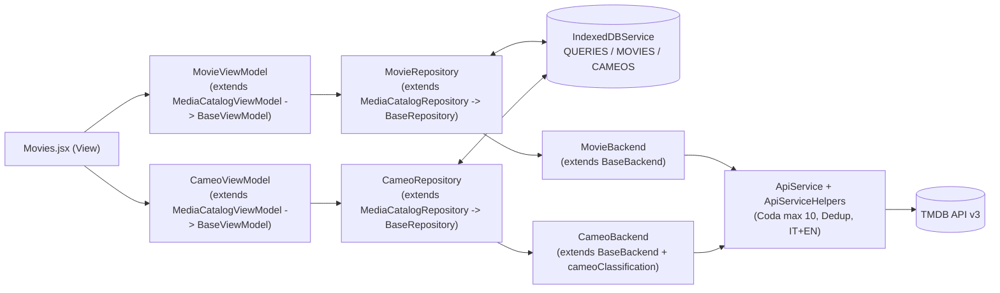
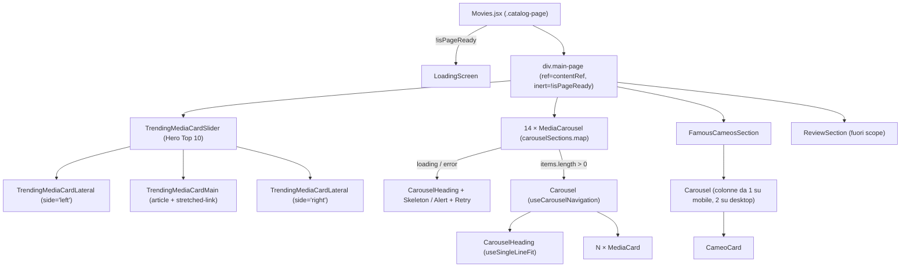

# Documentazione Pagina `Movies.jsx`

Documentazione tecnica della pagina [Movies.jsx](file:///C:/GitHub_Repositories/Cameos/src/pages/Movies.jsx), responsabile del catalogo principale Film (`/` e `/movies`).

> **Nota di perimetro:** la sezione Recensioni (`ReviewSection` e `INITIAL_COMMUNITY_REVIEWS` da `catalogData.js`) è gestita su un branch separato ed è quindi trattata solo come segnaposto strutturale.

---

## Parte 1 — Fetch dei Dati (Architettura, Repository, Backend e Parametri)

### 1.1 Architettura e interazione tra i layer

La pagina applica rigorosamente l'architettura **MVVM unidirezionale** (`View -> ViewModel -> Repository -> Backend -> ApiService / IndexedDB -> Models`): `Movies.jsx` non importa né interroga mai Repository, Backend, `ApiService` o `IndexedDBService`. La configurazione statica dei generi è separata in [mediaCategoryConfig.js](file:///C:/GitHub_Repositories/Cameos/src/utils/media/mediaCategoryConfig.js) (usata da Backend e ViewModel), mentre il mapping di presentazione/i18n risiede in [mediaCategoryPresentation.js](file:///C:/GitHub_Repositories/Cameos/src/utils/media/mediaCategoryPresentation.js) (usato dalla View).

Al mount, `Movies.jsx` attiva **tre flussi dati indipendenti**:

1. **Film in tendenza (`trendingMovies`)** — orchestrati dentro `MovieViewModel.loadFilmsFeed()`.
2. **Prossime uscite + 13 categorie di genere (`upcomingMovies`, `categoryMovies`)** — orchestrati in parallelo dentro `MovieViewModel.loadFilmsFeed()` seguendo l'ordine di [MOVIE_CATEGORY_CONFIG](file:///C:/GitHub_Repositories/Cameos/src/utils/media/mediaCategoryConfig.js#L2-L60) (allineato 1:1 all'ordine visivo della pagina) e paginabili incrementalmente allo scorrimento.
3. **Camei celebri (`famousCameos`)** — sezione a carattere di *archivio storico* gestita da `CameoViewModel.loadFamousCameos()`: viene caricata una sola volta all'ingresso nell'app, mantenuta in memoria per tutta la navigazione e paginabile solo su scorrimento esplicito dell'utente.

---

### 1.2 Layer ViewModel (`MovieViewModel`, `CameoViewModel`, `MediaCatalogViewModel`, `BaseViewModel`)

La gerarchia rispetta il principio di *Single Responsibility*:
- [BaseViewModel.js](file:///C:/GitHub_Repositories/Cameos/src/viewmodel/BaseViewModel.js) gestisce esclusivamente lo stato osservabile immutabile compatibile con `useSyncExternalStore`, la normalizzazione della lingua, lo stato di connettività e la guardia anti race-condition `runAsync` ([BaseViewModel.js](file:///C:/GitHub_Repositories/Cameos/src/viewmodel/BaseViewModel.js#L186-L226)).
- [MediaCatalogViewModel.js](file:///C:/GitHub_Repositories/Cameos/src/viewmodel/MediaCatalogViewModel.js) estende `BaseViewModel` aggiungendo la logica condivisa di catalogo: `buildCategoryInitialState`, `_loadCategoryList`, `_loadMediaFeed`, `runSearch` e la paginazione unificata `loadPagination` ([MediaCatalogViewModel.js](file:///C:/GitHub_Repositories/Cameos/src/viewmodel/MediaCatalogViewModel.js#L96-L186)).
- [MovieViewModel.js](file:///C:/GitHub_Repositories/Cameos/src/viewmodel/movies/MovieViewModel.js) e [CameoViewModel.js](file:///C:/GitHub_Repositories/Cameos/src/viewmodel/cameos/CameoViewModel.js) estendono `MediaCatalogViewModel` mantenendo i soli metodi e stati del proprio dominio.

Punti chiave del flusso:
- **Istanziazione condivisa**:
  - `useMovieViewModel({ language: normalizedLang })` restituisce il singleton di sessione `sharedMovieVM` ([useViewModel.js](file:///C:/GitHub_Repositories/Cameos/src/viewmodel/useViewModel.js#L54-L91)).
  - `useCameoViewModel({ language: normalizedLang, shared: true })` restituisce il singleton di sessione `sharedCatalogCameoVM` ([useViewModel.js](file:///C:/GitHub_Repositories/Cameos/src/viewmodel/useViewModel.js#L55-L99)), condiviso anche con `TVSeries.jsx`.
- **Protezione da race condition**: `BaseViewModel.runAsync` assegna un contatore progressivo per ogni `operationKey` (`_requestCounters`); risposte lente arrivate fuori ordine vengono ignorate prima di aggiornare lo stato.
- **Paginazione unificata (`MediaCatalogViewModel.loadPagination`)**:
  - Gestisce sia il caricamento iniziale multipagina (`initialPages: 2` → scarica pagine `1` e `2` in parallelo) sia l'accodamento incrementale (`append: true` → pagina `currentPage + 1`).
  - **Ritorno su `/` senza flash del loader**: quando `retainPages: true` è attivo nella stessa lingua e la categoria possiede già elementi in memoria (`hasRetainedItems`), la rivalidazione in background avviene **senza** riportare `categoryPagination[key].loading` a `true`. Se invece cambia lingua, la lista è vuota o `force: true` (`retainPages: false`), imposta normalmente `loading: true`.
  - **Isolamento per categoria e uniformità di `upcoming`**: ogni categoria ha una propria voce in `categoryPagination[key]` (`{ page, totalPages, hasMore, loadingMore, loading, error, language }`) unita a commit tramite `mergeCategoryPatch`. Anche `loadUpcomingMovies` ([MovieViewModel.js](file:///C:/GitHub_Repositories/Cameos/src/viewmodel/movies/MovieViewModel.js#L108-L119)) popola `groupedListProp: 'categoryMovies'` oltre a `upcomingMovies`, delegando il filtraggio temporale esclusivamente a Repository e Backend (nessun filtro ridondante nel ViewModel).
- **Politica archivio storico per `CameoViewModel.loadFamousCameos`** ([CameoViewModel.js](file:///C:/GitHub_Repositories/Cameos/src/viewmodel/cameos/CameoViewModel.js#L252-L288)):
  - Con `onlyIfEmpty: true`, se `famousCameos` contiene già dati in memoria oppure esiste una chiamata `loadFamousCameos` già in corso (`_pendingOperations`), ritorna immediatamente senza interrogare la Repository.
  - Con `loadMoreFamousCameos()` (`append: true`) carica la pagina successiva da 8 camei e la accoda allo stato condiviso.

---

### 1.3 Snodo Centrale: Layer Repository (`BaseRepository`, `MediaCatalogRepository`, `MovieRepository`, `CameoRepository`)

La Repository è il punto di controllo unico di **caching, deduplicazione, persistenza locale e resilienza offline**, strutturato su due classi base:
- [BaseRepository.js](file:///C:/GitHub_Repositories/Cameos/src/repository/BaseRepository.js): meccaniche generiche di persistenza, deduplicazione in-flight, TTL (`executeCatalogQuery`, [BaseRepository.js](file:///C:/GitHub_Repositories/Cameos/src/repository/BaseRepository.js#L259-L322)), fallback offline (`executeWithFallback`, [BaseRepository.js](file:///C:/GitHub_Repositories/Cameos/src/repository/BaseRepository.js#L106-L137)), caching di singole entità da lista (`_cacheEntitiesFromList`) e dettagli (`_executeEntityDetails`).
- [MediaCatalogRepository.js](file:///C:/GitHub_Repositories/Cameos/src/repository/MediaCatalogRepository.js): specializzazione per il dominio catalogo media (`_executeMediaCatalogPage`, `_getGenres`, `_executeMediaSearch`, `_searchLocalEntities`), estesa da `MovieRepository`, `SeriesRepository` e `CameoRepository`.

#### Politica di esecuzione (`executeCatalogQuery` + `executeWithFallback`)

1. **Deduplicazione in-flight (`this._catalogRequests`)**: se due chiamate richiedono contemporaneamente la stessa chiave `storeName:cacheKey` (es. React StrictMode in dev o più componenti), condividono la stessa `Promise` senza duplicare lavoro di rete o scrittura DB.
2. **Controllo freschezza TTL (`CATALOG_CACHE_TTL_MS = 300_000 ms` = 5 minuti)** ([catalogCache.js](file:///C:/GitHub_Repositories/Cameos/src/repository/catalogCache.js#L1-L7)):
   - Se `force` è `false`, legge la chiave in IndexedDB e verifica `Date.now() - timestamp < 300_000`.
   - **TTL Hit**: restituisce subito i modelli re-idratati (`new Movie(...)` / `new Cameo(...)`) senza chiamare la rete e **senza rinnovare il TTL**.
   - **Cache Miss / TTL Scaduto / `force: true`**: passa a `executeWithFallback`.
3. **Network-First con Fallback Offline (`executeWithFallback`)**:
   - **Online (`isOnline() === true`)**: invoca `fetchRemote()` sul Backend → persiste il risultato in IndexedDB con `saveLocal()` → ritorna i dati freschi. Se la rete fallisce (errore HTTP/timeout), tenta `getLocal()`: se trova dati in cache (anche oltre i 5 minuti), li restituisce invece di fallire.
   - **Offline (`isOnline() === false`)**: **anche quando `force: true`**, salta la rete e legge direttamente da IndexedDB tramite `getLocal()`. Se la cache è vuota lancia un errore controllato (`Connettività assente e nessun dato locale in cache per: ...`).

#### Store IndexedDB, chiavi di cache e politica non-distruttiva (`shouldReplace: (existing) => !existing`)

Database: `cameos_pwa_db` v3 gestito da [IndexedDBService.js](file:///C:/GitHub_Repositories/Cameos/src/storage/IndexedDBService.js).

| Repository & Metodo | Store principale | Formato `cacheKey` | Effetti secondari di salvataggio |
| :--- | :--- | :--- | :--- |
| [MovieRepository.getTrendingMovies](file:///C:/GitHub_Repositories/Cameos/src/repository/movies/MovieRepository.js#L141-L158) | `STORES.QUERIES` | `trending_movies:language=<lang>&limit=10&onlyReleased=true&page=1&timeWindow=month` | Inserisce i singoli `Movie` in `STORES.MOVIES` (`movie:<id>:<lang>`, `isComplete: false`) **solo se non già presenti** |
| [MovieRepository.getUpcomingMovies](file:///C:/GitHub_Repositories/Cameos/src/repository/movies/MovieRepository.js#L87-L102) | `STORES.QUERIES` | `upcoming_movies:language=<lang>&page=
` | Inserisce i singoli `Movie` in `STORES.MOVIES` (`isComplete: false`, solo se assenti) e ri-applica il filtro `isMediaUpcoming` contro la data odierna anche sui dati letti da cache |
| [MovieRepository.getMoviesByCategory](file:///C:/GitHub_Repositories/Cameos/src/repository/movies/MovieRepository.js#L114-L128) | `STORES.QUERIES` | `category_movies_<key>:categoryKey=<key>&language=<lang>&page=
` | Inserisce i singoli `Movie` in `STORES.MOVIES` (`isComplete: false`, solo se assenti) |
| [CameoRepository.getFamousCameos](file:///C:/GitHub_Repositories/Cameos/src/repository/cameos/CameoRepository.js#L196-L231) | `STORES.CAMEOS` | `famous_cinema_cameos:language=<lang>&limit=8&page=
` | Salva `{ cacheKey, cachedAt, data }` con array `Cameo` (inclusi `mediaTitles` bilingue). **Non** scrive in `STORES.MOVIES` (evita record privi di `watch/providers` e `videos`). |

- **Inserimento senza sovrascrittura ([BaseRepository.js](file:///C:/GitHub_Repositories/Cameos/src/repository/BaseRepository.js#L148-L169))**: quando le liste catalogo salvano le singole card in `STORES.MOVIES` tramite `putMany(..., { shouldReplace: (existing) => !existing })`, la condizione viene valutata atomicamente dentro la transazione IndexedDB: i record sommari (`isComplete: false`) vengono scritti **solo se la chiave non esiste già**, evitando qualsiasi sovrascrittura sia di dettagli completi (`isComplete: true`) sia di record già presenti nello store. Lo stesso principio si applica anche a `CameoRepository.getMovieCameos` ([CameoRepository.js](file:///C:/GitHub_Repositories/Cameos/src/repository/cameos/CameoRepository.js#L163-L178)).

---

### 1.4 Layer Backend & Sorgente Remota (`MovieBackend`, `CameoBackend`, `ApiService`)

#### `ApiService` e `ApiServiceHelpers` ([ApiService.js](file:///C:/GitHub_Repositories/Cameos/src/service/ApiService.js), [ApiServiceHelpers.js](file:///C:/GitHub_Repositories/Cameos/src/service/ApiServiceHelpers.js))

- **Autenticazione CORS-simple**: estrae l'API key v3 (32 hex dal claim `aud` del JWT `VITE_TMDB_API_TOKEN`) e la invia via `?api_key=...` senza header custom per evitare i preflight HTTP `OPTIONS`.
- **Coda di concorrenza FIFO**: massimo **`MAX_CONCURRENT_REQUESTS = 10`** richieste HTTP simultanee (`scheduleApiRequest`). È il motivo per cui l'ordine delle categorie in `MOVIE_CATEGORY_CONFIG` è allineato all'ordine visivo: i caroselli visibili sopra la piega (`upcoming`, `animation`, `adventure`) entrano in coda per primi.
- **Deduplicazione HTTP in-flight**: `_inflightRequests` condivide la stessa fetch per URL identici e clona il payload (`cloneApiPayload`) prima di arricchirlo con gli URL immagine (`enrichWithImageUrls`).
- **Retry automatico**: 1 retry dopo 200 ms su errore di rete (con fallback ad `Authorization: Bearer`) e 1 retry dopo 300 ms su HTTP `429` o `5xx`.
- **Fetch bilingue (`it-IT` + `en-US`)**: tutte le operazioni di lista (`fetchLanguagesList`) e di dettaglio (`fetchLanguagesDetail`) lanciano in parallelo `it-IT` ed `en-US` con `Promise.allSettled` (`allowPartial = true`), fondendo i risultati in mappe localizzate (`titles`, `overview`, `posterUrl`, `backdropUrl`, `taglines`, `videosByLanguage`). Se una delle due lingue fallisce per errore transitorio o rate-limit, l'altra permette di completare il caricamento; se falliscono entrambe viene rilanciato l'errore originale.

#### Endpoint TMDB e logica di trasformazione per flusso

1. **Trending (`MovieBackend.getTrendingMovies`)** ([MovieBackend.js](file:///C:/GitHub_Repositories/Cameos/src/backend/movies/MovieBackend.js#L98-L104), [BaseBackend.js](file:///C:/GitHub_Repositories/Cameos/src/backend/BaseBackend.js#L80-L98)):
   - Endpoint: `GET /discover/movie` con `sort_by=popularity.desc`, `primary_release_date.gte=<oggi - 30gg>`, `primary_release_date.lte=<oggi>` (finestra mobile ultimi 30 giorni).
   - Post-processing: filtra `releaseDate <= oggi` (`onlyReleased: true`), taglia ai primi `limit: 10` e mappa in `new Movie(item)`.
2. **Prossime uscite (`MovieBackend.getUpcomingMovies`)** ([MovieBackend.js](file:///C:/GitHub_Repositories/Cameos/src/backend/movies/MovieBackend.js#L46-L68)):
   - Endpoint lista: `GET /discover/movie` con `sort_by=popularity.desc`, `primary_release_date.gte=<oggi>`.
   - Arricchimento stato: filtra i candidati con `isMediaUpcoming`, poi verifica con concorrenza limitata a 4 (`_enrichWithConcurrency`, [BaseBackend.js](file:///C:/GitHub_Repositories/Cameos/src/backend/BaseBackend.js#L107-L123)) lo `status` reale chiamando `GET /movie/{id}` per i candidati senza `status`, scartando film marcati `Released` su TMDB.
3. **13 Categorie di genere (`MovieBackend.getMoviesByCategory`)** ([MovieBackend.js](file:///C:/GitHub_Repositories/Cameos/src/backend/movies/MovieBackend.js#L79-L86), [BaseBackend.js](file:///C:/GitHub_Repositories/Cameos/src/backend/BaseBackend.js#L55-L77)):
   - Endpoint: `GET /discover/movie` con `page`, `sort_by=popularity.desc`, `primary_release_date.lte=<oggi>` (esclude titoli non ancora usciti), `with_genres=<genreId>` (e `vote_count.gte=500` per `sagas`).
4. **Camei celebri (`CameoBackend.getFamousCameos`)** ([CameoBackend.js](file:///C:/GitHub_Repositories/Cameos/src/backend/cameos/CameoBackend.js#L121-L209), [cameoClassification.js](file:///C:/GitHub_Repositories/Cameos/src/backend/cameos/cameoClassification.js#L1-L79)):
   - **Step A**: `GET /discover/movie` con `with_keywords=179430` (keyword TMDB *cameo*) e `sort_by=vote_count.desc`. Ogni pagina di 8 camei seleziona una finestra di **4 film** (pagine 1..5 condividono i 20 film di `heavyPage = 1`). Il numero totale di pagine è calcolato dinamicamente dal catalogo reale TMDB (`totalPages = Math.max(1, (heavyRes?.total_pages || 1) * 5)`), così la paginazione termina esattamente alla fine dei dati disponibili.
   - **Step B**: per ciascuno dei 4 film chiama `getMovieCameos({ movieId, minPopularity: 4, language })` → `GET /movie/{id}?append_to_response=credits,images&include_image_language=it,en,null` (IT+EN).
   - **Step C (euristica cameo pura in `cameoClassification.js`)**: `analyzeCameoRole` e `resolveCameoBadge` marcano un membro del cast come cameo se il personaggio contiene indicatori espliciti (`self`, `himself`, `herself`, `se stesso`, `cameo`, `uncredited`, nome dell'attore stesso) oppure se `order >= 8` e `popularity >= 4`. Prende al massimo i **top 2** per popolarità per film, fino al raggiungimento di `limit` (8 per pagina), popolando sia `mediaTitles: { it, en }` sia `mediaTitle`.

---

### 1.5 Giustificazione dei parametri impiegati

| Parametro | Layer / Chiamata | Valore in `Movies.jsx` | Motivazione tecnica |
| :--- | :--- | :--- | :--- |
| `language` / `normalizedLang` | Hook → VM → Repo → Backend → API | `'it-IT'` o `'en-US'` | Chiave primaria di ordinamento/fallback e partizionamento cache in `STORES.QUERIES` e `STORES.CAMEOS`; assicura coerenza con la lingua attiva in `LanguageContext`. |
| `shared: true` | `useCameoViewModel` | `true` | Collega `Movies.jsx` al singleton `sharedCatalogCameoVM` invece di creare un'istanza locale: consente di conservare i camei celebri navigando tra Film, Dettagli e Serie TV. |
| `initialPages` | `loadFilmsFeed`, `retryByCategory` | `2` | Carica subito 2 pagine (~40 film per carosello) in parallelo per garantire riempimento completo su desktop/monitor larghi e scorrimento immediato senza attendere una chiamata al primo click. |
| `retainPages` | `loadFilmsFeed` → `loadPagination` | `!force` (`true`) | Quando si torna su `/` nella stessa lingua, preserva tutte le pagine già caricate dall'utente (es. 4 pagine dopo lo scroll) invece di troncarle a 2, ed evita di rimettere `loading: true`. |
| `append` | `loadMoreByCategory`, `loadMoreFamousCameos` | `true` | Indica a `loadPagination` di richiedere `currentPage + 1` e accodare i nuovi elementi (deduplicandoli per chiave stabile) impostando `loadingMore: true` invece di `loading: true`. |
| `timeWindow` | `loadTrendingMovies` | `'month'` | Seleziona l'endpoint `/discover/movie` filtrato sugli ultimi 30 giorni per mostrare uscite recenti ad alta popolarità anziché classifiche giornaliere volatili. |
| `onlyReleased` | `loadTrendingMovies` | `true` | Esclude dallo slider Hero titoli non ancora distribuiti, tenendoli separati nel carosello dedicato `upcoming`. |
| `limit` (Trending) | `MovieRepository.getTrendingMovies` | `10` (default) | Coerente con lo slider Hero (massimo 10 dot / Top 10 del mese) e riduce il numero di oggetti salvati in cache. |
| `limit` (Camei) | `loadFamousCameos` | `16` | Tradotto da `CameoViewModel` in `initialPages = Math.ceil(16 / 8) = 2` tranche (8 colonne × 2 righe su desktop), così lo scorrimento iniziale è immediato. |
| `onlyIfEmpty` | `loadFamousCameos` (mount) | `true` | Attua la politica di *archivio storico*: carica i camei una sola volta a inizio sessione e blocca ogni re-fetch durante la navigazione interna o il cambio lingua (i titoli si traducono in memoria via `mediaTitles`). |
| `force` | `loadFamousCameos` (mount e retry) | `true` | Su ingresso fresco nell'app (stato vuoto) forza un fetch aggiornato da TMDB se online, mantenendo comunque il fallback automatico su IndexedDB se offline; su Retry ignora eventuale stato stantio. |
| `primary_release_date.lte` | `MovieBackend.getMoviesByCategory` | data odierna (`YYYY-MM-DD`) | Impedisce che film futuri non ancora usciti appaiano nei caroselli di genere con valutazioni 0 o nulle. |
| `vote_count.gte` | `MOVIE_CATEGORY_CONFIG.sagas` | `500` | Filtra i titoli `28,12` (Azione + Avventura) mantenendo solo grandi franchise e saghe affermate. |
| `with_keywords` | `CameoBackend.getCameoHeavyMovies` | `'179430'` | Keyword ufficiale TMDB per opere contenenti camei; evita di scansionare film casuali. |
| `minPopularity` | `CameoBackend._appendFamousMovieCameos` | `4` | Soglia di popolarità attore usata per identificare volti riconoscibili tra i ruoli secondari (`order >= 8`) nei film candidati. |

---

## Parte 2 — Visualizzazione (Struttura, Componenti, Hooks e Props)

### 2.1 Struttura della pagina e meccanismo di rivelazione (`LoadingScreen` + `usePageReady`)

`Movies.jsx` non smonta mai il contenuto mentre sta caricando: mantiene il DOM montato ma invisibile (`visibility: hidden`, `inert`, `aria-hidden="true"`) dietro `LoadingScreen` finché `isPageReady` non diventa `true`. Questo permette a `usePageReady` di misurare geometria e visibilità reale nel viewport (`getBoundingClientRect()`) ed eseguire il pre-decoding delle sole immagini visibili sopra la piega prima di mostrare la pagina senza layout shift.

#### Gestione degli stati UI per sezione

| Stato | `TrendingMediaCardSlider` | `MediaCarousel` (14 categorie) | `FamousCameosSection` |
| :--- | :--- | :--- | :--- |
| **Loading iniziale** (`items=[]`, `loading=true`) | Box Hero shimmer con `data-catalog-loading="true"` e `role="status"` | `CarouselHeading` + 8 skeleton poster (`catalog-placeholder-track`) con `data-catalog-loading="true"` | Card vetro con header + spinner centrato e `data-catalog-loading="true"` |
| **Successo** (`items.length > 0`) | Card centrale + 2 anteprime laterali (desktop) + controlli/dot + swipe | `Carousel` scrollabile orizzontalmente con `MediaCard` + auto-fill viewport | `Carousel` a 2 righe (desktop) o 1 riga 84% (mobile) con `CameoCard` |
| **Caricamento pagina successiva** (`isLoadingMore=true`) | N/A | Spinner compatto in coda alla track (`.carousel-loading`) | Spinner compatto in coda alla track (`.carousel-loading`) |
| **Errore senza dati** (`items=[]`, `error!=null`) | Box errore `role="alert"` + pulsante `common.retry` (`onRetry`) | `CarouselHeading` + alert `role="alert"` + pulsante `common.retry` (`onRetry`) | Header + alert centrato `role="alert"` + pulsante `common.retry` (`onRetry`) |
| **Vuoto senza errori** (`items=[]`, `loading=false`, `error=null`) | Ritorna `null` | Ritorna `null` | Ritorna `null` |

---

### 2.2 Utilizzo degli Hooks e motivazioni

#### Hook usati direttamente in [Movies.jsx](file:///C:/GitHub_Repositories/Cameos/src/pages/Movies.jsx)

| Hook | Codice / Dipendenze | Come funziona e perché viene usato |
| :--- | :--- | :--- |
| `useTranslation()` | `const { t, normalizedLang } = useTranslation()` | Legge lingua attiva (`'it-IT'` / `'en-US'`) e funzione di traduzione da `LanguageContext`; reagisce automaticamente al cambio lingua. |
| `useMovieViewModel({ language })` | Wrapper di `useViewModel` (`useState` + `useSyncExternalStore` + `useEffect` lingua/rete) | Sottoscrive la pagina allo snapshot immutabile di `sharedMovieVM` in modo tearing-safe (React 19). In `Movies.jsx` vengono **destrutturati solo slice e metodi usati** (mai l'intero oggetto `movieViewModel` nelle dipendenze di memo/effetti). |
| `useCameoViewModel({ language, shared: true })` | Wrapper di `useViewModel` su `sharedCatalogCameoVM` | Collega la pagina al ViewModel condiviso dei camei, preservando i dati tra `Movies` e `TVSeries`. |
| `useRef(null)` | `contentRef` | Fornisce a `usePageReady` il riferimento diretto al contenitore `.main-page` per ispezionare solo i nodi visibili nel viewport senza query globali su `document`. |
| `usePageReady(contentRef, movieState, cameoState)` | [usePageReady.js](file:///C:/GitHub_Repositories/Cameos/src/utils/use/usePageReady.js) (`useState` + `useEffect` + `requestAnimationFrame` + `preloadImages`) | Attende esclusivamente il completamento di `[data-catalog-loading="true"]` e `.carousel-loading` **visibili nel viewport iniziale**, decodifica le relative immagini (`timeoutMs: 1200`) e `document.fonts.ready`, poi abilita `isPageReady = true` così i caroselli fuori schermo non bloccano l'apertura della pagina. |
| `useScrollToTop('movies', isPageReady)` | [domUtils.js](file:///C:/GitHub_Repositories/Cameos/src/utils/domUtils.js#L71-L86) | Imposta `history.scrollRestoration = 'manual'` (con cleanup simmetrico allo smontaggio) e riporta lo scroll a `(0, 0)` non appena `isPageReady` diventa `true`. |
| `useEffect` (fetch iniziale) | Deps: `[loadFilmsFeed, loadFamousCameos, normalizedLang]` | Avvia il caricamento asincrono del feed film e dei camei al mount e al cambio lingua. Le azioni provengono da campi bound del ViewModel, quindi sono referenzialmente stabili. |
| `useMemo` (`carouselSections`) | Deps: `[upcomingMovies, categoryMovies, t]` | Costruisce la lista ordinata delle 14 sezioni tramite [getMovieCarouselSections](file:///C:/GitHub_Repositories/Cameos/src/utils/media/mediaCategoryPresentation.js#L4-L92) passando solo `{ upcomingMovies, categoryMovies }`: evita ricalcoli inutili quando cambiano altri campi di `movieViewModel` (es. `trendingMovies`, `categoryPagination`, `loading`). |
| `useMemo` (`loadMoreByCategory`) | Deps: `[loadMoviesFromCategory, loadUpcomingMovies]` | Costruisce **una sola volta** la mappa `{ [key]: () => void }` sulle chiavi statiche `MOVIE_CATEGORY_KEYS`. È `useMemo` (non `useCallback`) perché produce un oggetto di 14 callback, impossibile da generare con `useCallback` dentro `.map()` per le Rules of Hooks. |
| `useMemo` (`retryByCategory`) | Deps: `[loadMoviesFromCategory, loadUpcomingMovies, normalizedLang]` | Costruisce una mappa stabile `{ [key]: () => void }` per il retry di ciascuna delle 14 categorie, coerente con `loadMoreByCategory`, aggiornandosi solo al cambio lingua. |
| `useCallback` (`handleRetryTrending`, `handleRetryFamousCameos`) | Deps: `[loadTrendingMovies, normalizedLang]` / `[loadFamousCameos, normalizedLang]` | Singole callback stabili passate come `onRetry` a `TrendingMediaCardSlider` e `FamousCameosSection`. |

#### Hook chiave nei componenti figli di `Movies.jsx`

- **`useCarouselNavigation`** ([useCarouselNavigation.js](file:///C:/GitHub_Repositories/Cameos/src/utils/use/useCarouselNavigation.js)): gestisce frecce sinistra/destra, `ResizeObserver`, prefetch allo scroll (`shouldTriggerLoadMore`), destinazione unica durante click multipli (`pendingNextScroll`) e auto-fill controllato delle righe sparse. Usa **`useEffectEvent`** (React 19) per invocare `onLoadMore` dai due `useEffect` senza ri-sottoscrivere `ResizeObserver` o dover sincronizzare ref in un `useEffect` senza dipendenze.
- **`useSingleLineFit`** ([domUtils.js](file:///C:/GitHub_Repositories/Cameos/src/utils/domUtils.js#L137-L161)): usato in `CarouselHeading` con `useLayoutEffect` + `ResizeObserver` + `document.fonts.ready` per scalare i titoli su una riga singola rispettando `--text-min-size` prima del paint, evitando flicker.
- **`useDevice`** (`DeviceContext`): usato in `TrendingMediaCardMain` (badge compatto `#rank` su mobile) e `FamousCameosSection` (chunk da 1 card per colonna su mobile, 2 righe su desktop).

---

### 2.3 Componenti e Parametri (Props)

#### 1. `LoadingScreen` ([LoadingScreen.jsx](file:///C:/GitHub_Repositories/Cameos/src/components/LoadingScreen.jsx))
| Prop | Tipo | Default | Ruolo |
| :--- | :--- | :--- | :--- |
| `message` | `string` | `t('common.loading')` | Testo mostrato sotto lo spinner |
| `className` | `string` | `''` | Classi extra (`"catalog-loading-screen"` in `Movies.jsx`) |

#### 2. `TrendingMediaCardSlider` ([TrendingMediaCardSlider.jsx](file:///C:/GitHub_Repositories/Cameos/src/components/media/TrendingMediaCardSlider.jsx))
Slider Hero con rotazione automatica ogni 7 s (in pausa su hover e su focus tastiera `onFocus`/`onBlur`), swipe touch orizzontale e `safeCurrentIndex` per clamping sicuro se la lista cambia lunghezza.

| Prop | Tipo | Default | Ruolo |
| :--- | :--- | :--- | :--- |
| `items` | `Array<Movie\|Series>` | `[]` | Lista titoli trending (troncata a max 10) |
| `type` | `'movie' \| 'tv'` | `'movie'` | Determina route di dettaglio, getter titolo e badge stagioni/anno |
| `className` | `string` | `''` | Classi extra (`"mb-3"` in `Movies.jsx`) |
| `loading` | `boolean` | `false` | Mostra placeholder shimmer con `data-catalog-loading` quando `items` è vuoto |
| `error` | `Error \| string \| object \| null` | `null` | Mostra stato errore `role="alert"` quando `items` è vuoto |
| `onRetry` | `() => void` | `undefined` | Se fornito insieme a `error`, mostra il pulsante `common.retry` |

- **Figli interni**:
  - `TrendingMediaCardMain` ([TrendingMediaCardMain.jsx](file:///C:/GitHub_Repositories/Cameos/src/components/media/TrendingMediaCardMain.jsx)): props `{ media, rank, slideDirection='', onAnimationEnd }`. Usa `<article>` + `<Link className="... stretched-link">` (nessun elemento interattivo annidato, click/Invio/focus nativi sull'intera card, nessun `key={currentIndex}` per non distruggere il focus ogni 7 s).
  - `TrendingMediaCardLateral` ([TrendingMediaCardLateral.jsx](file:///C:/GitHub_Repositories/Cameos/src/components/media/TrendingMediaCardLateral.jsx)): props `{ media, rank, side: 'left'|'right', animationClass='', onSelect }`. Anteprima laterale cliccabile/attivabile da tastiera (`role="button"`, `Enter`/`Space`) visibile su desktop (`d-none d-lg-block`).

#### 3. `MediaCarousel` ([MediaCarousel.jsx](file:///C:/GitHub_Repositories/Cameos/src/components/media/MediaCarousel.jsx))
| Prop | Tipo | Default | Ruolo |
| :--- | :--- | :--- | :--- |
| `title` | `string` *(req)* | — | Titolo del carosello |
| `subtitle` | `string` | `undefined` | Sottotitolo sopra il titolo |
| `categoryKey` | `string` | `undefined` | Genera il link alla pagina categoria (`APP_ROUTES.category(type, categoryKey)`) |
| `titleLink` | `string` | `undefined` | Link alternativo personalizzato se `categoryKey` non è passato |
| `items` | `Array<Object>` | `[]` | Lista media da renderizzare |
| `type` | `'movie' \| 'tv' \| 'mixed'` | `'movie'` | Tipo media per card e link categoria |
| `rows` | `1 \| 2` | `1` | Layout a 1 riga flex o 2 righe CSS grid |
| `upcoming` | `boolean` | `false` | Nasconde il badge rating sulle card (`true` per `section.key === 'upcoming'`) |
| `onLoadMore` | `() => any` | `undefined` | Callback per caricare la pagina successiva |
| `onRetry` | `() => void` | `undefined` | Callback del pulsante `common.retry` nello stato di errore |
| `hasMore` | `boolean` | `false` | Abilita paginazione e pulsante freccia destra oltre i card caricati |
| `isLoadingMore` | `boolean` | `false` | Mostra lo spinner `.carousel-loading` in coda e blocca richieste duplicate |
| `loading` | `boolean` | `false` | Mostra 8 card skeleton con `data-catalog-loading` quando `items` è vuoto |
| `error` | `Error \| string \| object \| null` | `null` | Mostra blocco errore `role="alert"` quando `items` è vuoto |

- **Figli interni**:
  - `Carousel` ([Carousel.jsx](file:///C:/GitHub_Repositories/Cameos/src/components/Carousel.jsx)): props `{ header, children, itemCount, className, headerClassName, trackClassName, previousLabel, nextLabel, scrollDistance='page', onLoadMore, hasMore, isLoadingMore }`.
  - `CarouselHeading` ([CarouselHeading.jsx](file:///C:/GitHub_Repositories/Cameos/src/components/CarouselHeading.jsx)): props `{ title, subtitle, as='h3', className, subtitleClassName='text-success', titleLink }`.
  - `MediaCard` ([MediaCard.jsx](file:///C:/GitHub_Repositories/Cameos/src/components/media/MediaCard.jsx)): props `{ item, type='movie', upcoming=false, showType=false, variant='default', role=null }`. Risolve titolo e poster localizzati nella lingua corrente (`langKey`) con fallback su `IMAGE_PLACEHOLDERS.POSTER`.

#### 4. `FamousCameosSection` ([FamousCameosSection.jsx](file:///C:/GitHub_Repositories/Cameos/src/components/cameo/FamousCameosSection.jsx))
Deduplica i camei per chiave composta (`id_mediaType_mediaId_character`) e li raggruppa in colonne da 1 card su mobile o 2 card su desktop/tablet tramite `useMemo`.

| Prop | Tipo | Default | Ruolo |
| :--- | :--- | :--- | :--- |
| `cameos` | `Array<Cameo>` | `[]` | Lista camei celebri dalla sessione |
| `loading` | `boolean` | `false` | Mostra placeholder vetro + spinner con `data-catalog-loading` se `cameos` è vuoto |
| `error` | `Error \| string \| object \| null` | `null` | Mostra messaggio errore `role="alert"` se `cameos` è vuoto |
| `onLoadMore` | `() => any` | `undefined` | Callback per caricare la tranche successiva (`loadMoreFamousCameos`) |
| `onRetry` | `() => void` | `undefined` | Callback del pulsante `common.retry` in stato di errore |
| `hasMore` | `boolean` | `false` | Indica se sono disponibili ulteriori pagine di camei |
| `isLoadingMore` | `boolean` | `false` | Mostra lo spinner in coda alla track |

- **Figlio interno**:
  - `CameoCard` ([CameoCard.jsx](file:///C:/GitHub_Repositories/Cameos/src/components/cameo/CameoCard.jsx)): props `{ cameo, className='', variant='default' }`. Visualizza foto profilo attore (`getProfileSrc`), nome linkato a `/person/:id`, pill `uncredited` se applicabile, personaggio, titolo del film risolto nella lingua attiva tramite `cameo.getMediaTitle(langKey)` linkato a `/movie/:mediaId` e CTA *"Vedi scheda attore"*.
