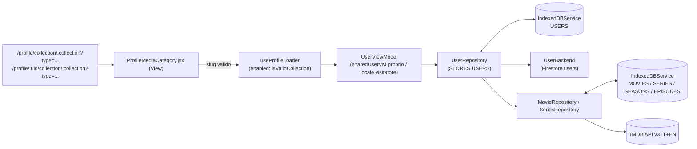
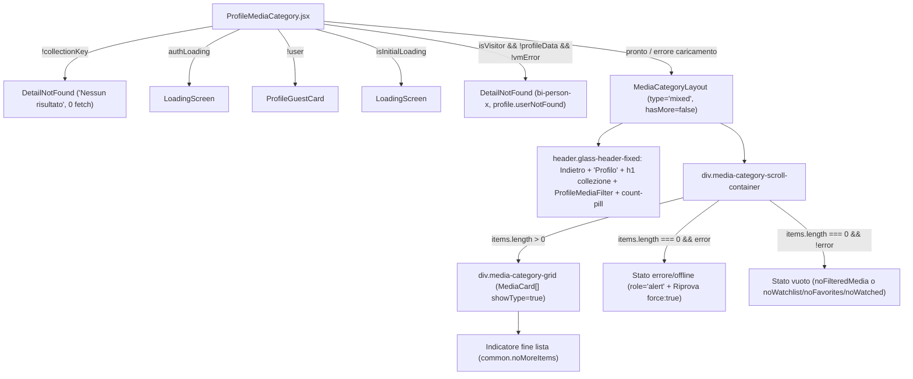

# Documentazione Pagina `ProfileMediaCategory.jsx`

Documentazione tecnica della pagina [ProfileMediaCategory.jsx](file:///C:/GitHub_Repositories/Cameos/src/pages/ProfileMediaCategory.jsx), gemella di [MovieCategory.jsx](file:///C:/GitHub_Repositories/Cameos/src/pages/MovieCategory.jsx) e [TVSeriesCategory.jsx](file:///C:/GitHub_Repositories/Cameos/src/pages/TVSeriesCategory.jsx), dedicata alla griglia completa di una collezione del profilo utente (`/Cameos/profile/collection/:collection` e `/Cameos/profile/:uid/collection/:collection`).

---

## Parte 1 — Fetch dei Dati (Architettura, ViewModel, Repository, Backend e Parametri)

### 1.1 Architettura e interazione tra i layer

La pagina applica l'architettura **MVVM unidirezionale** (`View -> Contexts / ViewModel -> Repository -> Backend -> Firestore / IndexedDB / TMDB -> Models`) e condivide lo stesso layer dati di [Profile.jsx](file:///C:/GitHub_Repositories/Cameos/src/pages/Profile.jsx) tramite `useProfileLoader` e `sharedUserVM`.

La pagina gestisce **quattro scenari operativi**:
1. **Ingresso da `Profile.jsx` (profilo proprio)**: `sharedUserVM` ha già `loadedUid === targetUid` e le collezioni `resolvedWatchlist`, `resolvedFavorites` e `resolvedWatched` in memoria. `ProfileMediaCategory.jsx` renderizza istantaneamente la griglia con **0 chiamate Firestore/TMDB** e **0 flash di `<LoadingScreen />`**, ereditando l'eventuale filtro attivo via query string `?type=movie|tv|season|episode`.
2. **Ingresso diretto via URL su collezione valida** (`watchlist`, `favorites`, `watched`) **o visita profilo amico**: `useProfileLoader` invoca `UserViewModel.loadProfile` (Network-First + fallback IndexedDB per profilo proprio; online-only diretto su `UserBackend` per visitatore) e risolve i riferimenti nelle istanze `Movie`, `Series`, `Season` ed `Episode`.
3. **URL con `:collection` invalido** (es. `voted`, `favourites`, slug inesistenti o proprietà del prototipo come `constructor`): `PROFILE_COLLECTION_KEYS.includes(collection)` è `false`, quindi `useProfileLoader` riceve `enabled: false` (**0 chiamate di rete**) e la View renderizza subito `DetailNotFound`.
4. **Cambio filtro locale e cambio lingua `IT <-> EN`**: entrambi operano al 100% in memoria con **0 chiamate di rete** — il filtro agisce tramite `filterByMediaType` su `item.mediaType`, la lingua traduce live titolo pagina, badge conteggio, etichette filtro e `MediaCard`.

---

### 1.2 Layer ViewModel (`UserViewModel`, `useProfileLoader`)

- **Validazione canonica (`PROFILE_COLLECTION_KEYS`)** ([UserViewModel.js](file:///C:/GitHub_Repositories/Cameos/src/viewmodel/user/UserViewModel.js#L5)): elenco congelato `['watchlist', 'favorites', 'watched']` condiviso tra View e test.
- **Condivisione stato (`sharedUserVM`)**: sul profilo proprio `useProfileLoader` riusa il singleton `sharedUserVM` ([useViewModel.js](file:///C:/GitHub_Repositories/Cameos/src/viewmodel/useViewModel.js#L81-L263)); su profilo visitatore crea un'istanza isolata.
- **Zero re-fetch al cambio lingua**: `useProfileLoader` incapsula il caricamento iniziale in `useEffectEvent`, escludendo `normalizedLang` dalle dipendenze di `useEffect`.
- **Retry esplicito (`force: true`)**: la callback `retry` invoca `loadProfile(targetUid, { isVisitor, language: normalizedLang, force: true })` per forzare l'aggiornamento online e la ri-risoluzione dei media in caso di errore temporaneo o ritorno online.

---

### 1.3 Snodo Centrale: Layer Repository & Sorgente Remota (`UserRepository`, `UserBackend`, `MovieRepository`, `SeriesRepository`)

Identico al layer dati documentato in [profile.md](file:///C:/GitHub_Repositories/Cameos/docs/pages/profile.md#L46-L62):
- **Profilo proprio**: `UserRepository.getUser` (`STORES.USERS`, sync modifiche pendenti, Network-First + fallback IndexedDB).
- **Profilo visitatore**: `UserRepository.getVisitorProfile` → `UserBackend.getUserById` (solo online, senza cache locale di terzi).
- **Risoluzione media**: `UserRepository.resolveUserMediaList` (max `5` worker concorrenti) → `MovieRepository` / `SeriesRepository` (TTL `300_000 ms`, dedup in-flight, fallback IndexedDB, arricchimento non distruttivo di `Season`/`Episode` con dati della serie padre).

---

### 1.4 Giustificazione dei parametri impiegati

| Parametro | Layer / Chiamata | Valore in `ProfileMediaCategory.jsx` | Motivazione tecnica |
| :--- | :--- | :--- | :--- |
| `collection` | `useParams().collection` | `'watchlist' \| 'favorites' \| 'watched'` | Seleziona la lista risolta e i testi localizzati; validato contro `PROFILE_COLLECTION_KEYS` prima di abilitare il loader. |
| `uid` (`routeUid`) | `useParams().uid` → `useProfileLoader` | `undefined` (proprio) o UID visitatore | Determina `isVisitor`, l'isolamento del ViewModel e il fallback di `useGoBack`. |
| `type` (query string) | `useSearchParams().get('type')` | `'movie' \| 'tv' \| 'season' \| 'episode'` (opzionale) | Passato da `Profile.jsx` tramite `APP_ROUTES.profileCollectionOf` per inizializzare lo stato locale `mediaTypeFilter`. Le variazioni successive nella pagina restano confinate allo stato React locale e non alterano URL o stato condiviso. |
| `enabled` | `useProfileLoader` | `isValidCollection` | Garantisce `0` chiamate Firestore/TMDB quando lo slug `:collection` non è valido. |
| `normalizedLang` | `useTranslation()` → `useProfileLoader` | `'it-IT'` o `'en-US'` | Usato solo su fetch iniziale / `retry` via `useEffectEvent`; il cambio lingua è live in memoria. |
| `force` | `retry()` → `loadProfile` | `true` (solo su Retry) | Forza il ricaricamento completo bypassando `loadedUid` e TTL cache quando online. |

---

## Parte 2 — Visualizzazione (Struttura, Componenti, Hooks e Props)

### 2.1 Struttura della pagina e gestione degli stati

Le route `/Cameos/profile/collection/:collection` e `/Cameos/profile/:uid/collection/:collection` in [App.jsx](file:///C:/GitHub_Repositories/Cameos/src/App.jsx#L58-L59) montano `<ProfileMediaCategory key={pathname} />` e condividono la shell [MediaCategoryLayout.jsx](file:///C:/GitHub_Repositories/Cameos/src/components/media/MediaCategoryLayout.jsx) con `MovieCategory.jsx` e `TVSeriesCategory.jsx`.

#### Stati di visualizzazione
- **Ordine rigoroso dei guard**: `!collectionKey` (blocco immediato con `0` fetch) → `authLoading` → `!user` (`ProfileGuestCard`) → `isInitialLoading` (`<LoadingScreen />`, saltato arrivando da `Profile.jsx` con cache calda) → visitatore inesistente (`DetailNotFound`).
- **Errore / Offline**: gestito nativamente da `MediaCategoryLayout` con icona dedicata (`bi-wifi-off` offline o `bi-exclamation-triangle`), messaggio localizzato `t('common.error')` (`role="alert"`) e pulsante `Riprova` collegato a `retry`.
- **Filtro locale effimero**: `ProfileMediaFilter` risiede nello slot `headerActions` dell'header fisso (su mobile `< 576px` nasconde l'etichetta testuale lasciando visibile il pulsante compatto per mantenere l'header su una sola riga). Alla chiusura o uscita dalla pagina la scelta locale non viene salvata.

---

### 2.2 Utilizzo degli Hooks e motivazioni

| Hook | Codice / Dipendenze | Come funziona e perché viene usato |
| :--- | :--- | :--- |
| `useParams()` | `{ uid: routeUid, collection }` | Estrae UID opzionale e slug `:collection` per validazione e selezione lista. |
| `useSearchParams()` | `[searchParams]` | Legge una sola volta `?type=` nell'inizializzatore lazy di `useState` per ereditare l'eventuale filtro attivo in `Profile.jsx`. |
| `useState` (`mediaTypeFilter`) | Inizializzatore validato contro `VALID_MEDIA_FILTERS` | Mantiene il filtro media localmente alla sola permanenza sulla pagina senza persisterlo all'uscita. |
| `useAuth()` | `{ user, userProfile, loading: authLoading }` | Verifica autenticazione e fornisce `userProfile` al loader. |
| `useTranslation()` | `{ t, normalizedLang }` | Traduzioni live di header, empty state e `DetailNotFound`; `normalizedLang` usato dal loader senza re-fetch. |
| `useProfileLoader(...)` | `enabled: isValidCollection` | Riusa `sharedUserVM` sul profilo proprio (zero fetch al passaggio da `Profile.jsx`), isola i visitatori e blocca il fetch su `:collection` invalido. |
| `useGoBack(...)` | `APP_ROUTES.profileOf(isVisitor ? routeUid : undefined)` | Torna alla vista precedente nella history o ripiega sul profilo corrispondente. |
| `useScrollToTop(...)` | `` `${targetUid \|\| 'me'}-${collection \|\| 'invalid'}` ``, `!authLoading && !isInitialLoading` | Resetta lo scroll solo a caricamento iniziale completato (parità con `MovieCategory`/`TVSeriesCategory`). |
| `useMemo` (`mediaItems`) | Deps: `[rawResolvedList, mediaTypeFilter]` | Filtra la collezione risolta con `filterByMediaType` senza ricalcoli superflui. |

---

### 2.3 Componenti e Parametri (Props)

#### 1. `MediaCategoryLayout` ([MediaCategoryLayout.jsx](file:///C:/GitHub_Repositories/Cameos/src/components/media/MediaCategoryLayout.jsx))
Shell condivisa con [MovieCategory.jsx](file:///C:/GitHub_Repositories/Cameos/src/pages/MovieCategory.jsx) e [TVSeriesCategory.jsx](file:///C:/GitHub_Repositories/Cameos/src/pages/TVSeriesCategory.jsx), estesa per supportare collezioni miste e azioni opzionali nell'header.

| Prop | Tipo | Default | Ruolo |
| :--- | :--- | :--- | :--- |
| `title` | `string` *(req)* | — | Nome localizzato della collezione (`Watchlist`, `Preferiti`/`Favorites`, `Watched`) |
| `subtitle` | `string` | `''` | Etichetta superiore `t('profile.title')` (`Profilo` / `Profile`) |
| `items` | `Array<Object>` *(req)* | — | Modelli `Movie`/`Series`/`Season`/`Episode` già filtrati |
| `type` | `'movie' \| 'tv' \| 'mixed'` *(req)* | — | Valore `'mixed'`: imposta icona `bi-collection`, conteggio `N Media`, `showType={true}` e instrada ogni `MediaCard` su `'movie'` o `'tv'` in base a `item.mediaType` |
| `hasMore` | `boolean` | `false` | Impostato a `false`: nasconde il pulsante `Carica altri` e mostra l'indicatore `common.noMoreItems` in fondo alla griglia |
| `error` / `isOffline` | `Error\|string\|Object\|null` / `boolean` | `null` / `false` | Mostra stato errore/offline centrato con `role="alert"` |
| `emptyMessage` | `string` | `t('common.noResults')` | Messaggio vuoto contestuale (`profile.noFilteredMedia` quando filtrato o `profile.noWatchlist`/`noFavorites`/`noWatched`) |
| `headerActions` | `ReactNode` | `undefined` | Slot nell'header fisso che ospita `<ProfileMediaFilter />` a sinistra del badge conteggio |
| `onBack` / `onRetry` | `() => void` | req / `undefined` | Azioni dei pulsanti Indietro e `Riprova` (`force: true`) |

#### 2. Componenti condivisi usati dalla pagina
- **`ProfileMediaFilter`** ([ProfileMediaFilter.jsx](file:///C:/GitHub_Repositories/Cameos/src/components/profile/ProfileMediaFilter.jsx)): dropdown filtro locale alimentato da `useDropdownMenu` ([domUtils.js](file:///C:/GitHub_Repositories/Cameos/src/utils/domUtils.js#L383-L445)).
- **`MediaCard`** ([MediaCard.jsx](file:///C:/GitHub_Repositories/Cameos/src/components/media/MediaCard.jsx)): renderizzata da `MediaCategoryLayout` con `showType={true}` e chiave composta per `mediaType`/`id`/`seasonNumber`/`episodeNumber`.
- **`DetailNotFound`** ([MediaDetailLayout.jsx](file:///C:/GitHub_Repositories/Cameos/src/components/media/MediaDetailLayout.jsx#L39-L86)): usata per `:collection` invalido (`bi-collection`) e profilo visitatore inesistente (`bi-person-x`).
- **`ProfileGuestCard`** ([ProfileGuestCard.jsx](file:///C:/GitHub_Repositories/Cameos/src/components/profile/ProfileGuestCard.jsx)) e **`LoadingScreen`** ([LoadingScreen.jsx](file:///C:/GitHub_Repositories/Cameos/src/components/LoadingScreen.jsx)): stati ospite e caricamento iniziale.
