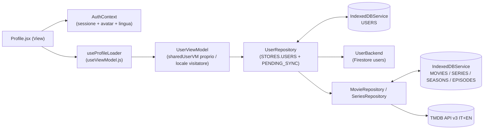
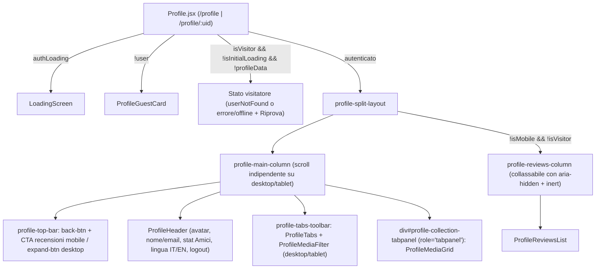

# Documentazione Pagina `Profile.jsx`

Documentazione tecnica della pagina [Profile.jsx](file:///C:/GitHub_Repositories/Cameos/src/pages/Profile.jsx), responsabile del profilo personale (`/Cameos/profile`) e della vista visitatore in sola lettura (`/Cameos/profile/:uid`), con collezioni multi-media (`Watchlist`, `Preferiti`, `Watched`), filtro per tipo media su desktop/tablet e colonna laterale recensioni collassabile.

---

## Parte 1 — Fetch dei Dati (Architettura, ViewModel, Repository, Backend e Parametri)

### 1.1 Architettura e interazione tra i layer

La pagina applica l'architettura **MVVM unidirezionale** (`View -> Contexts / ViewModel -> Repository -> Backend -> Firestore / IndexedDB / TMDB -> Models`): `Profile.jsx` non importa mai `UserRepository`, `UserBackend`, `ApiService`, `IndexedDBService` o utility di normalizzazione dei riferimenti media.

La pagina coordina **due flussi principali**:
1. **Profilo proprio (`/Cameos/profile`)**: `useProfileLoader` riusa il singleton di sessione `sharedUserVM` (`shared: true`), pre-popolato da `AuthContext.userProfile`. Al primo ingresso (o quando `syncFromUser` rileva una modifica reale alle liste `watchlist`/`favorites`/`watched`/`reviews` o un cambio UID), `UserViewModel.loadProfile` esegue `UserRepository.getUser` (Network-First + fallback IndexedDB) e risolve i riferimenti leggeri salvati su Firestore (`movie:id`, `tv:id`, `season:id:s`, `episode:id:s:e`) nei corrispondenti modelli completi bilingue (`Movie`, `Series`, `Season`, `Episode`) tramite `hydrateUserMediaLists`.
2. **Profilo visitatore (`/Cameos/profile/:uid`)**: `useProfileLoader` istanzia un `UserViewModel` isolato (`shared: false`) affinché i dati di un altro utente non sovrascrivano mai `sharedUserVM`. `UserViewModel.loadProfile(..., { isVisitor: true })` legge direttamente `UserRepository.getVisitorProfile(uid)` → `UserBackend.getUserById(uid)` (solo online, senza dipendenza laterale da `SocialRepository`) e risolve le sue collezioni media; non modifica mai `this._language` né mostra la sezione Recensioni.

Il **cambio lingua** dal controllo segmentato `IT / EN` in `ProfileHeader` passa esclusivamente da `LanguageContext.setLanguage(nextLang)` (che aggiorna stato UI, `localStorage` e persiste `language` su Firestore tramite `AuthContext.updateUserProfile`), senza doppie scritture su `UserViewModel.switchLanguage` e senza re-fetch di profilo o media.

---

### 1.2 Layer ViewModel (`UserViewModel`, `useProfileLoader`, `BaseViewModel`)

- **Condivisione e isolamento ([useViewModel.js](file:///C:/GitHub_Repositories/Cameos/src/viewmodel/useViewModel.js#L81-L263))**:
  - `getSharedUserViewModel()` mantiene in memoria `sharedUserVM` tra `Profile.jsx` e `ProfileMediaCategory.jsx` (azzerabile con `resetSharedViewModels()`).
  - `useProfileLoader` usa `useEffectEvent` (`runInitialLoad`) così che `normalizedLang` non compaia mai nelle dipendenze di `useEffect` (cambio lingua `IT <-> EN` a `0` re-fetch).
  - Espone `isInitialLoading` (`enabled && user?.uid && targetUid && loadedUid !== targetUid && !error`), eliminando il flash iniziale di 1 frame di stato vuoto prima dell'avvio dell'effetto e tra caricamento utente e risoluzione liste.
- **Orchestrazione e anti-stale ([UserViewModel.js](file:///C:/GitHub_Repositories/Cameos/src/viewmodel/user/UserViewModel.js))**:
  - `loadProfile(uid, { isVisitor, language, force })` esegue caricamento utente + `hydrateUserMediaLists` con un singolo contatore sequenziale `_latestProfileRequest` (scarta risposte obsolete su cambi rapidi di profilo) e imposta `loadedUid: uid` solo a completamento (oppure su visitatore inesistente senza errore).
  - Se `!force && this.state.loadedUid === uid`, ritorna immediatamente `currentUser` con `0` chiamate al Repository.
  - `syncFromUser(user)` confronta le liste tramite `isSameMediaTarget`: una modifica della sola lingua/anagrafica non invalida `loadedUid`, mentre aggiunta/rimozione/sostituzione di elementi nelle liste invalida `loadedUid: null` (e il cambio UID svuota anche `resolved*`).
  - `hydrateUserMediaLists` deduplica i riferimenti condivisi tra `watchlist`, `favorites`, `watched` e `reviews` in una `Map` per `targetKey` così ogni media viene risolto una sola volta.
  - `filterByMediaType(items, filter)` filtra direttamente su `item.mediaType` (`'movie' | 'tv' | 'season' | 'episode'`) esposto da tutti i modelli di dominio e dai riferimenti Firestore.

---

### 1.3 Snodo Centrale: Layer Repository (`UserRepository`, `MovieRepository`, `SeriesRepository`)

| Flusso | Store IndexedDB | Strategia | Note |
| :--- | :--- | :--- | :--- |
| `getUser(uid, { force })` | `STORES.USERS` (`user:<uid>`, `session:current_user`) | Sync pendenti → Network-First + fallback locale | Sincronizza prima eventuali modifiche offline in `pendingSync`; con `force: true` forza refresh online mantenendo il fallback offline. |
| `getVisitorProfile(uid)` | Nessuno (solo online) | Chiamata diretta a `UserBackend.getUserById(uid)` | Nessuna cache locale di utenti terzi e nessun accoppiamento laterale con `SocialRepository`; lancia errore controllato se offline. |
| `resolveUserMediaList(refs, lang, { force })` | `STORES.MOVIES`, `STORES.SERIES`, `STORES.SEASONS`, `STORES.EPISODES` | Worker pool parallelo (max `5` concorrenti) | Delega a `MovieRepository` / `SeriesRepository` (TTL 5m + fallback offline). Arricchisce `Season`/`Episode` con `seriesNames` e fallback `posterUrl` clonando shallow senza mutare le istanze in cache; in caso di fallimento singolo restituisce un oggetto fallback con `resolutionError`. |

---

### 1.4 Layer Backend & Sorgente Remota (`UserBackend`, `ApiService`)

- **`UserBackend.getUserById(uid)`** ([UserBackend.js](file:///C:/GitHub_Repositories/Cameos/src/backend/user/UserBackend.js#L55-L59)): legge il documento Firestore `users/{uid}` e lo idrata in [User](file:///C:/GitHub_Repositories/Cameos/src/models/User.js).
- **Risoluzione media TMDB**: ogni riferimento viene risolto via `MovieRepository.getMovieDetails` (`/movie/{id}`), `SeriesRepository.getSeriesDetails` (`/tv/{id}`), `SeriesRepository.getSeasonDetails` (`/tv/{id}/season/{s}`) e `SeriesRepository.getEpisodeDetails` (`/tv/{id}/season/{s}/episode/{e}`) in parallelo `it-IT` + `en-US`, restituendo modelli [Movie](file:///C:/GitHub_Repositories/Cameos/src/models/Movie.js), [Series](file:///C:/GitHub_Repositories/Cameos/src/models/Series.js), [Season](file:///C:/GitHub_Repositories/Cameos/src/models/Season.js) ed [Episode](file:///C:/GitHub_Repositories/Cameos/src/models/Episode.js) con proprietà `mediaType` nativa e campi bilingue.

---

### 1.5 Giustificazione dei parametri impiegati

| Parametro | Layer / Chiamata | Valore in `Profile.jsx` | Motivazione tecnica |
| :--- | :--- | :--- | :--- |
| `routeUid` | `useParams().uid` → `useProfileLoader` | `undefined` (proprio) o UID stringa | Determina `isVisitor` (`routeUid && routeUid !== user.uid`) e seleziona `sharedUserVM` vs istanza isolata visitatore. |
| `user`, `userProfile` | `useAuth()` → `useProfileLoader` | Utente autenticato e profilo cached | Pre-popola immediatamente nome/email/liste sul profilo proprio e consente di rilevare variazioni alle preferenze apportate da altre pagine. |
| `normalizedLang` | `useTranslation()` → `useProfileLoader` | `'it-IT'` o `'en-US'` | Passato al `UserViewModel` e letto solo al momento del caricamento tramite `useEffectEvent`; non innesca mai re-fetch su cambio lingua. |
| `force` | `retry()` → `loadProfile` | `true` (solo su Retry) | Bypassa `loadedUid === uid` e la cache TTL dei repository media su tentativo esplicito dell'utente. |
| `effectiveMediaFilter` | `Profile.jsx` → `filterByMediaType` & `APP_ROUTES.profileCollectionOf` | `'all'` su mobile, `mediaTypeFilter` su desktop/tablet | Filtra simultaneamente carosello attivo, conteggi dei tab e costruisce il link `/collection/:collection?type=...` per pre-filtrare `ProfileMediaCategory.jsx`. |

---

## Parte 2 — Visualizzazione (Struttura, Componenti, Hooks e Props)

### 2.1 Struttura della pagina e gestione degli stati

Le route `/Cameos/profile` e `/Cameos/profile/:uid` in [App.jsx](file:///C:/GitHub_Repositories/Cameos/src/App.jsx#L56-L57) montano `<Profile key={pathname} />`, resettando tab, filtro e stato collassato al cambio profilo.

#### Stati di visualizzazione
- **Auth loading / Ospite**: `authLoading` mostra `<LoadingScreen />`; `!user` mostra `<ProfileGuestCard onBack={goBack} />`.
- **Visitatore non trovato vs Errore/Offline**: se `!vmError` mostra `bi-person-x` + `profile.userNotFound`; se `vmError` mostra `bi-wifi-off` (offline) o `bi-exclamation-triangle` + `common.error` localizzato + pulsante `Riprova`.
- **Collezioni (`ProfileMediaGrid`)**: gestisce `loading` (spinner + `profile.loading*`), `error` (`role="alert"` + icona offline/errore + messaggio localizzato + `Riprova`), `empty` (`profile.noFilteredMedia` se filtrato o `profile.no*` multi-media) e successo (`MediaCarousel` a 2 righe `type="mixed"` con link al titolo verso `ProfileMediaCategory`).
- **Split-view desktop/tablet**: `.profile-main-column` scorre indipendentemente dalla colonna recensioni (`height: calc(100dvh - var(--profile-navbar-offset))`); il collasso/espansione della colonna recensioni transiziona orizzontalmente `grid-template-columns` senza spostamento verticale e applica `aria-hidden` + `inert`. In modalità visitatore la colonna recensioni e tutti i controlli correlati sono omessi.

---

### 2.2 Utilizzo degli Hooks e motivazioni

| Hook | Codice / Dipendenze | Come funziona e perché viene usato |
| :--- | :--- | :--- |
| `useAuth()` | `{ user, userProfile, avatarDataUrl, loading, logout }` | Fornisce stato sessione Firebase, profilo in memoria, avatar offline in cache e azione logout. |
| `useDevice()` | `{ isMobile }` | Governa lo split-view desktop/tablet, la visibilità di `ProfileMediaFilter` e la posizione del pulsante Recensioni mobile. |
| `useTranslation()` | `{ t, normalizedLang, setLanguage }` | Traduzioni live e unico punto di aggiornamento della lingua utente (`setLanguage`). |
| `useReducedMotion()` | `motion/react` | Disattiva le transizioni di ingresso del pulsante di espansione recensioni per utenti con preferenza `prefers-reduced-motion`. |
| `useProfileLoader(...)` | [useViewModel.js](file:///C:/GitHub_Repositories/Cameos/src/viewmodel/useViewModel.js#L193-L263) | Carica e idrata il profilo target (condiviso se proprio, isolato se visitatore) senza re-fetch al cambio lingua, esponendo `isInitialLoading`, `isOffline` e `retry`. |
| `useGoBack(...)` | `isVisitor ? APP_ROUTES.friends : APP_ROUTES.home` | Navigazione indietro coerente con history interna o fallback su Amici/Home. |
| `useScrollToTop(...)` | `useScrollToTop(targetUid \|\| 'me', !authLoading && isMobile)` | Resetta `window` su mobile; su desktop/tablet un `useEffect` dedicato azzera `mainColumnRef.current.scrollTop` al cambio profilo. |
| `useElementOuterHeight(...)` | `'.navbar-top-bar', !isMobile` | Misura l'altezza live della navbar via `ResizeObserver` per bloccare esattamente la viewport dello split-view desktop/tablet. |
| `useMemo` (`collectionCounts`, `activeItems`) | Deps minime su liste e `effectiveMediaFilter` | Evita di ricalcolare i filtri su render puramente UI (es. apertura/chiusura colonna recensioni). |
| `useCallback` (`handleLanguageChange`, `handleLogout`) | Deps minime | Mantiene stabili le callback passate a `ProfileHeader`. |

---

### 2.3 Componenti e Parametri (Props)

#### 1. `ProfileHeader` ([ProfileHeader.jsx](file:///C:/GitHub_Repositories/Cameos/src/components/profile/ProfileHeader.jsx))
| Prop | Tipo | Default | Ruolo |
| :--- | :--- | :--- | :--- |
| `avatarUrl` | `string \| null` | `undefined` | URL immagine o Data URL cached per `FriendAvatar` |
| `displayName` | `string` *(req)* | — | Username principale (`<h1>`) |
| `displayEmail` | `string` | `''` | Indirizzo email sottostante |
| `friendsCount` | `number` | `0` | Contatore amici su due righe (link a `/friends` sul profilo proprio, statico per visitatore) |
| `isVisitor` | `boolean` | `false` | Nasconde selettore lingua e pulsante logout, rende non cliccabile il contatore amici |
| `onLanguageChange` | `(lang: string) => void \| Promise<void>` | `undefined` | Callback cambio lingua `IT / EN` |
| `onLogout` | `() => void \| Promise<void>` | `undefined` | Callback disconnessione |

#### 2. `ProfileTabs` ([ProfileTabs.jsx](file:///C:/GitHub_Repositories/Cameos/src/components/profile/ProfileTabs.jsx))
| Prop | Tipo | Default | Ruolo |
| :--- | :--- | :--- | :--- |
| `activeSection` | `'watchlist' \| 'favorites' \| 'watched'` *(req)* | — | Tab attiva (`aria-selected`, collegata via `aria-controls="profile-collection-tabpanel"`) |
| `onSelectSection` | `(section) => void` | `undefined` | Selezione collezione attiva |
| `watchlistCount` / `favoritesCount` / `watchedCount` | `number` | `0` | Conteggi filtrati mostrati accanto al titolo di ciascuna tab |

#### 3. `ProfileMediaFilter` ([ProfileMediaFilter.jsx](file:///C:/GitHub_Repositories/Cameos/src/components/profile/ProfileMediaFilter.jsx))
Usa `useDropdownMenu` ([domUtils.js](file:///C:/GitHub_Repositories/Cameos/src/utils/domUtils.js#L383-L445)) per apertura/chiusura, click esterno, `Escape` e navigazione tastiera `ArrowUp`/`ArrowDown`/`Home`/`End`; stili dedicati in [profileMediaFilter.css](file:///C:/GitHub_Repositories/Cameos/src/css/profile/profileMediaFilter.css).

| Prop | Tipo | Default | Ruolo |
| :--- | :--- | :--- | :--- |
| `value` | `'all' \| 'movie' \| 'tv' \| 'season' \| 'episode'` | `'all'` | Filtro tipo media selezionato |
| `onChange` | `(nextValue) => void` *(req)* | — | Aggiorna lo stato locale del filtro |

#### 4. `ProfileMediaGrid` ([ProfileMediaGrid.jsx](file:///C:/GitHub_Repositories/Cameos/src/components/profile/ProfileMediaGrid.jsx))
| Prop | Tipo | Default | Ruolo |
| :--- | :--- | :--- | :--- |
| `title` / `titleLink` | `string` | `''` / `undefined` | Titolo carosello e link verso `ProfileMediaCategory` (con `?type=...` se filtrato) |
| `items` | `Array<Object>` | `[]` | Modelli `Movie`/`Series`/`Season`/`Episode` filtrati, passati direttamente a `MediaCarousel` (`type="mixed"`, `rows={2}`) |
| `loading` / `error` / `isOffline` | `boolean` / `Error\|string\|Object\|null` / `boolean` | `false` / `null` / `false` | Stati di caricamento, errore localizzato e icona offline |
| `loadingLabel` / `errorLabel` / `emptyLabel` | `string` | `''` | Messaggi localizzati per ciascuno stato |
| `onRetry` | `() => void` | `undefined` | Mostra il pulsante `Riprova` (`force: true`) nello stato errore |

#### 5. Componenti di supporto e sezioni fuori perimetro
- **`ProfileGuestCard`** ([ProfileGuestCard.jsx](file:///C:/GitHub_Repositories/Cameos/src/components/profile/ProfileGuestCard.jsx)): card di invito al login quando `!user`.
- **`ProfileReviewsList`** ([ProfileReviewsList.jsx](file:///C:/GitHub_Repositories/Cameos/src/components/profile/ProfileReviewsList.jsx)): colonna laterale recensioni del profilo proprio; la vertical slice Recensioni (`ReviewSection`, `ReviewViewModel`, `ProfileReviews.jsx`) resta fuori perimetro secondo `AGENTS.md` §3.
