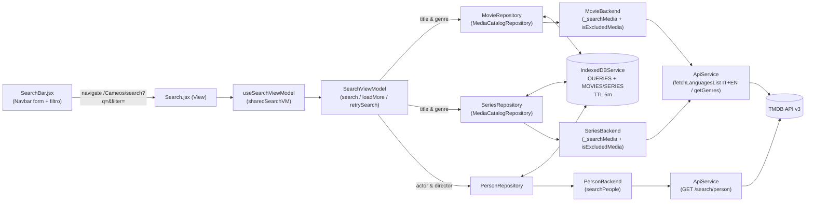
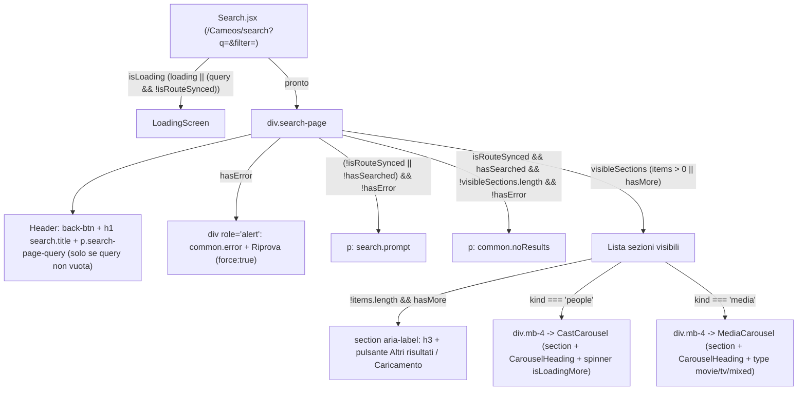

# Documentazione Pagina `Search.jsx`

Documentazione tecnica della pagina [Search.jsx](file:///C:/GitHub_Repositories/Cameos/src/pages/Search.jsx) e della barra di ricerca collegata [SearchBar.jsx](file:///C:/GitHub_Repositories/Cameos/src/components/navbar/SearchBar.jsx), responsabili della ricerca unificata multi-sezione di film, serie TV, attori, registi e generi (`/Cameos/search?q=<query>&filter=<filter>`).

---

## Parte 1 — Fetch dei Dati (Architettura, ViewModel, Repository, Backend e Parametri)

### 1.1 Architettura e interazione tra i layer

La pagina applica rigorosamente l'architettura **MVVM unidirezionale** (`View -> ViewModel -> Repository -> Backend -> ApiService / IndexedDB -> Models`): né `Search.jsx` né `SearchBar.jsx` importano o interrogano mai Repository, Backend, `ApiService`, `IndexedDBService` o `catalogData.js`. La normalizzazione del contratto di ricerca e il fuzzy matching localizzato dei generi sono isolati nel modulo puro [search.js](file:///C:/GitHub_Repositories/Cameos/src/utils/media/search.js).

A seconda del filtro attivo (`all`, `title`, `actor`, `director`, `genre`), la ricerca orchestra in parallelo fino a tre famiglie di sorgenti:

1. **Titoli (`all` / `title`)**: `MovieRepository.searchMovies` e `SeriesRepository.searchSeries` interrogano rispettivamente `/search/movie` e `/search/tv` con fetch bilingue (`it-IT` + `en-US` via `fetchLanguagesList`), producendo due caroselli indipendenti (`Film` e `Serie TV`).
2. **Persone (`all` / `actor` / `director`)**: `PersonRepository.searchPeople` interroga `/search/person`. In modalità `all`, `Attori` (`knownForDepartment === 'Acting'`) e `Registi` (`knownForDepartment === 'Directing'`) condividono la stessa richiesta HTTP per pagina attraverso la mappa interna `pages` (con eviction automatica su reject per permettere retry puliti).
3. **Generi localizzati (`all` / `genre`)**: recupera i registri generi di film e serie (`getGenres({ language })`), seleziona fino a `MAX_GENRE_MATCHES = 4` generi compatibili con [matchSearchGenres](file:///C:/GitHub_Repositories/Cameos/src/utils/media/search.js#L99-L115) (supporto a sottostringhe, diacritici ed edit distance limitata) e compone caroselli misti `type: 'mixed'` ordinati per popolarità da `/discover/movie` e `/discover/tv`, fermando automaticamente le sorgenti esaurite tramite la mappa `totals`.

---

### 1.2 Layer ViewModel (`SearchViewModel`, `useSearchViewModel`, `BaseViewModel`)

- **Singleton condiviso di sessione (`sharedSearchVM`)** ([useViewModel.js](file:///C:/GitHub_Repositories/Cameos/src/viewmodel/useViewModel.js#L53-L87), [L115-L134](file:///C:/GitHub_Repositories/Cameos/src/viewmodel/useViewModel.js#L115-L134)):
  - `useSearchViewModel({ query, filter, language })` sottoscrive il singleton `sharedSearchVM` (salvo iniezione esplicita di `repositories` nei test) tramite `useSyncExternalStore`.
  - Al ritorno da una pagina di dettaglio (`Search -> MovieDetail/TVSeriesDetail/PersonDetail -> Back`), se `sharedSearchVM.state` corrisponde già a `(normalizedQuery, normalizedFilter)` con `hasSearched === true` (o richiesta già in corso), `useSearchViewModel` salta completamente `search()`, **preservando istantaneamente tutte le pagine `2..N` caricate nei caroselli** senza `<LoadingScreen />` né chiamate di rete.
  - Il trigger di ricerca usa `useEffectEvent` con dipendenze `[normalizedQuery, normalizedFilter]`: il cambio lingua `IT <-> EN` aggiorna `vm.setLanguage(language)` senza rilanciare `search()`, traducendo live titoli sezione e card bilingue senza azzerare la paginazione né far sparire ricerche per genere localizzate.
- **Orchestrazione e anti-stale (`SearchViewModel`)** ([SearchViewModel.js](file:///C:/GitHub_Repositories/Cameos/src/viewmodel/search/SearchViewModel.js#L30-L208)):
  - **Stato iniziale**: `loading: false` (nessun flash `<LoadingScreen />` su `/Cameos/search` senza query); la View sincronizza lo stato rispetto alla route tramite `isRouteSynced`.
  - **Metadati `titleKey`** ([_section](file:///C:/GitHub_Repositories/Cameos/src/viewmodel/search/SearchViewModel.js#L59-L62)): le sezioni statiche (`movie`, `tv`, `actor`, `director`) espongono `titleKey` (`nav.movies`, `nav.tvSeries`, `search.actors`, `search.directors`) oltre a `title`, consentendo la traduzione live in `Search.jsx`; le sezioni genere lasciano `titleKey: null`.
  - **Scansione limitata dei gap filtrati (`_loadSection`)** ([L64-L80](file:///C:/GitHub_Repositories/Cameos/src/viewmodel/search/SearchViewModel.js#L64-L80)): se `isExcludedMedia` svuota interamente una pagina remota, avanza automaticamente fino a `MAX_SEARCH_PAGE_BATCH = 3` pagine prima di restituire la sezione, evitando di percorrere l'intero catalogo TMDB in un colpo solo.
  - **Condivisione pagine persone con eviction su errore (`_peopleSections`)** ([L97-L123](file:///C:/GitHub_Repositories/Cameos/src/viewmodel/search/SearchViewModel.js#L97-L123)): salva la `Promise` della pagina in `pages` per condividerla tra `actor` e `director`, ma rimuove la entry in `.catch()` (`if (pages.get(page) === request) pages.delete(page)`) così un errore transitorio su pagina `N` non blocca i tentativi successivi di `loadMore`.
  - **Isolamento fallimenti e retry forzato**: ogni sezione cattura i propri errori impostando `section.error = true` (e `hasFailures = true`) senza invalidare le altre sezioni riuscite; se un registro generi fallisce in `_genreSections` ([L169-L171](file:///C:/GitHub_Repositories/Cameos/src/viewmodel/search/SearchViewModel.js#L169-L171)), viene aggiunta la sentinella `{ id: 'genre-error', items: [], error: true, hasMore: false }`. [retrySearch](file:///C:/GitHub_Repositories/Cameos/src/viewmodel/search/SearchViewModel.js#L207) invoca `this.search(this.state.query, this.state.filter, this.language, { force: true })` propagando `force: true` al batch iniziale e ai registri generi.
  - **Anti-stale su `search` e `loadMore`**: `search` usa [BaseViewModel.runAsync](file:///C:/GitHub_Repositories/Cameos/src/viewmodel/BaseViewModel.js#L201-L241) (`'search'`); `loadMore` ([L196-L205](file:///C:/GitHub_Repositories/Cameos/src/viewmodel/search/SearchViewModel.js#L196-L205)) cattura `searchSeq = _requestCounters.get('search')` prima dell'`await` e scarta il risultato se nel frattempo è partita una nuova ricerca, deduplicando gli elementi per `${mediaType || section.type}:${id}`.

---

### 1.3 Snodo Centrale: Layer Repository (`BaseRepository`, `MediaCatalogRepository`, `MovieRepository`, `SeriesRepository`, `PersonRepository`)

Tutte le query di ricerca passano per [BaseRepository._executePaginatedQuery](file:///C:/GitHub_Repositories/Cameos/src/repository/BaseRepository.js#L212-L244) e [executeCatalogQuery](file:///C:/GitHub_Repositories/Cameos/src/repository/BaseRepository.js#L259-L322) (dedup in-flight `_catalogRequests`, TTL `5 min` in `STORES.QUERIES`, Network-First + fallback offline su `cameos_pwa_db` v3):

| Metodo Repository | Store principale | Formato `cacheKey` | Effetti secondari / Fallback offline |
| :--- | :--- | :--- | :--- |
| `MovieRepository.searchMovies` ([L165-L171](file:///C:/GitHub_Repositories/Cameos/src/repository/movies/MovieRepository.js#L165-L171)) → [MediaCatalogRepository._executeMediaSearch](file:///C:/GitHub_Repositories/Cameos/src/repository/MediaCatalogRepository.js#L82-L102) | `STORES.QUERIES` | `search_movies:language=<l>&page=
&query=<q>` oppure `search_movies_by_genre:genreId=<id>&language=<l>&page=
` | Salva i singoli `Movie` in `STORES.MOVIES` (`isComplete: false`) **solo se assenti** (`shouldReplace: (existing) => !existing`); rifiltra `isExcludedMedia` anche da cache; per `searchBy === 'title'` attiva fallback locale su [\_searchLocalEntities](file:///C:/GitHub_Repositories/Cameos/src/repository/MediaCatalogRepository.js#L115-L145) |
| `SeriesRepository.searchSeries` ([L186-L192](file:///C:/GitHub_Repositories/Cameos/src/repository/series/SeriesRepository.js#L186-L192)) → `_executeMediaSearch` | `STORES.QUERIES` | `search_series:language=<l>&page=
&query=<q>` oppure `search_series_by_genre:genreId=<id>&language=<l>&page=
` | Come sopra su `STORES.SERIES` e modello `Series` |
| `MovieRepository.getGenres` ([L28-L30](file:///C:/GitHub_Repositories/Cameos/src/repository/movies/MovieRepository.js#L28-L30)) / `SeriesRepository.getGenres` ([L28-L30](file:///C:/GitHub_Repositories/Cameos/src/repository/series/SeriesRepository.js#L28-L30)) → [\_getGenres](file:///C:/GitHub_Repositories/Cameos/src/repository/MediaCatalogRepository.js#L53-L68) | `STORES.QUERIES` | `genres_movie:language=<l>` / `genres_tv:language=<l>` | Cache TTL `5 min` con fallback offline per lingua |
| `PersonRepository.searchPeople` ([L30-L37](file:///C:/GitHub_Repositories/Cameos/src/repository/person/PersonRepository.js#L30-L37)) | `STORES.QUERIES` | `search_people:language=<l>&page=
&query=<q>` | Non scrive record parziali in `STORES.PERSONS`, preservando integralmente eventuali profili completi già salvati |

---

### 1.4 Layer Backend & Sorgente Remota (`BaseBackend`, `PersonBackend`, `ApiService`)

- **`BaseBackend._searchMedia`** ([BaseBackend.js](file:///C:/GitHub_Repositories/Cameos/src/backend/BaseBackend.js#L159-L185)) invocato da `MovieBackend.searchMovies` e `SeriesBackend.searchSeries`:
  - `searchBy: 'title'` → [ApiService.searchMovie](file:///C:/GitHub_Repositories/Cameos/src/service/ApiService.js#L268-L270) / [searchTv](file:///C:/GitHub_Repositories/Cameos/src/service/ApiService.js#L259-L261) (`fetchLanguagesList` parallelo `it-IT` + `en-US`, tollerante a fallimenti parziali).
  - `searchBy: 'genre'` → [ApiService.searchMoviesByGenre](file:///C:/GitHub_Repositories/Cameos/src/service/ApiService.js#L278-L280) / [searchSeriesByGenre](file:///C:/GitHub_Repositories/Cameos/src/service/ApiService.js#L273-L275) (`/discover/movie` e `/discover/tv` con `with_genres`, bilingue).
  - Applica `isExcludedMedia` sia sul payload grezzo sia sul modello istanziato (`Movie`/`Series`), rimuovendo documentari (`99`), talk show (`10767`), reality (`10764`), news (`10763`), premiazioni e contenuti `video: true`.
- **`PersonBackend.searchPeople`** ([PersonBackend.js](file:///C:/GitHub_Repositories/Cameos/src/backend/person/PersonBackend.js#L41-L46)) → [ApiService.searchPeople](file:///C:/GitHub_Repositories/Cameos/src/service/ApiService.js#L283-L285) (`GET /search/person`): mantiene l'ordinamento per rilevanza di TMDB e mappa i risultati in modelli [Person](file:///C:/GitHub_Repositories/Cameos/src/models/Person.js). *(Nota: il matching per sottostringa arbitraria sui nomi persona non è supportato nativamente dall'API TMDB.)*

---

### 1.5 Giustificazione dei parametri impiegati

| Parametro | Layer / Chiamata | Valore in `Search.jsx` | Motivazione tecnica |
| :--- | :--- | :--- | :--- |
| `q` (`query`) | `useSearchParams()` → `normalizeSearchRequest` | Trimmato (`''` se assente/spazi) | Evita ricerche vuote e garantisce coerenza chiave tra URL, `SearchBar`, `sharedSearchVM` e UI. |
| `filter` | `useSearchParams()` → `normalizeSearchRequest` | `'all' \| 'title' \| 'actor' \| 'director' \| 'genre'` | Valori sconosciuti ripiegano automaticamente su `'all'`, prevenendo sezioni vuote o chiamate non gestite. |
| `language` / `normalizedLang` | `useSearchViewModel` → `SearchViewModel` | `'it-IT'` o `'en-US'` | Inizializza la lingua della ricerca e dei registri generi; al cambio lingua successivo non rilancia `search()` (`useEffectEvent`), preservando le pagine caricate e i generi già trovati. |
| `force` | `retrySearch()` → `search(..., { force: true })` | `true` solo su `Riprova` | Bypassa il TTL di 5 minuti se online su tentativo esplicito dell'utente; resta omesso in `search()` iniziale e in `loadMore()`. |
| `MAX_SEARCH_PAGE_BATCH` | `SearchViewModel._loadSection` | `3` | Salta fino a 3 pagine consecutive svuotate dai filtri `isExcludedMedia` senza scorrere indefinitamente l'API TMDB. |
| `MAX_GENRE_MATCHES` | `matchSearchGenres` | `4` | Limita a 4 caroselli genere contemporanei per query generiche (es. prefissi brevi). |
| `showRoles` | `CastCarousel` in `Search.jsx` | `false` | Nei risultati di ricerca una persona non appartiene a uno specifico titolo: nasconde la didascalia personaggio/ruolo e il toggle espansione di `PersonCard`. |

---

## Parte 2 — Visualizzazione (Struttura, Componenti, Hooks e Props)

### 2.1 Struttura della pagina e gestione degli stati

La route `/Cameos/search` in [App.jsx](file:///C:/GitHub_Repositories/Cameos/src/App.jsx#L36) monta `<Search />` senza `key`, mantenendo l'istanza attiva tra ricerche consecutive mentre [SearchBar.jsx](file:///C:/GitHub_Repositories/Cameos/src/components/navbar/SearchBar.jsx#L43-L45) naviga con `replace: Boolean(searchMatch)` affinché il pulsante Indietro riporti direttamente alla pagina di origine. Lo styling di pagina è governato da [searchPage.css](file:///C:/GitHub_Repositories/Cameos/src/css/pages/searchPage.css) (incluso `padding-block-start` responsivo e `padding-bottom` con `env(safe-area-inset-bottom, 0px)` senza conflitti `!important` Bootstrap).

#### Stati di visualizzazione
- **Query vuota (`/Cameos/search`)**: `loading` parte da `false` e `isRouteSynced` è `true` → mostra subito `t('search.prompt')` senza `<LoadingScreen />` e senza `
` vuoto.
- **Cambio route tra query diverse (`q=a` → `q=b` o `q=a` → `''`)**: `isRouteSynced` isola `sections`, `error`, `hasSearched` e `hasFailures` tramite `visibleSections` e `hasError` finché il nuovo stato non è allineato, evitando qualsiasi flash dei caroselli precedenti.
- **Ritorno da pagina dettaglio (`Back`)**: `sharedSearchVM` è già sincronizzato (`isRouteSynced === true`, `loading === false`) → ripristina immediatamente caroselli e pagine `2..N` senza loader né re-fetch.
- **Batch filtrato vuoto con `hasMore: true`**: la sezione rimane in `visibleSections`, quindi `!visibleSections.length` è `false` e sopprime il messaggio contraddittorio `common.noResults`; viene renderizzato un `<section>` dedicato con pulsante `Altri risultati` (che mostra spinner + `common.loading` durante `section.isLoadingMore`).
- **Sezioni vuote senza `hasMore` e sentinella `genre-error`**: filtrate fuori da `visibleSections`, eliminando `<section>` vuote nel DOM e qualsiasi warning `PropTypes` su `MediaCarousel`, mentre `hasError` mantiene visibile il banner `role="alert"` con `Riprova`.
- **Struttura semantica**: `Search.jsx` usa `
` intorno a `CastCarousel` e `MediaCarousel`, lasciando a `<Carousel>` l'unico `<section className="responsive-carousel">` con il relativo `<CarouselHeading>` (`<h3>`), senza `<section>` annidate, prop extra o Context dedicati.

---

### 2.2 Utilizzo degli Hooks e motivazioni

| Hook | Codice / Dipendenze | Come funziona e perché viene usato |
| :--- | :--- | :--- |
| `useSearchParams()` | `const [params] = useSearchParams()` | Legge reattivamente `?q=` e `?filter=` dall'URL, normalizzandoli tramite `normalizeSearchRequest`. |
| `useTranslation()` | `{ t, normalizedLang }` | Risolve le stringhe UI, i titoli delle sezioni statiche tramite `section.titleKey` (`t(section.titleKey)`) e il tag lingua per `useSearchViewModel`. |
| `useSearchViewModel({ query, filter, language })` | Destrutturazione diretta di stato e `retrySearch` | Sottoscrive `sharedSearchVM` via `useSyncExternalStore`; avvia `search()` via `useEffectEvent` solo al cambio di `query`/`filter` quando lo stato condiviso non corrisponde già alla richiesta corrente. |
| `useScrollToTop(\`${query}:${filter}\`, !isLoading)` | [domUtils.js](file:///C:/GitHub_Repositories/Cameos/src/utils/domUtils.js#L71-L86) | Imposta `scrollRestoration = 'manual'` e riporta lo scroll a `(0, 0)` a ogni cambio di query o filtro una volta completato il caricamento. |
| `useGoBack(APP_ROUTES.movies)` | [domUtils.js](file:///C:/GitHub_Repositories/Cameos/src/utils/domUtils.js#L55-L60) | Torna alla pagina precedente nella history interna (preservata da `SearchBar` con `replace: true` su ricerche consecutive) o ripiega su `/Cameos/movies` in caso di accesso diretto. |

---

### 2.3 Componenti e Parametri (Props)

#### 1. `SearchBar` / `SearchInput` ([SearchBar.jsx](file:///C:/GitHub_Repositories/Cameos/src/components/navbar/SearchBar.jsx))
Integrata nella [Navbar.jsx](file:///C:/GitHub_Repositories/Cameos/src/components/navbar/Navbar.jsx), sincronizza automaticamente input e dropdown filtro (`Tutti`/`All`, `Film e serie`/`Movies & series`, `Attori`/`Actors`, `Registi`/`Directors`, `Generi`/`Genres`) montando `SearchInput` con `key={`${location.pathname}:${location.search}`}`.

| Prop (`SearchInput`) | Tipo | Default | Ruolo |
| :--- | :--- | :--- | :--- |
| `initialQuery` | `string` *(req)* | — | Valore iniziale normalizzato del campo `input[type="search"]` |
| `initialFilter` | `string` *(req)* | — | Valore iniziale normalizzato del filtro dropdown (`all`, `title`, `actor`, `director`, `genre`) |

#### 2. `MediaCarousel` ([MediaCarousel.jsx](file:///C:/GitHub_Repositories/Cameos/src/components/media/MediaCarousel.jsx))
Renderizza le sezioni `movie`, `tv` e `genre-*` (`type="mixed"` con badge icona Film/TV in `MediaCard`).

| Prop | Tipo | Valore passato da `Search.jsx` | Ruolo |
| :--- | :--- | :--- | :--- |
| `title` | `string` *(req)* | `sectionTitle` | Titolo `CarouselHeading` della sezione carosello |
| `items` | `Array<Object>` | `section.items` | Modelli `Movie`/`Series` (o proiezioni `_mediaItem` con `mediaType` per sezioni `mixed`) |
| `type` | `'movie' \| 'tv' \| 'mixed'` | `section.type` | Determina rotta dettaglio, `showType` su `mixed` e chiavi delle card |
| `onLoadMore` | `() => Promise<void>` | `section.onLoadMore` | Invoca `SearchViewModel.loadMore(section.id)` su scroll/auto-fill/freccia |
| `hasMore` | `boolean` | `section.hasMore` | Abilita caricamento incrementale e freccia avanti oltre il viewport corrente |
| `isLoadingMore` | `boolean` | `section.isLoadingMore` | Mostra lo spinner `.carousel-loading` in coda al track e blocca richieste duplicate |

#### 3. `CastCarousel` ([CastCarousel.jsx](file:///C:/GitHub_Repositories/Cameos/src/components/media/CastCarousel.jsx))
Renderizza le sezioni `actor` e `director` tramite [PersonCard](file:///C:/GitHub_Repositories/Cameos/src/components/person/PersonCard.jsx) (link canonico verso `/Cameos/person/:id`).

| Prop | Tipo | Valore passato da `Search.jsx` | Ruolo |
| :--- | :--- | :--- | :--- |
| `title` | `string` | `sectionTitle` | Titolo `CarouselHeading` della sezione carosello |
| `cast` | `Array<Object>` | `section.items` | Lista di `Person` filtrati per reparto (`Acting` / `Directing`) con `personCredits` |
| `limit` | `number` | `section.items.length` | Espone tutte le persone caricate nelle pagine accumulate senza troncare al default `20` |
| `showRoles` | `boolean` | `false` | Nasconde il ruolo/personaggio sotto il nome persona nei risultati di ricerca |
| `onLoadMore` | `() => Promise<void>` | `section.onLoadMore` | Invoca `SearchViewModel.loadMore(section.id)` condividendo la pagina persone |
| `hasMore` | `boolean` | `section.hasMore` | Abilita paginazione orizzontale e riempimento viewport su pagine sparse |
| `isLoadingMore` | `boolean` | `section.isLoadingMore` | Mostra lo spinner `.carousel-loading` in coda al track durante il caricamento |

#### 4. Componenti condivisi di supporto
- **`Carousel`** ([Carousel.jsx](file:///C:/GitHub_Repositories/Cameos/src/components/Carousel.jsx)): contenitore orizzontale condiviso (`<section className="responsive-carousel">`) con `useCarouselNavigation` e auto-fill controllato per pagine sparse.
- **`LoadingScreen`** ([LoadingScreen.jsx](file:///C:/GitHub_Repositories/Cameos/src/components/LoadingScreen.jsx)): velo di caricamento full-screen mostrato solo durante una nuova ricerca in corso (`isLoading`).
