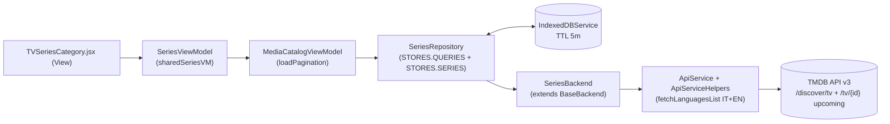
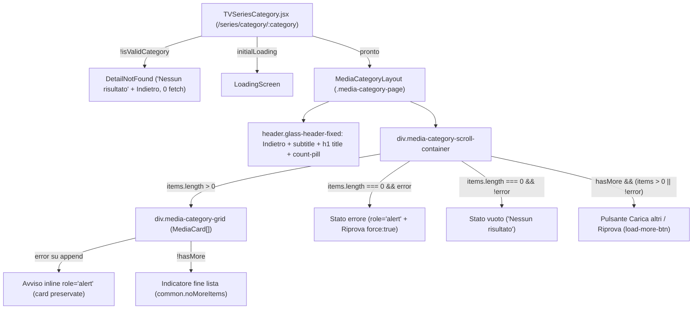

# Documentazione Pagina `TVSeriesCategory.jsx`

Documentazione tecnica della pagina [TVSeriesCategory.jsx](file:///C:/GitHub_Repositories/Cameos/src/pages/TVSeriesCategory.jsx), responsabile della vista a griglia completa delle serie TV di una categoria o delle prossime uscite (`/Cameos/series/category/:category`).

---

## Parte 1 — Fetch dei Dati (Architettura, ViewModel, Repository, Backend e Parametri)

### 1.1 Architettura e interazione tra i layer

La pagina applica rigorosamente l'architettura **MVVM unidirezionale** (`View -> ViewModel -> Repository -> Backend -> ApiService / IndexedDB -> Models`): `TVSeriesCategory.jsx` non importa né interroga mai Repository, Backend, `ApiService`, `IndexedDBService` o `catalogData.js`. La configurazione statica delle 13 categorie serie è isolata in [mediaCategoryConfig.js](file:///C:/GitHub_Repositories/Cameos/src/utils/media/mediaCategoryConfig.js), mentre i metadati di presentazione/i18n risiedono in [mediaCategoryPresentation.js](file:///C:/GitHub_Repositories/Cameos/src/utils/media/mediaCategoryPresentation.js).

La pagina gestisce **un solo flusso paginato per categoria**, con quattro scenari operativi:

1. **Ingresso dal catalogo ([TVSeries.jsx](file:///C:/GitHub_Repositories/Cameos/src/pages/TVSeries.jsx))**: `sharedSeriesVM.categorySeries[categoryKey]` e `categoryPagination[categoryKey]` contengono già le 2 pagine pre-caricate dal feed; la griglia si apre istantaneamente senza `<LoadingScreen />` né chiamate di rete aggiuntive.
2. **Ingresso diretto via URL su categoria valida**: `useEffect` invoca `loadSeriesFromCategory(categoryKey, { page: 1, language: normalizedLang })` via `useEffectEvent` per caricare pagina `1` (con `20` serie sui generi standard o l'unione di nuove serie e serie di ritorno con stagione futura per `upcoming`).
3. **URL con categoria non valida (`!Object.hasOwn(SERIES_CATEGORY_CONFIG, categoryKey)`)**: bloccato sia nella View sia in `SeriesViewModel.loadSeriesFromCategory` (incluse chiavi solo-film come `action` o proprietà del prototipo come `constructor`/`__proto__`) con **0 chiamate al Repository** e **0 scritture in cache/stato**; la pagina renderizza subito `DetailNotFound`.
4. **Paginazione incrementale ("Carica altri")**: `handleLoadMore` chiama `loadSeriesFromCategory(categoryKey, { append: true, language: normalizedLang })` richiedendo `currentPage + 1` e accodando i risultati deduplicati per `id`.

---

### 1.2 Layer ViewModel (`SeriesViewModel`, `MediaCatalogViewModel`, `BaseViewModel`)

- **Istanziazione e sottoscrizione**: `useSeriesViewModel({ language: normalizedLang })` sottoscrive il singleton di sessione `sharedSeriesVM` ([useViewModel.js](file:///C:/GitHub_Repositories/Cameos/src/viewmodel/useViewModel.js#L53-L84)) via `useSyncExternalStore`. `TVSeriesCategory.jsx` destruttura esclusivamente `{ categorySeries, categoryPagination, loadSeriesFromCategory }`.
- **Validazione categoria (`SeriesViewModel.loadSeriesFromCategory`)** ([SeriesViewModel.js](file:///C:/GitHub_Repositories/Cameos/src/viewmodel/series/SeriesViewModel.js#L205-L224)):
  - Verifica `typeof categoryKey === 'string' && Object.hasOwn(SERIES_CATEGORY_CONFIG, categoryKey)`; se invalida ritorna `[]` senza toccare stato né Repository.
  - Se `categoryKey === 'upcoming'`, delega a `loadUpcomingSeries` ([SeriesViewModel.js](file:///C:/GitHub_Repositories/Cameos/src/viewmodel/series/SeriesViewModel.js#L157-L168)), che popola anch'esso `groupedListProp: 'categorySeries'` e `paginationMapProp: 'categoryPagination'`.
  - Per tutte le altre 12 categorie di genere (`crime`, `drama`, `comedy`, `sciFiFantasy`, `animation`, `mystery`, `actionAdventure`, `family`, `kids`, `warPolitics`, `western`, `soap`) delega a `MediaCatalogViewModel.loadPagination` con `asyncKey: 'loadCategory_' + categoryKey`.
- **Paginazione e isolamento errori (`MediaCatalogViewModel.loadPagination`)** ([MediaCatalogViewModel.js](file:///C:/GitHub_Repositories/Cameos/src/viewmodel/MediaCatalogViewModel.js#L132-L199)):
  - Pianifica pagine, lingua e politica `retainPages` tramite `planPaginationLoad` ([pagination.js](file:///C:/GitHub_Repositories/Cameos/src/viewmodel/pagination.js#L45-L66)) e applica lo stato di loading iniziale via `_beginPaginationLoad` ([MediaCatalogViewModel.js](file:///C:/GitHub_Repositories/Cameos/src/viewmodel/MediaCatalogViewModel.js#L82-L94)) usando `buildPaginationPatch` ([pagination.js](file:///C:/GitHub_Repositories/Cameos/src/viewmodel/pagination.js#L28-L32)).
  - **Append (`append: true`)**: blocca clic concorrenti se `loadingMore || hasMore === false || _pendingOperations.has(asyncKey)`, deduplica in-place via `combinePages` ([pagination.js](file:///C:/GitHub_Repositories/Cameos/src/viewmodel/pagination.js#L78-L88)) e fonde la sola categoria tramite `mergeCategoryPatch` ([pagination.js](file:///C:/GitHub_Repositories/Cameos/src/viewmodel/pagination.js#L69-L75)). Su errore mantiene intatte le card già in griglia e scrive `pagination.error`.
  - **Caricamento iniziale / Retry (`append: false`)**: delega a `_runRefreshPagination` ([MediaCatalogViewModel.js](file:///C:/GitHub_Repositories/Cameos/src/viewmodel/MediaCatalogViewModel.js#L97-L115)) su [BaseViewModel.runAsync](file:///C:/GitHub_Repositories/Cameos/src/viewmodel/BaseViewModel.js#L201-L241) catturando localmente `requestError` nel `try/catch`. Un'altra operazione parallela su `sharedSeriesVM` che azzera `state.error` **non può mai cancellare** `categoryPagination[categoryKey].error`.

---

### 1.3 Snodo Centrale: Layer Repository (`BaseRepository`, `MediaCatalogRepository`, `SeriesRepository`)

Entrambi i flussi (`getSeriesByCategory` [L135-L149](file:///C:/GitHub_Repositories/Cameos/src/repository/series/SeriesRepository.js#L135-L149) e `getUpcomingSeries` [L108-L123](file:///C:/GitHub_Repositories/Cameos/src/repository/series/SeriesRepository.js#L108-L123)) delegano a [MediaCatalogRepository._executeMediaCatalogPage](file:///C:/GitHub_Repositories/Cameos/src/repository/MediaCatalogRepository.js#L26-L42) e [BaseRepository.executeCatalogQuery](file:///C:/GitHub_Repositories/Cameos/src/repository/BaseRepository.js#L259-L322) su `cameos_pwa_db` v3 ([IndexedDBService.js](file:///C:/GitHub_Repositories/Cameos/src/storage/IndexedDBService.js)):

| Flusso | Store principale | Formato `cacheKey` | Effetti secondari |
| :--- | :--- | :--- | :--- |
| `getSeriesByCategory(key, params)` | `STORES.QUERIES` | `category_series_<key>:categoryKey=<key>&language=<lang>&page=
` | Inserisce le singole `Series` in `STORES.SERIES` (`isComplete: false`) **solo se assenti** (`shouldReplace: (existing) => !existing`) |
| `getUpcomingSeries(params)` | `STORES.QUERIES` | `upcoming_series:language=<lang>&page=
` | Salva le `Series` in `STORES.SERIES` (non distruttivo) e ri-applica il filtro `isMediaUpcoming(series, today)` anche sui record letti da cache, scartando eventuali stagioni di ritorno già scadute |

- **Deduplicazione in-flight e TTL 5 minuti**: richieste concorrenti sulla stessa chiave (es. React StrictMode) condividono la stessa `Promise` in `_catalogRequests`; con `force: false`, record entro `300_000 ms` sono serviti subito da IndexedDB re-idratati in `new Series(...)`.
- **Network-First + Fallback offline**: quando `handleRetry` passa `force: true`, se online bypassa il TTL e aggiorna la cache; se offline (anche con `force: true`), legge comunque la cache locale se disponibile, oppure lancia un errore controllato mostrato dalla UI con pulsante `Riprova`.

---

### 1.4 Layer Backend & Sorgente Remota (`SeriesBackend`, `BaseBackend`, `ApiService`)

- **`SeriesBackend.getSeriesByCategory`** ([SeriesBackend.js](file:///C:/GitHub_Repositories/Cameos/src/backend/series/SeriesBackend.js#L127-L134)) → **`BaseBackend._getMediaByCategory`** ([BaseBackend.js](file:///C:/GitHub_Repositories/Cameos/src/backend/BaseBackend.js#L55-L77)) → **`ApiService.discoverTv`** ([ApiService.js](file:///C:/GitHub_Repositories/Cameos/src/service/ApiService.js#L172-L174)):
  - Chiama `GET /discover/tv` in parallelo per `it-IT` ed `en-US` tramite `fetchLanguagesList` (tollerante a fallimenti parziali di una lingua con `Promise.allSettled`), filtrando `first_air_date.lte: today`, `sort_by: 'popularity.desc'` e `with_genres: config.genreId`.
  - Restituisce modelli [Series](file:///C:/GitHub_Repositories/Cameos/src/models/Series.js) già bilingue (`names`, `overviews`, `posterUrl`, `backdropUrl`).
- **`SeriesBackend.getUpcomingSeries`** ([SeriesBackend.js](file:///C:/GitHub_Repositories/Cameos/src/backend/series/SeriesBackend.js#L75-L116)) → **`ApiService.getUpcomingSeries`** ([ApiService.js](file:///C:/GitHub_Repositories/Cameos/src/service/ApiService.js#L190-L197)) + **`ApiService.discoverTv`**:
  - Unisce in parallelo le serie inedite (`first_air_date.gte: today`) e le serie di ritorno (`air_date.gte: today` & `first_air_date.lte: today`), arricchisce i candidati con `_enrichWithConcurrency(..., 4)` su `/tv/{id}` per individuare `status` e `upcomingSeason` (`findUpcomingSeason`) e rifiltra con `isMediaUpcoming(item, today)`.

---

### 1.5 Giustificazione dei parametri impiegati

| Parametro | Layer / Chiamata | Valore in `TVSeriesCategory.jsx` | Motivazione tecnica |
| :--- | :--- | :--- | :--- |
| `category` (`categoryKey`) | `useParams()` → `loadSeriesFromCategory` | `:category` (default `'upcoming'`) | Seleziona la configurazione TMDB da `SERIES_CATEGORY_CONFIG`, i metadati da `getCategoryDisplayInfo` e lo slice in `categorySeries`/`categoryPagination`; validato con `Object.hasOwn`. |
| `page` | `fetchInitialCategory`, `handleRetry` | `1` | Su ingresso diretto o retry carica la prima pagina da `20` serie, lasciando all'utente il controllo esplicito di paginazione via `"Carica altri"`. |
| `append` | `handleLoadMore` | `true` | Attiva il ramo incrementale di `loadPagination`, calcolando `currentPage + 1` e mantenendo intatte tutte le card già visualizzate. |
| `language` / `normalizedLang` | Hook → VM → Repo | `'it-IT'` o `'en-US'` | Chiave di cache della query; il cambio lingua **non** rilancia il fetch (gestito via `useEffectEvent`) perché i `Series` in memoria sono già bilingue e si traducono live preservando le pagine `2..N`. |
| `force` | `handleRetry` | `true` (solo su Retry) | Forza il bypass del TTL di 5 minuti se online su tentativo esplicito dell'utente, mantenendo il fallback IndexedDB se offline. |
| `first_air_date.lte` / `.gte` + `air_date.gte` | `BaseBackend` / `SeriesBackend` | Data odierna ISO `YYYY-MM-DD` | Separa le serie già uscite (categorie di genere) dalle nuove uscite e dalle serie di ritorno con stagione imminente (`upcoming`). |
| `upcoming` | `MediaCategoryLayout` → `MediaCard` | `categoryKey === 'upcoming'` | Nasconde il badge voto e abilita i metadati della nuova stagione in arrivo sulle card `upcoming`. |

---

## Parte 2 — Visualizzazione (Struttura, Componenti, Hooks e Props)

### 2.1 Struttura della pagina e gestione degli stati

La route `/Cameos/series/category/:category` in [App.jsx](file:///C:/GitHub_Repositories/Cameos/src/App.jsx#L48) monta `<TVSeriesCategory key={pathname} />`, garantendo il reset pulito di scroll e stato al cambio categoria.

#### Stati di visualizzazione
- **Categoria non valida**: `!isValidCategory` mostra immediatamente [DetailNotFound](file:///C:/GitHub_Repositories/Cameos/src/components/media/MediaDetailLayout.jsx#L39-L86) (`icon="bi-tv"`, `title={t('common.noResults')}`, `subtitle={null}`, `onBack={goBack}`) senza `<LoadingScreen />` né errori di rete.
- **Loading iniziale**: mostra [LoadingScreen](file:///C:/GitHub_Repositories/Cameos/src/components/LoadingScreen.jsx) solo quando `series.length === 0` e la paginazione non è ancora pronta (`!pagination || pagination.loading`). Arrivando da `TVSeries.jsx` con dati già in memoria, il loader viene saltato del tutto.
- **Errore iniziale vs Errore su "Carica altri"**:
  - Se fallisce il caricamento iniziale (`items.length === 0 && error`), mostra il blocco centrato con `role="alert"` e il pulsante `Riprova` che chiama `handleRetry` (`force: true`).
  - Se fallisce la paginazione incrementale (`items.length > 0 && error`), mantiene tutte le card caricate in griglia, mostra un avviso compatto `role="alert"` subito sopra il footer e commuta il pulsante `.load-more-btn` su `Riprova` (invocando `handleLoadMore`).
- **Pagina 1 filtrata vuota con `hasMore: true`**: anche se `items.length === 0` senza errori (es. pagina 1 di `upcoming` con tutti i candidati scartati dal filtro temporale mentre esistono pagine successive), il pulsante `Carica altri` resta disponibile per avanzare a pagina 2.
- **Cambio lingua `IT <-> EN`**: aggiorna live titolo categoria, sottotitolo, badge conteggio (`N Serie TV` ↔ `N TV Series`) e tutte le `MediaCard` senza re-fetch né perdita delle pagine `2..N`.

---

### 2.2 Utilizzo degli Hooks e motivazioni

| Hook | Codice / Dipendenze | Come funziona e perché viene usato |
| :--- | :--- | :--- |
| `useParams()` | `const { category } = useParams()` | Estrae lo slug `:category` dalla route e lo valida contro `SERIES_CATEGORY_CONFIG`. |
| `useTranslation()` | `{ t, normalizedLang }` | Fornisce traduzioni per `getCategoryDisplayInfo`/`DetailNotFound` e tag esteso per `useSeriesViewModel` e fetch iniziali/retry. |
| `useSeriesViewModel({ language })` | Destrutturati `{ categorySeries, categoryPagination, loadSeriesFromCategory }` | Sottoscrive `sharedSeriesVM` in modo tearing-safe, condividendo in memoria le pagine già caricate da `TVSeries.jsx`. |
| `useMemo` (`categoryInfo`) | Deps: `[categoryKey, isValidCategory, t]` | Risolve `{ name, fullTitle, subtitle }` tramite `getCategoryDisplayInfo(categoryKey, t, 'series')` solo al cambio categoria o lingua (saltato se categoria invalida). |
| `useScrollToTop(categoryKey, !initialLoading)` | [domUtils.js](file:///C:/GitHub_Repositories/Cameos/src/utils/domUtils.js#L71-L86) | Imposta `scrollRestoration = 'manual'` e resetta lo scroll di `window` solo a caricamento iniziale completato. |
| `useEffectEvent` (`fetchInitialCategory`) | Invoca `loadSeriesFromCategory(targetCategory, { page: 1, language: normalizedLang })` | Legge sempre `normalizedLang` corrente senza inserirlo nelle dipendenze di `useEffect`, azzerando i re-fetch distruttivi al cambio lingua. |
| `useEffect` (fetch iniziale) | Deps: `[categoryKey, isValidCategory, series.length, pagination?.loading, pagination?.error, pagination?.page]` | Carica pagina `1` solo su categoria valida, vuota, mai richiesta e priva di errore pendente. |
| `useGoBack(APP_ROUTES.series)` | [domUtils.js](file:///C:/GitHub_Repositories/Cameos/src/utils/domUtils.js#L55-L60) | Torna alla vista precedente nella history interna o ripiega su `/Cameos/series` su accesso diretto. |
| `useCallback` (`handleLoadMore`, `handleRetry`) | Deps minime per azione | Mantengono stabile l'identità dei callback verso `MediaCategoryLayout`; `handleLoadMore` accoda la pagina successiva (`append: true`), `handleRetry` forza il ricaricamento (`force: true`). |

---

### 2.3 Componenti e Parametri (Props)

#### 1. `MediaCategoryLayout` ([MediaCategoryLayout.jsx](file:///C:/GitHub_Repositories/Cameos/src/components/media/MediaCategoryLayout.jsx))
Shell a tutto schermo condivisa con [MovieCategory.jsx](file:///C:/GitHub_Repositories/Cameos/src/pages/MovieCategory.jsx): header glass fisso, griglia responsiva (`.media-category-grid` in [mediaCategory.css](file:///C:/GitHub_Repositories/Cameos/src/css/media/mediaCategory.css)), stati vuoto/errore iniziale, errore inline su append e pulsante `Carica altri`.

| Prop | Tipo | Default | Ruolo |
| :--- | :--- | :--- | :--- |
| `title` | `string` *(req)* | — | Titolo principale `<h1>` nell'header glass |
| `subtitle` | `string` | `''` | Sottotitolo descrittivo sopra `<h1>` (omesso se vuoto) |
| `countLabel` | `string` | Derivato (`common.mediaCount`) | Etichetta del badge conteggio; omessa dalla View e calcolata internamente da `items.length` e `type="tv"` |
| `items` | `Array<Object>` *(req)* | — | Lista dei modelli `Series` da renderizzare in griglia |
| `type` | `'movie' \| 'tv'` *(req)* | — | Valore `'tv'`: imposta icona badge `bi-tv`, etichetta conteggio `nav.tvSeries` e prop `type` di `MediaCard` |
| `upcoming` | `boolean` | `false` | Prop inoltrata a `MediaCard` (`categoryKey === 'upcoming'`) per nascondere i voti e mostrare la stagione in arrivo |
| `hasMore` | `boolean` | `false` | Mostra il pulsante `Carica altri` / `Riprova` quando esistono altre pagine (`items.length > 0 \|\| !error`) |
| `isLoadingMore` | `boolean` | `false` | Disabilita `.load-more-btn` e mostra spinner + `common.loadingMore` durante l'append |
| `error` | `Error \| string \| Object \| null` | `null` | Attiva `role="alert"` (stato centrato se `items` vuoto; avviso inline sopra `.load-more-btn` se `items` popolato) |
| `onBack` | `() => void` *(req)* | — | Azione del pulsante circolare indietro nell'header |
| `onLoadMore` | `() => void` *(req)* | — | Azione del pulsante `Carica altri` (e retry append in stato errore con `items > 0`) |
| `onRetry` | `() => void` *(req)* | — | Azione del pulsante `Riprova` in stato errore iniziale (`items.length === 0`) |

#### 2. Componenti condivisi usati dalla pagina
- **`MediaCard`** ([MediaCard.jsx](file:///C:/GitHub_Repositories/Cameos/src/components/media/MediaCard.jsx)): renderizzata per ogni elemento della griglia con `{ key: item.id, item, type: 'tv', upcoming }`. Risolve nome serie, poster, anno, badge voto, badge stagione in arrivo e badge cameo live tramite `langKey`.
- **`DetailNotFound`** ([MediaDetailLayout.jsx](file:///C:/GitHub_Repositories/Cameos/src/components/media/MediaDetailLayout.jsx#L39-L86)): usata solo quando `!isValidCategory` con `{ icon: 'bi-tv', title: t('common.noResults'), subtitle: null, onBack: goBack }`.
- **`LoadingScreen`** ([LoadingScreen.jsx](file:///C:/GitHub_Repositories/Cameos/src/components/LoadingScreen.jsx)): velo full-screen di caricamento iniziale con messaggio predefinito `t('common.loading')`.
