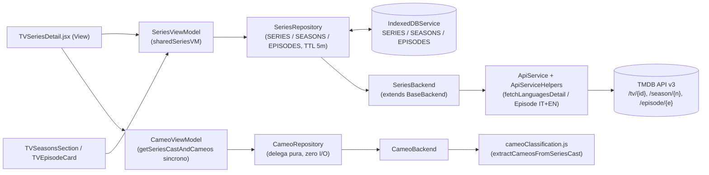
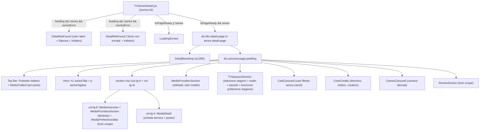

# Documentazione Pagina `TVSeriesDetail.jsx`

Documentazione tecnica della pagina [TVSeriesDetail.jsx](file:///C:/GitHub_Repositories/Cameos/src/pages/TVSeriesDetail.jsx), responsabile della scheda di dettaglio di una serie TV e della guida interattiva alle sue stagioni ed episodi (`/series/:id`, `/series/:id/season/:seasonNumber` e `/series/:id?season=N`).

> **Nota di perimetro:** la barra preferenze utente ([MediaPreferencesBar.jsx](file:///C:/GitHub_Repositories/Cameos/src/components/media/MediaPreferencesBar.jsx)) e la sezione Recensioni ([ReviewSection.jsx](file:///C:/GitHub_Repositories/Cameos/src/components/ReviewSection.jsx), `getReviewsForTarget` da `catalogData.js`, `ReviewViewModel` / `UserViewModel`) sono sviluppate su un branch separato e sono trattate qui solo come segnaposto strutturale.

---

## Parte 1 — Fetch dei Dati (Architettura, Repository, Backend e Parametri)

### 1.1 Architettura e interazione tra i layer

La pagina applica rigorosamente l'architettura **MVVM unidirezionale** (`View -> ViewModel -> Repository -> Backend -> ApiService / IndexedDB -> Models`), allineata 1:1 a [MovieDetail.jsx](file:///C:/GitHub_Repositories/Cameos/src/pages/MovieDetail.jsx): `TVSeriesDetail.jsx` e i suoi figli TV non importano né interrogano mai Repository, Backend, `ApiService` o `IndexedDBService`.

Al mount su `/series/:id`, `TVSeriesDetail.jsx` coordina **due flussi di rete indipendenti**, **una derivazione sincrona in memoria** e **un arricchimento episodio on-demand**:

1. **Dettagli completi della serie (`selectedSeries`)**: `SeriesViewModel.loadSeriesDetails({ seriesId: id, appendAggregateCredits: true, language: normalizedLang })` scarica in parallelo `it-IT` ed `en-US` di `/tv/{id}?append_to_response=aggregate_credits,watch/providers,videos,images` (2 GET totali) e restituisce un modello bilingue [Series](file:///C:/GitHub_Repositories/Cameos/src/models/Series.js) comprensivo di cast aggregato (`total_episode_count`, `roles`), crew, provider streaming e trailer.
2. **Stagione attiva (`selectedSeason`)**: `SeriesViewModel.loadSeasonDetails({ seriesId: id, seasonNumber: activeSeasonNumber, appendAggregateCredits: true, language: normalizedLang })` scarica `/tv/{id}/season/{n}` in `it-IT` ed `en-US` (2 GET) producendo un modello bilingue [Season](file:///C:/GitHub_Repositories/Cameos/src/models/Season.js) con episodi già localizzati (`names`, `overviews`, `stillUrl`) e trailer di stagione. Parte subito in parallelo per stagione `1`; per `?season=N` con `N > 1` attende `series` per validare `totalSeasons` e fare clamping sicuro a `1` se fuori intervallo.
3. **Cast disgiunto e camei della serie (`cast`, `cameos`)**: invece di lanciare una seconda coppia di GET su `/tv/{id}` (`loadSeriesCameos`), la View delega a `CameoViewModel.getSeriesCastAndCameos(series, { language: normalizedLang })` → `extractSeriesCameos` → `CameoRepository.extractCameosFromSeries` → `CameoBackend.extractCameosFromSeries` → `extractCameosFromSeriesCast` ([cameoClassification.js](file:///C:/GitHub_Repositories/Cameos/src/backend/cameos/cameoClassification.js)) e riceve `{ cast, cameos }` già disgiunti via `excludeCameosFromCast`. Garantisce **0 richieste HTTP aggiuntive**, **0 filtraggio nella View** e disponibilità offline garantita insieme alla serie.
4. **Arricchimento singolo episodio (on-demand)**: espandendo una [TVEpisodeCard](file:///C:/GitHub_Repositories/Cameos/src/components/tv/TVEpisodeCard.jsx) priva di `airDate` o `voteAverage`, `TVSeasonsSection` delega a `SeriesViewModel.loadEpisodeDetails(...)` per recuperare `runtime`, `airDate`, `voteAverage` e testi bilingue completi dell'episodio.

---

### 1.2 Layer ViewModel (`SeriesViewModel`, `CameoViewModel`, `BaseViewModel`)

- **Istanziazione e sottoscrizione**:
  - `useSeriesViewModel({ language: normalizedLang })` sottoscrive il singleton di sessione `sharedSeriesVM` ([useViewModel.js](file:///C:/GitHub_Repositories/Cameos/src/viewmodel/useViewModel.js#L54-L94)) via `useSyncExternalStore`.
  - `useCameoViewModel({ language: normalizedLang })` espone `getSeriesCastAndCameos` con identità stabile, mantenendo il dominio `Series` separato dalle euristiche camei e la View puramente presentazionale.
- **Derivazione cast & camei (`CameoViewModel.getSeriesCastAndCameos`)** ([CameoViewModel.js](file:///C:/GitHub_Repositories/Cameos/src/viewmodel/cameos/CameoViewModel.js)):
  - Metodo sincrono puro sul ViewModel: se `series` è `null` ritorna `{ cast: [], cameos: [] }`, altrimenti riusa `series.cameos` (se già presenti) o delega a `extractSeriesCameos` ed esclude i camei da `series.cast` via `excludeCameosFromCast` senza mutare stato né attivare `loading`.

#### Struttura in 5 stadi dei loader di dettaglio (`Serie`, `Stagione`, `Episodio`)

I tre loader in [SeriesViewModel.js](file:///C:/GitHub_Repositories/Cameos/src/viewmodel/series/SeriesViewModel.js#L277-L458) restano intenzionalmente **metodi separati** (non centralizzati in un singolo wrapper generico) affinché serie, stagioni ed episodi possano evolvere logiche e parametri indipendenti senza rigidi accoppiamenti, condividendo al tempo stesso la medesima pipeline difensiva in 5 stadi su [BaseViewModel.runAsync](file:///C:/GitHub_Repositories/Cameos/src/viewmodel/BaseViewModel.js#L201-L241):

| Passo | Serie (`loadSeriesDetails`, [L277-L316](file:///C:/GitHub_Repositories/Cameos/src/viewmodel/series/SeriesViewModel.js#L277-L316)) | Stagione (`loadSeasonDetails`, [L326-L375](file:///C:/GitHub_Repositories/Cameos/src/viewmodel/series/SeriesViewModel.js#L326-L375)) | Episodio (`loadEpisodeDetails`, [L386-L458](file:///C:/GitHub_Repositories/Cameos/src/viewmodel/series/SeriesViewModel.js#L386-L458)) |
| :--- | :--- | :--- | :--- |
| **1. Normalizzazione argomenti (dual-signature)** | Risolve `{ seriesId, id, appendAggregateCredits, language, force }` o posizionale `(seriesId, appendAggregateCredits, language)`. | Risolve `{ seriesId, id, seasonNumber, appendAggregateCredits, language, force }` o posizionale `(seriesId, seasonNumber, appendAggregateCredits, language)`. | Risolve `{ seriesId, id, seasonNumber, episodeNumber, appendCredits, language, force }` o posizionale `(seriesId, seasonNumber, episodeNumber, appendCredits, language)`. |
| **2. Validazione route (early exit)** | `isValidNumericParam(seriesId)` ([BaseViewModel.js](file:///C:/GitHub_Repositories/Cameos/src/viewmodel/BaseViewModel.js#L10-L17), intero `> 0`); ritorna `null` con 0 chiamate se invalido. | `isValidSeasonRoute(seriesId, seasonNumber)` ([L15-L18](file:///C:/GitHub_Repositories/Cameos/src/viewmodel/series/SeriesViewModel.js#L15-L18)): `seriesId > 0` e `seasonNumber >= 0` (accetta Specials `0`). | `isValidEpisodeRoute(seriesId, seasonNumber, episodeNumber)` ([L27-L30](file:///C:/GitHub_Repositories/Cameos/src/viewmodel/series/SeriesViewModel.js#L27-L30)): `seriesId > 0`, `seasonNumber >= 0`, `episodeNumber >= 0`. |
| **3. Tracking richiesta & token identità** | Crea `requestToken = {}`, salva `this._latestSeriesRequest = requestToken` e imposta `{ requestedSeriesId: seriesId, seriesError: null }`. | Crea `request = { seriesId, seasonNumber, error: null }` e imposta `{ requestedSeason: request }` (il riferimento oggetto fa da token identità). | Crea `request = { seriesId, seasonNumber, episodeNumber, error: null }` e imposta `{ requestedEpisode: request }` (il riferimento oggetto fa da token identità). |
| **4. Esecuzione protetta (`runAsync`)** | `runAsync('loadSeriesDetails', () => repo.getSeriesDetails(params), (selectedSeries) => ({ selectedSeries, seriesError: null }))`. | `runAsync('loadSeasonDetails', () => repo.getSeasonDetails(params), (selectedSeason) => ({ selectedSeason }))`. | `runAsync('loadEpisodeDetails', () => repo.getEpisodeDetails(params), (selectedEpisode) => ({ selectedEpisode }))`. |
| **5. Isolamento errore & guard anti-stale** | Cattura `requestError` in `try/catch`; scrive `{ seriesError: requestError }` solo se `series === null && this._latestSeriesRequest === requestToken && requestError !== null`. | Cattura `requestError` in `try/catch`; aggiorna `requestedSeason.error` solo se `season === null && this.state.requestedSeason === request && requestError !== null`. | Cattura `requestError` in `try/catch`; aggiorna `requestedEpisode.error` solo se `episode === null && this.state.requestedEpisode === request && requestError !== null`. |
| **Selettore loading dedicato** | `isSeriesLoading(id)` ([L461](file:///C:/GitHub_Repositories/Cameos/src/viewmodel/series/SeriesViewModel.js#L461)) via `_isRouteEntityLoading` (`false` se ID invalido). | `isSeasonLoading(id, season)` ([L463-L471](file:///C:/GitHub_Repositories/Cameos/src/viewmodel/series/SeriesViewModel.js#L463-L471)): guard `isValidSeasonRoute`, poi controlla `requestedSeason` e `_pendingOperations`. | `isEpisodeLoading(id, season, ep)` ([L473-L482](file:///C:/GitHub_Repositories/Cameos/src/viewmodel/series/SeriesViewModel.js#L473-L482)) + `getEpisodeForRoute` ([L485-L493](file:///C:/GitHub_Repositories/Cameos/src/viewmodel/series/SeriesViewModel.js#L485-L493)): guard `isValidEpisodeRoute` e match sulla tripla. |
| **Reset (`clearSelection`)** | Azzera `_latestSeriesRequest`, `selectedSeries`, `requestedSeriesId`, `seriesError` ([L498-L509](file:///C:/GitHub_Repositories/Cameos/src/viewmodel/series/SeriesViewModel.js#L498-L509)). | Azzera `selectedSeason`, `requestedSeason` (invalida eventuali errori in volo via `!== request`). | Azzera `selectedEpisode`, `requestedEpisode` (invalida eventuali errori in volo via `!== request`). |

> **Perché `requestToken` è esplicito in `loadSeriesDetails` ma implicito in stagione ed episodio:** il meccanismo anti-stale per identità di riferimento (`===`) è identico in tutti e tre i loader, ma dipende dal tipo salvato nello stato. `loadSeasonDetails` e `loadEpisodeDetails` salvano già un **nuovo oggetto** `request` ad ogni invocazione (`this.state.requestedSeason === request` / `requestedEpisode === request`), quindi due chiamate sullo stesso target creano comunque riferimenti distinti. `loadSeriesDetails` (come `loadMovieDetails`) salva invece un **primitivo** (`requestedSeriesId`), che non distingue due richieste sullo stesso ID (es. primo fetch lento che va in timeout dopo un retry veloce riuscito, oppure dopo `clearSelection()`): l'oggetto vuoto `const requestToken = {}` in `_latestSeriesRequest` fornisce quindi lo stesso confronto per riferimento univoco senza cambiare il contratto pubblico dello stato.

---

### 1.3 Snodo Centrale: Layer Repository (`BaseRepository`, `SeriesRepository`, `CameoRepository`)

#### Dettagli gerarchici Serie → Stagione → Episodio ([SeriesRepository.js](file:///C:/GitHub_Repositories/Cameos/src/repository/series/SeriesRepository.js#L222-L316))
Tutti e tre i metodi delegano a [BaseRepository._executeEntityDetails](file:///C:/GitHub_Repositories/Cameos/src/repository/BaseRepository.js#L343-L382) su `cameos_pwa_db` v3 ([IndexedDBService.js](file:///C:/GitHub_Repositories/Cameos/src/storage/IndexedDBService.js)):

| Metodo | Store | Chiave completa (`isComplete: true`) | Indice fallback offline | Effetti secondari |
| :--- | :--- | :--- | :--- | :--- |
| `getSeriesDetails` | `STORES.SERIES` | `series:<id>:<lang>` (`:basic` se senza crediti) | `id` | Re-idrata `Series` (inclusi `WatchProvider` e `Trailer`); i record di lista (`isComplete: false`) non sovrascrivono mai i dettagli completi |
| `getSeasonDetails` | `STORES.SEASONS` | `season:<id>:<n>:<lang>` (`:basic` se senza crediti) | `seasonKey` `[seriesId, seasonNumber]` | Salva i sommari degli episodi in `STORES.EPISODES` sotto chiave `episode:<id>:<n>:<e>:<lang>:summary` (`isComplete: false`) senza intaccare eventuali episodi completi |
| `getEpisodeDetails` | `STORES.EPISODES` | `episode:<id>:<n>:<e>:<lang>` (`:basic` se senza crediti) | `episodeKey` `[seriesId, seasonNumber, episodeNumber]` | Re-idrata `Episode` con cast, guest star, camei e trailer |

- **Deduplicazione in-flight e TTL 5 minuti**: richieste concorrenti sulla stessa chiave condividono la stessa `Promise`; con `force: false`, record completi entro 300 s vengono serviti subito da IndexedDB.
- **Network-First + Fallback offline cross-lingua (`_getEntityWithIndexFallback`)**: anche quando `force: true` (es. click su `Riprova` offline), se manca la rete legge da IndexedDB preferendo sempre un record `isComplete: true` (anche nell'altra lingua, essendo già bilingue) rispetto a un record sommario. Se la cache è vuota lancia un errore controllato gestito dalla UI con `DetailNotFound` o alert stagione.

#### Derivazione camei (`CameoRepository.extractCameosFromSeries`)
[CameoRepository.js](file:///C:/GitHub_Repositories/Cameos/src/repository/cameos/CameoRepository.js#L129-L131) espone un delegato sincrono privo di I/O (`this.backend.extractCameosFromSeries`), coerente con `extractCameosFromMovie` ed `extractCameosFromGuestStars`.

---

### 1.4 Layer Backend, Classificazione Camei & Sorgente Remota

- **`SeriesBackend.getSeriesDetails`** ([SeriesBackend.js](file:///C:/GitHub_Repositories/Cameos/src/backend/series/SeriesBackend.js#L191-L200)) → `GET /tv/{id}` (`it-IT` + `en-US`, `append_to_response=aggregate_credits,watch/providers,videos,images`): fonde testi bilingue, stagioni, immagini, trailer e `aggregate_credits` in `new Series(data)`.
- **`SeriesBackend.getSeasonDetails`** ([SeriesBackend.js](file:///C:/GitHub_Repositories/Cameos/src/backend/series/SeriesBackend.js#L211-L223)) → `GET /tv/{id}/season/{n}` (`it-IT` + `en-US`, `append_to_response=aggregate_credits,videos,images`): fonde `episodes` bilingue (`mergeLanguagesCollection` in [ApiServiceHelpers.js](file:///C:/GitHub_Repositories/Cameos/src/service/ApiServiceHelpers.js#L105-L122)) e trailer di stagione in `new Season(...)`.
- **`SeriesBackend.getEpisodeDetails`** ([SeriesBackend.js](file:///C:/GitHub_Repositories/Cameos/src/backend/series/SeriesBackend.js#L235-L250)) → `GET /tv/{id}/season/{n}/episode/{e}` (`it-IT` + `en-US`, `append_to_response=credits,videos`): calcola i camei dell'episodio tramite `extractCameosFromGuestStars` e restituisce `new Episode(...)`.
- **Classificazione pura camei serie (`extractCameosFromSeriesCast`)** ([cameoClassification.js](file:///C:/GitHub_Repositories/Cameos/src/backend/cameos/cameoClassification.js)):
  - Scorre `seriesData.cast` (deduplicato da `dedupeCast`, popolato da `aggregate_credits.cast` con `total_episode_count` e `roles`).
  - Seleziona gli attori con apparizione breve (`0 < total_episode_count <= maxEpisodes`, default `MAX_SERIES_CAMEO_EPISODES = 2`, purché inferiore al totale episodi della serie per non penalizzare i protagonisti di miniserie da 1–2 episodi) e popolarità `>= minPopularity` (default `DEFAULT_CAMEO_MIN_POPULARITY = 2`), oppure ruoli `Self` / esplicitamente cameo sul ruolo principale per gli attori ricorrenti (`analyzeCameoRole`), in simmetria con `CameoBackend.getActorCareerCameos`.
  - Ordina per popolarità decrescente e costruisce istanze [Cameo](file:///C:/GitHub_Repositories/Cameos/src/models/Cameo.js) con `cameoBadge` (`Cameo (Se stesso)`, `Cameo`, `Special Guest Star`), `mediaTitles` bilingue e `mediaTitle`.
  - `CameoViewModel.getSeriesCastAndCameos` filtra `series.cast` tramite `excludeCameosFromCast` ([formatters.js](file:///C:/GitHub_Repositories/Cameos/src/utils/formatters.js)), garantendo zero sovrapposizioni tra `CastCarousel` e `CameoCarousel`.

---

### 1.5 Giustificazione dei parametri impiegati

| Parametro | Layer / Chiamata | Valore in `TVSeriesDetail.jsx` | Motivazione tecnica |
| :--- | :--- | :--- | :--- |
| `seriesId` / `id` | `useParams()` → `loadSeriesDetails`, `loadSeasonDetails` | `:id` dalla route | Identifica la serie su TMDB, isola `isSeriesLoading(id)` / `isSeasonLoading` e partiziona la cache IndexedDB. |
| `seasonParam` / `activeSeasonNumber` | `useParams()` + `useSearchParams()` → `parseSeasonParam` | `seasonNumber ?? ?season` (default `1`, clamp a `1` se `> totalSeasons`) | Permette deep-link diretti a una stagione evitando fetch di stagioni inesistenti prima della validazione di `totalSeasons`. |
| `appendAggregateCredits` | `loadSeriesDetails`, `loadSeasonDetails` | `true` | Scarica cast/crew aggregati, provider e video in un'unica coppia di GET bilingue e marca il record IndexedDB come `isComplete: true`. |
| `language` / `normalizedLang` | Hook → VM → Repo / `extractSeriesCameos` | `'it-IT'` o `'en-US'` | Chiave primaria di cache e `mediaTitle` dei camei; il cambio lingua sullo stesso titolo **non** rilancia i fetch perché `Series`, `Season` ed `Episode` in memoria sono già bilingue. |
| `force` | `handleRetrySeries`, `handleRetrySeason` | `true` (solo su Retry) | Su errore rete/stagione forza il bypass del TTL di 5 minuti se online, mantenendo il fallback IndexedDB se offline. |
| `maxEpisodes` / `minPopularity` | `extractSeriesCameos` (default `cameoClassification.js`) | `2` / `2` (omessi nella View) | Distingue le guest star di breve apparizione (1–2 episodi, popolarità `>= 2`) dal cast ricorrente della serie in simmetria con `PersonDetail`, senza chiamate HTTP extra. |
| `size` | `series.getBackdropUrl(langKey, 'w1280')` | `'w1280'` | Richiede direttamente al modello la variante HD del backdrop via `resolveLocalizedImage`, senza `.replace()` nella View. |
| `langKey` | Getter di `Series`, `Season`, `Episode` | `'it'` o `'en'` | Traduzione live e coerente di titolo, tagline, trama, generi, stato, episodi e ricalibrazione pillole in `TVSeasonSelection`. |

---

## Parte 2 — Visualizzazione (Struttura, Componenti, Hooks e Props)

### 2.1 Struttura della pagina e gestione degli stati (Loading, Errore, Not-Found, Cambio lingua)

La route `/series/:id` (e `/series/:id/season/:seasonNumber`) in [App.jsx](file:///C:/GitHub_Repositories/Cameos/src/App.jsx#L49-L50) monta `<TVSeriesDetail key={pathname} />`, che a sua volta monta `<TVSeriesDetailContent key={`${id}:${rawSeasonParam ?? ''}`} />` per azzerare in modo deterministico stati locali, stagione selezionata e modali al cambio serie o parametro stagione.

#### Stati di visualizzazione
- **Loading iniziale**: mostra [LoadingScreen](file:///C:/GitHub_Repositories/Cameos/src/components/LoadingScreen.jsx) finché `series` non corrisponde a `id`, `!loading` è vero e `useMovieImagesReady(seriesId, backdropSrc)` ha decodificato il backdrop (`1200 ms` timeout).
- **Rivelazione sticky al cambio lingua (`revealedSeriesId`)**: una volta rivelata la pagina per `seriesId === String(id)`, cambiare lingua `IT <-> EN` mantiene montati pagina, stagione selezionata ed eventuali `TVEpisodeCard` espanse senza `LoadingScreen` né spinner episodi, traducendo live tutti i testi e ricalibrando le pillole di `TVSeasonSelection`.
- **Errore serie vs Serie non trovata e route malformate**: la pagina filtra `activeSeriesError = String(requestedSeriesId) === String(id) ? seriesError : null`. Con `!loading && !series`, se `activeSeriesError` è valorizzato renderizza [DetailNotFound](file:///C:/GitHub_Repositories/Cameos/src/components/media/MediaDetailLayout.jsx#L39-L86) con `role="alert"` e pulsante `Riprova` (`handleRetrySeries`); altrimenti (inclusi URL malformati come `/series/abc`, bloccati con 0 chiamate sia serie sia stagione) mostra `t('detail.seriesNotFound')` con `t('common.noResults')` e solo il pulsante indietro.
- **Stati interni a `TVSeasonsSection`**: loading episodi gestito puramente con classi Bootstrap e attributi HTML (`invisible pe-none`, `inert`, `aria-hidden` sulla lista già montata in `currentSeason` durante `isLoadingSeason`, con spinner in overlay `position-absolute top-0 start-0 w-100 h-100`, zero `useState`/`useEffect`/observer), errore stagione isolato con `role="alert"` + pulsante `Riprova` (`handleRetrySeason` con `force: true`), stagione vuota (`common.noResults`), griglia unificata a 2 colonne su desktop/tablet che posiziona nella colonna sinistra titolo `"Stagioni & Episodi"`, `TVSeasonSelection` equidistante tra titolo sezione e titolo lista episodi (centrata e distesa lungo l'ampiezza della lista episodi con margini simmetrici) e lista episodi, e nella colonna destra il riquadro trailer 16:9 (senza testo stagione sottostante) seguito — con respiro verticale `pt-4 pt-lg-5` — dai pulsanti preferenze stagione in stile Frosted Glass + Icon-Badge & Tinted Active Glow (3 pulsanti quadrati disposti a triangolo — Preferiti sopra, Watchlist e Visto sotto — su desktop; pill impilati con larghezza stabile su tablet; senza pulsante like, rimosso da `MediaPreferencesBar`). Su mobile titolo lista + icone preferenze (`variant="icons-plain"`, box invisibile con sola area cliccabile) e riquadro trailer 16:9 compatto solo play (`MediaTrailerCard` con `variant="card"`) sono racchiusi in `.tv-episodes-header-group` centrato rispetto alla pagina.

---

### 2.2 Utilizzo degli Hooks e motivazioni

#### Hook usati direttamente in [TVSeriesDetail.jsx](file:///C:/GitHub_Repositories/Cameos/src/pages/TVSeriesDetail.jsx)

| Hook | Codice / Dipendenze | Come funziona e perché viene usato |
| :--- | :--- | :--- |
| `useParams()` / `useSearchParams()` | `{ id, seasonNumber }`, `?season` | Risolve l'ID serie e l'eventuale stagione iniziale sia da segmento path sia da query string. |
| `useTranslation()` | `{ t, langKey, normalizedLang }` | Fornisce dizionario, chiave corta per getter/ricalibrazione UI e tag esteso per i ViewModel. |
| `useDevice()` | `{ isMobile }` | Commuta `MediaProvidersSection` inline/modale e selettore stagioni desktop (`TVSeasonSelection`) vs mobile (`SeasonSelectionDropDown`). |
| `useSeriesViewModel({ language })` | Destrutturati `selectedSeries`, `selectedSeason`, `requestedSeriesId`, `requestedSeason`, `seriesError`, `isSeriesLoading`, `isSeasonLoading`, `loadSeriesDetails`, `loadSeasonDetails` | Sottoscrive `sharedSeriesVM` in modo tearing-safe, filtrando `seriesError` su `requestedSeriesId === id` e destrutturando solo gli slice effettivamente usati. |
| `useCameoViewModel({ language })` | Destrutturato `getSeriesCastAndCameos` | Espone `{ cast, cameos }` disgiunti dal ViewModel senza generare fetch extra né filtrare il cast nella View. |
| `useState` | `isReviewModalOpen`, `isProvidersModalOpen`, `selectedSeasonNumber`, `revealedSeriesId` | Gestisce modali locali, stagione attiva (inizializzata lazy via `parseSeasonParam`) e rivelazione sticky. |
| `useEffectEvent` (`fetchSeriesData`, `fetchSeasonData`) | Invocano `loadSeriesDetails` / `loadSeasonDetails` leggendo `normalizedLang` corrente | Evitano di inserire `normalizedLang` nelle dipendenze dei due `useEffect`, impedendo re-fetch superflui al cambio lingua. |
| `useEffect` (serie & stagione) | Deps: `[id]` e `[canFetchSeason, id, activeSeasonNumber]` | Avviano i fetch solo al cambio serie o cambio stagione valida. |
| `useCallback` (`handleRetrySeries`, `handleRetrySeason`) | Deps esplicite con `force: true` | Callback stabili per il recupero da errore serie (con stagione attiva) e da errore singola stagione. |
| `useMemo` (`cast/cameos`, `currentSeason`, `reviews`) | Deps minime per dominio | Derivano cast disgiunto e camei della serie, stagione corrente sincronizzata con `id`/`activeSeasonNumber` e recensioni senza ricalcoli superflui. |
| `useMovieImagesReady(seriesId, backdropSrc)` | [imageUtils.js](file:///C:/GitHub_Repositories/Cameos/src/utils/imageUtils.js#L70-L74) | Precarica e decodifica il backdrop HTTP prima del reveal iniziale (timeout 1200 ms). |
| `useScrollToTop(id, isPageReady)` | [domUtils.js](file:///C:/GitHub_Repositories/Cameos/src/utils/domUtils.js#L71-L86) | Imposta `scrollRestoration = 'manual'` e scorre a `(0, 0)` a pagina pronta. |
| `useGoBack(APP_ROUTES.series)` | [domUtils.js](file:///C:/GitHub_Repositories/Cameos/src/utils/domUtils.js#L55-L60) | Torna indietro nella history interna o ripiega su `/series` su accesso diretto. |

#### Hook chiave nei componenti figli TV

- **`TVSeasonSelection`** ([TVSeasonSelection.jsx](file:///C:/GitHub_Repositories/Cameos/src/components/tv/TVSeasonSelection.jsx)): usa `useLayoutEffect` su `[updatePillGeometry, seasonsCount, langKey, needsNavigation]` + `ResizeObserver` per calcolare quante pillole intere entrano nello spazio disponibile senza mai tagliarne una a metà (espandendole uniformemente lungo l'intera lunghezza della lista episodi dentro margini orizzontali simmetrici quando serve navigazione, anche al cambio lingua `Stagione` ↔ `Season`), `position-relative` sul track + `useEffect` per centrare orizzontalmente la stagione attiva e cleanup del timer `scrollTimerRef`.
- **`SeasonSelectionDropDown`** ([SeasonSelectionDropDown.jsx](file:///C:/GitHub_Repositories/Cameos/src/components/tv/SeasonSelectionDropDown.jsx)): usa `useId()` per collegare trigger (`aria-controls`) e `role="listbox"`, `useEffect` per chiusura su click esterno e `Escape` (ripristinando il focus sul trigger).
- **`TVEpisodeCard`** ([TVEpisodeCard.jsx](file:///C:/GitHub_Repositories/Cameos/src/components/tv/TVEpisodeCard.jsx)): gestisce stato `isExpanded` + `details` on-demand, `mountedRef`/`fetchingRef` per evitare aggiornamenti post-unmount o fetch doppi, memoizza `episodePreferenceTarget` (`MediaPreferencesBar` montata solo quando espansa), delega la formattazione a `resolveEpisodeView` ([formatters.js](file:///C:/GitHub_Repositories/Cameos/src/utils/formatters.js)) e usa `useKeepExpandedCardAnchored` ([domUtils.js](file:///C:/GitHub_Repositories/Cameos/src/utils/domUtils.js)) per ancorare in basso l'ultima card espansa nello scroll container.

---

### 2.3 Componenti e Parametri (Props)

> Per i componenti condivisi con `MovieDetail.jsx` (`DetailBackdrop`, `DetailNotFound`, `MediaTrailerCard`, `MediaOverview`, `MediaDetail`, `MediaProvidersSection`, `MediaProviders`, `CastCarousel`, `CrewCredits`, `CameoCarousel`) vale integralmente la specifica in [movie-detail.md §2.3](file:///C:/GitHub_Repositories/Cameos/docs/pages/movie-detail.md#L179-L235). Di seguito i componenti specifici della vertical slice TV:

#### 1. `TVSeasonsSection` ([TVSeasonsSection.jsx](file:///C:/GitHub_Repositories/Cameos/src/components/tv/TVSeasonsSection.jsx))
| Prop | Tipo | Default | Ruolo |
| :--- | :--- | :--- | :--- |
| `series` | `Series \| Object \| null` | — | Serie TV corrente (se assente ritorna `null`) |
| `selectedSeasonNumber` | `number` | `1` | Numero della stagione selezionata |
| `onSelectSeason` | `(seasonNumber: number) => void` | — | Callback invocata al cambio stagione |
| `currentSeason` | `Season \| Object \| null` | `undefined` | Stagione attiva con lista episodi e trailer |
| `isLoadingEpisodes` | `boolean` | `false` | Mostra il placeholder di caricamento compatto |
| `failed` | `boolean` | `false` | Mostra alert `role="alert"` di errore stagione |
| `onRetry` | `() => void` | `undefined` | Azione del pulsante `common.retry` in stato errore |
| `className` | `string` | `''` | Classi esterne di spaziatura (`"mb-5"` da `TVSeriesDetail`) |

#### 2. `TVSeasonSelection` ([TVSeasonSelection.jsx](file:///C:/GitHub_Repositories/Cameos/src/components/tv/TVSeasonSelection.jsx)) e `SeasonSelectionDropDown` ([SeasonSelectionDropDown.jsx](file:///C:/GitHub_Repositories/Cameos/src/components/tv/SeasonSelectionDropDown.jsx))
| Prop | Tipo | Default | Ruolo |
| :--- | :--- | :--- | :--- |
| `seasonsCount` | `number` *(req)* | — | Numero totale di stagioni da esporre |
| `selectedSeasonNumber` | `number` | `1` | Stagione attualmente evidenziata (`aria-pressed` / `aria-selected`) |
| `onSelectSeason` | `(seasonNumber: number) => void` *(req)* | — | Callback selezione stagione |
| `className` | `string` | `''` | Classi extra sul contenitore |

#### 3. `TVEpisodeCard` ([TVEpisodeCard.jsx](file:///C:/GitHub_Repositories/Cameos/src/components/tv/TVEpisodeCard.jsx))
| Prop | Tipo | Default | Ruolo |
| :--- | :--- | :--- | :--- |
| `episode` | `Episode \| Object \| null` | — | Modello episodio (se assente ritorna `null`) |
| `seriesId` | `number \| string` | `undefined` | Fallback ID serie per link e fetch dettagli |
| `seasonNumber` | `number \| string` | `undefined` | Fallback numero stagione per link e fetch dettagli |
| `defaultExpanded` | `boolean` | `false` | Se `true`, monta espansa e carica subito i dettagli mancanti |
| `onLoadEpisodeDetails` | `(params: Object) => Promise<Episode \| null>` | `undefined` | Azione ViewModel per arricchire l'episodio alla prima espansione |
