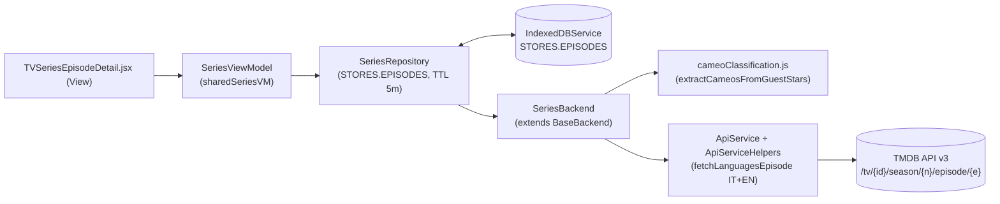
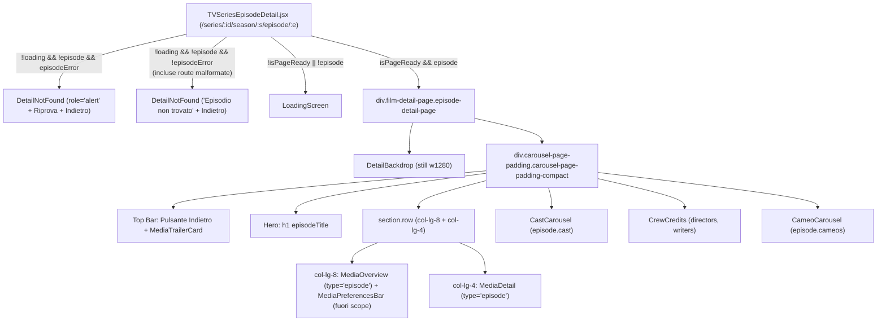

# Documentazione Pagina `TVSeriesEpisodeDetail.jsx`

Documentazione tecnica della pagina [TVSeriesEpisodeDetail.jsx](file:///C:/GitHub_Repositories/Cameos/src/pages/TVSeriesEpisodeDetail.jsx), responsabile della scheda di dettaglio di un singolo episodio di una serie TV (`/series/:id/season/:seasonNumber/episode/:episodeNumber`).

> **Nota di perimetro:** la barra preferenze utente ([MediaPreferencesBar.jsx](file:///C:/GitHub_Repositories/Cameos/src/components/media/MediaPreferencesBar.jsx)) è sviluppata su un branch separato ed è documentata qui solo come segnaposto strutturale.

---

## Parte 1 — Fetch dei Dati (Architettura, Repository, Backend e Parametri)

### 1.1 Architettura e interazione tra i layer

La pagina applica rigorosamente l'architettura **MVVM unidirezionale** (`View -> ViewModel -> Repository -> Backend -> ApiService / IndexedDB -> Models`), allineata a [MovieDetail.jsx](file:///C:/GitHub_Repositories/Cameos/src/pages/MovieDetail.jsx) e [TVSeriesDetail.jsx](file:///C:/GitHub_Repositories/Cameos/src/pages/TVSeriesDetail.jsx): `TVSeriesEpisodeDetail.jsx` non importa né interroga mai Repository, Backend, `ApiService` o `IndexedDBService`.

Al mount su `/series/:id/season/:seasonNumber/episode/:episodeNumber`, `TVSeriesEpisodeDetail.jsx` esegue un **unico flusso di rete** (`SeriesViewModel.loadEpisodeDetails`):

1. **Dettagli completi dell'episodio (`selectedEpisode`)**: invoca `loadEpisodeDetails({ seriesId: id, seasonNumber, episodeNumber, appendCredits: true, language: normalizedLang })`. Se la route è valida, `SeriesBackend.getEpisodeDetails` scarica in parallelo `it-IT` ed `en-US` di `/tv/{id}/season/{n}/episode/{e}?append_to_response=credits,videos` (2 GET totali) e costruisce un modello bilingue [Episode](file:///C:/GitHub_Repositories/Cameos/src/models/Episode.js).
2. **Cast, Crew, Camei e Trailer nello stesso payload**: il modello `Episode` espone in memoria senza ulteriori richieste HTTP:
   - `episode.cameos`: guest star evidenziate come cameo/VIP (`isCameoHighlight`), classificate da `extractCameosFromGuestStars` nel Backend;
   - `episode.cast`: cast regolare + guest star non cameo, deduplicati per `id`;
   - `episode.getDirectors()` / `episode.getWriters()`: regia e sceneggiatura estratte da `episode.crew` tramite `selectCrewByRole`;
   - `episode.trailers` / `episode.getTrailer(langKey)`: eventuali trailer o teaser YouTube/Vimeo bilingue.

---

### 1.2 Layer ViewModel (`SeriesViewModel`, `BaseViewModel`)

- **Istanziazione e sottoscrizione**: `useSeriesViewModel({ language: normalizedLang })` sottoscrive il singleton di sessione `sharedSeriesVM` ([useViewModel.js](file:///C:/GitHub_Repositories/Cameos/src/viewmodel/useViewModel.js#L54-L94)) tramite `useSyncExternalStore`. La pagina destruttura solo `requestedEpisode`, `isEpisodeLoading`, `loadEpisodeDetails` e `getEpisodeForRoute`.
- **Validazione parametri numerici di route (`isValidNumericParam`, `isValidEpisodeRoute`)** ([BaseViewModel.js](file:///C:/GitHub_Repositories/Cameos/src/viewmodel/BaseViewModel.js#L10-L17), [SeriesViewModel.js](file:///C:/GitHub_Repositories/Cameos/src/viewmodel/series/SeriesViewModel.js#L15-L30)):
  - `seriesId` deve essere un intero positivo (`> 0`).
  - `seasonNumber` e `episodeNumber` devono essere interi non negativi (`>= 0`, così da supportare gli *Specials* TMDB su stagione `0`).
  - Route malformate (es. `/series/888/season/abc/episode/1`) sono bloccate all'ingresso di `loadEpisodeDetails`, `isEpisodeLoading` e `getEpisodeForRoute`: restituiscono `null`/`false` con **0 chiamate al Repository** e impediscono il loop infinito di `<LoadingScreen />` dovuto al confronto `NaN !== NaN`.
- **Caricamento episodio (`SeriesViewModel.loadEpisodeDetails`)** ([SeriesViewModel.js](file:///C:/GitHub_Repositories/Cameos/src/viewmodel/series/SeriesViewModel.js#L386-L458)):
  - Segue la stessa pipeline in 5 stadi di `loadSeriesDetails` e `loadSeasonDetails` rimanendo un'operazione isolata (vedi tabella comparativa passo-per-passo in [tv-series-detail.md §1.2](file:///C:/GitHub_Repositories/Cameos/docs/pages/tv-series-detail.md#L50-L64)).
  - Accetta sia l'oggetto opzioni `{ seriesId, id, seasonNumber, episodeNumber, appendCredits, language, force }` sia gli argomenti posizionali legacy.
  - Cattura l'errore della singola richiesta in un `try/catch` locale (`requestError`) e lo salva in `requestedEpisode.error` solo se `episode === null && this.state.requestedEpisode === request && requestError !== null`: richieste parallele che azzerano il generico `state.error` non sovrascrivono l'errore dell'episodio, eventuali errori obsoleti vengono scartati e un vero not-found (`null`) lascia `error: null`.
- **Isolamento loading e risoluzione per route**:
  - `isEpisodeLoading(id, seasonNumber, episodeNumber)` ([SeriesViewModel.js](file:///C:/GitHub_Repositories/Cameos/src/viewmodel/series/SeriesViewModel.js#L473-L482)) isola lo stato di caricamento alla sola tripla `(seriesId, seasonNumber, episodeNumber)` corrente.
  - `getEpisodeForRoute(id, seasonNumber, episodeNumber)` ([SeriesViewModel.js](file:///C:/GitHub_Repositories/Cameos/src/viewmodel/series/SeriesViewModel.js#L485-L493)) restituisce `selectedEpisode` solo se coincide con la tripla richiesta, evitando flash dell'episodio precedente durante le transizioni tra episodi.

---

### 1.3 Snodo Centrale: Layer Repository (`BaseRepository`, `SeriesRepository`)

`SeriesRepository.getEpisodeDetails` ([SeriesRepository.js](file:///C:/GitHub_Repositories/Cameos/src/repository/series/SeriesRepository.js#L295-L316)) delega integralmente a [BaseRepository._executeEntityDetails](file:///C:/GitHub_Repositories/Cameos/src/repository/BaseRepository.js#L343-L382) su `cameos_pwa_db` v3 ([IndexedDBService.js](file:///C:/GitHub_Repositories/Cameos/src/storage/IndexedDBService.js)):

| Store | Chiave completa (`isComplete: true`) | Chiave sommario (`isComplete: false`) | Indice fallback offline | TTL / Dedup |
| :--- | :--- | :--- | :--- | :--- |
| `STORES.EPISODES` | `episode:<seriesId>:<seasonNumber>:<episodeNumber>:<lang>` (`:basic` se `appendCredits: false`) | `episode:<seriesId>:<seasonNumber>:<episodeNumber>:<lang>:summary` (scritta da `getSeasonDetails`) | `episodeKey` `[seriesId, seasonNumber, episodeNumber]` | 5 min + dedup in-flight |

- **Coabitazione non distruttiva con i sommari di stagione**: `getSeasonDetails` ([SeriesRepository.js](file:///C:/GitHub_Repositories/Cameos/src/repository/series/SeriesRepository.js#L266-L280)) salva gli episodi della stagione con suffisso `:summary` (`isComplete: false`), lasciando intatti i record completi (`isComplete: true`) comprensivi di `crew`, `cast`, `cameos` e `trailers`.
- **Network-First + Fallback offline cross-lingua (`_getEntityWithIndexFallback`)**: anche su retry (`force: true`), in assenza di rete legge da `STORES.EPISODES` via indice `episodeKey`, preferendo sempre un record `isComplete: true` (anche nell'altra lingua, essendo già bilingue) rispetto a un record `:summary` e re-idratando `new Episode(record.data)` (`Cameo`, `Trailer`, `crew`). Se la cache è vuota lancia un errore gestito dalla UI tramite `DetailNotFound` con pulsante `Riprova`.

---

### 1.4 Layer Backend, Classificazione Camei & Sorgente Remota

- **`SeriesBackend.getEpisodeDetails`** ([SeriesBackend.js](file:///C:/GitHub_Repositories/Cameos/src/backend/series/SeriesBackend.js#L235-L250)):
  - Chiama [ApiService.getEpisodeDetails](file:///C:/GitHub_Repositories/Cameos/src/service/ApiService.js#L340-L346) con `append_to_response: appendCredits ? 'credits,videos' : ''`.
  - [ApiServiceHelpers.fetchLanguagesEpisode](file:///C:/GitHub_Repositories/Cameos/src/service/ApiServiceHelpers.js#L137-L142) esegue in parallelo `GET /tv/{id}/season/{n}/episode/{e}` in `it-IT` ed `en-US`, fonde testi (`names`, `overviews`) e immagine `stillUrl` bilingue, e allega `videosByLanguage`.
- **Classificazione camei episodio (`extractCameosFromGuestStars`)** ([cameoClassification.js](file:///C:/GitHub_Repositories/Cameos/src/backend/cameos/cameoClassification.js#L65-L82)):
  - Analizza `guest_stars` (da root o `credits.guest_stars`) con `analyzeCameoRole` (ruoli `Self`, `Cameo`, `Uncredited`, `Voice`) e soglia `minPopularity = 12`.
  - Costruisce istanze `Cameo` ordinate per popolarità decrescente, assegnando `cameoBadge` (`VIP (Se stesso)`, `Cameo`, `Special Guest Star`), e filtra `star.isCameoHighlight`.
- **Modello dominio `Episode`** ([Episode.js](file:///C:/GitHub_Repositories/Cameos/src/models/Episode.js#L11-L150)):
  - Normalizza testi bilingue (`getName`, `getOverview`), fotogramma ridimensionabile (`getStillUrl(langKey, 'w1280')`), durata localizzata (`getRuntime(langKey)`), cast deduplicato senza duplicare i camei, `getDirectors()` / `getWriters()` ([Episode.js](file:///C:/GitHub_Repositories/Cameos/src/models/Episode.js#L126-L133)) via `selectCrewByRole`, e `getTrailer(langKey)`.

---

### 1.5 Giustificazione dei parametri impiegati

| Parametro | Layer / Chiamata | Valore in `TVSeriesEpisodeDetail.jsx` | Motivazione tecnica |
| :--- | :--- | :--- | :--- |
| `seriesId` (`id`) | `useParams()` → `loadEpisodeDetails` | `:id` dalla route | Identifica la serie padre su TMDB, partiziona `STORES.EPISODES` e definisce il fallback di `useGoBack(APP_ROUTES.seriesOf(id))`. |
| `seasonNumber` | `useParams()` → `loadEpisodeDetails` | `:seasonNumber` (accetta `0`) | Identifica la stagione (inclusi gli Specials `0`); validato come intero non negativo prima di qualunque fetch. |
| `episodeNumber` | `useParams()` → `loadEpisodeDetails` | `:episodeNumber` (accetta `0`) | Identifica l'episodio nella stagione; validato come intero non negativo insieme a `seriesId` e `seasonNumber`. |
| `appendCredits` | `loadEpisodeDetails` | `true` | Scarica `credits,videos` nella stessa coppia di GET bilingue e marca il record IndexedDB come `isComplete: true`. |
| `language` / `normalizedLang` | `useSeriesViewModel`, `loadEpisodeDetails` | `'it-IT'` o `'en-US'` | Chiave primaria di cache; il cambio lingua sullo stesso episodio **non** rilancia il fetch grazie a `useEffectEvent` e ai campi bilingue in memoria. |
| `force` | `handleRetryEpisode` | `true` (solo su Retry) | Su errore di rete forza il bypass del TTL di 5 minuti se online, preservando il fallback IndexedDB se offline. |
| `size` | `episode.getStillUrl(langKey, 'w1280')` | `'w1280'` | Richiede direttamente al modello la variante HD del fotogramma still per `DetailBackdrop`, senza manipolare URL nella View. |
| `langKey` | Getter di `Episode` e componenti figli | `'it'` o `'en'` | Traduzione live e coerente di titolo, trama, durata, badge `"Stagione X • Episodio Y"`, voti e trailer. |
| `minPopularity` | `extractCameosFromGuestStars` (Backend) | `12` (default) | Distingue le guest star di rilievo dalle comparse episodiche senza dipendere da chiamate HTTP aggiuntive. |

---

## Parte 2 — Visualizzazione (Struttura, Componenti, Hooks e Props)

### 2.1 Struttura della pagina e gestione degli stati (Loading, Errore, Not-Found, Cambio lingua)

La route `/series/:id/season/:seasonNumber/episode/:episodeNumber` in [App.jsx](file:///C:/GitHub_Repositories/Cameos/src/App.jsx#L51) monta `<TVSeriesEpisodeDetail key={pathname} />`, che a sua volta monta `<TVSeriesEpisodeDetailContent key={`${id ?? ''}:${seasonNumber ?? ''}:${episodeNumber ?? ''}`} />` ([TVSeriesEpisodeDetail.jsx](file:///C:/GitHub_Repositories/Cameos/src/pages/TVSeriesEpisodeDetail.jsx#L23-L34)) per azzerare in modo deterministico lo stato locale `revealedEpisodeKey` al cambio episodio.

#### Stati di visualizzazione
- **Loading iniziale**: mostra [LoadingScreen](file:///C:/GitHub_Repositories/Cameos/src/components/LoadingScreen.jsx) finché `episode` non corrisponde alla tripla di route, `!loading` è vero e `useMovieImagesReady(episodeId, backdropSrc)` ha decodificato lo still `w1280` (`1200 ms` timeout).
- **Rivelazione sticky al cambio lingua (`revealedEpisodeKey`)**: una volta rivelata la pagina per `routeKey`, cambiare lingua `IT <-> EN` mantiene montata la pagina senza mostrare `<LoadingScreen />` né rilanciare `loadEpisodeDetails`, traducendo live titolo, trama, badge stagione/episodio, scheda tecnica, durata e trailer.
- **Errore di rete vs Episodio non trovato**: con `!loading && !episode`, se `episodeError` è valorizzato renderizza [DetailNotFound](file:///C:/GitHub_Repositories/Cameos/src/components/media/MediaDetailLayout.jsx#L39-L86) con `role="alert"`, titolo `t('common.error')` e pulsante `Riprova` (`handleRetryEpisode` con `force: true`); altrimenti mostra `t('detail.episodeNotFound')` con solo il pulsante indietro.
- **Route malformate non numeriche**: grazie a `isValidEpisodeRoute`, URL come `/series/888/season/abc/episode/1` hanno immediatamente `loading === false`, `episode === null` ed `episodeError === null`, approdando subito allo stato `Episodio non trovato` con 0 chiamate di rete.

---

### 2.2 Utilizzo degli Hooks e motivazioni

| Hook | Codice / Dipendenze | Come funziona e perché viene usato |
| :--- | :--- | :--- |
| `useParams()` | `{ id, seasonNumber, episodeNumber }` | Estrae la tripla identificativa dell'episodio dalla URL e costruisce la `key` di `TVSeriesEpisodeDetailContent`. |
| `useTranslation()` | `{ t, langKey, normalizedLang }` | Fornisce dizionario, chiave corta (`'it'`/`'en'`) per i getter di `Episode` e tag esteso per `useSeriesViewModel` / `loadEpisodeDetails`. |
| `useDevice()` | `{ isMobile }` | Adatta il margine inferiore del wrapper di `MediaOverview` (`mb-1` mobile vs `mb-3` desktop). |
| `useSeriesViewModel({ language })` | Destrutturati `requestedEpisode`, `isEpisodeLoading`, `loadEpisodeDetails`, `getEpisodeForRoute` | Sottoscrive `sharedSeriesVM` in modo tearing-safe destrutturando solo slice e azioni usati dalla pagina. |
| `useState` | `revealedEpisodeKey` (`string \| null`) | Traccia se la route corrente è già stata rivelata, impedendo ritorni a `<LoadingScreen />` durante il cambio lingua live. |
| `useEffectEvent` (`fetchEpisodeData`) | Chiama `loadEpisodeDetails` leggendo `normalizedLang` corrente | Evita di includere `normalizedLang` nelle dipendenze di `useEffect`, azzerando i re-fetch inutili al cambio lingua. |
| `useEffect` | Deps: `[id, seasonNumber, episodeNumber]` | Avvia il caricamento dell'episodio solo al mount o al cambio effettivo di uno dei tre parametri di route. |
| `useCallback` (`handleRetryEpisode`) | Deps: `[id, seasonNumber, episodeNumber, normalizedLang, loadEpisodeDetails]` | Callback stabile passata a `DetailNotFound.onRetry` per forzare un nuovo tentativo con `force: true`. |
| `useMovieImagesReady(episodeId, backdropSrc)` | [imageUtils.js](file:///C:/GitHub_Repositories/Cameos/src/utils/imageUtils.js#L70-L74) | Precarica e decodifica lo still backdrop `w1280` prima della rivelazione iniziale (timeout 1200 ms). |
| `useScrollToTop(routeKey, isPageReady)` | [domUtils.js](file:///C:/GitHub_Repositories/Cameos/src/utils/domUtils.js#L71-L86) | Imposta `scrollRestoration = 'manual'` e riporta lo scroll a `(0, 0)` a pagina pronta. |
| `useGoBack(id ? APP_ROUTES.seriesOf(id) : APP_ROUTES.series)` | [domUtils.js](file:///C:/GitHub_Repositories/Cameos/src/utils/domUtils.js#L55-L60) | Torna indietro nella history interna o ripiega sulla scheda della serie madre (o su `/series`) in caso di accesso diretto. |

---

### 2.3 Componenti e Parametri (Props)

> Per la specifica completa di tutti i componenti condivisi (`DetailBackdrop`, `DetailNotFound`, `MediaTrailerCard`, `MediaOverview`, `MediaDetail`, `CastCarousel`, `CrewCredits`, `CameoCarousel`) vale [movie-detail.md §2.3](file:///C:/GitHub_Repositories/Cameos/docs/pages/movie-detail.md#L179-L235). Di seguito il riepilogo delle prop effettivamente passate in modalità episodio da [TVSeriesEpisodeDetail.jsx](file:///C:/GitHub_Repositories/Cameos/src/pages/TVSeriesEpisodeDetail.jsx#L108-L180):

| Componente | File | Props passate in `TVSeriesEpisodeDetail.jsx` | Comportamento specifico episodio |
| :--- | :--- | :--- | :--- |
| `DetailBackdrop` | [MediaDetailLayout.jsx](file:///C:/GitHub_Repositories/Cameos/src/components/media/MediaDetailLayout.jsx) | `src={backdropSrc}` (`episode.getStillUrl(langKey, 'w1280')`) | Usa il fotogramma still HD dell'episodio come sfondo hero con sfumatura scura. |
| `DetailNotFound` | [MediaDetailLayout.jsx](file:///C:/GitHub_Repositories/Cameos/src/components/media/MediaDetailLayout.jsx) | `icon="bi-tv"`, `title`, `onBack={goBack}`, `onRetry={episodeError ? handleRetryEpisode : undefined}` | Distingue errore di rete (`role="alert"` + pulsante `Riprova`) da episodio assente o route malformata (`Episodio non trovato`). |
| `MediaTrailerCard` | [MediaTrailerCard.jsx](file:///C:/GitHub_Repositories/Cameos/src/components/media/MediaTrailerCard.jsx) | `media={episode}` | Mostra l'anteprima video dell'episodio se `episode.getTrailer(langKey)` è presente; altrimenti non renderizza nulla. |
| `MediaOverview` | [MediaOverview.jsx](file:///C:/GitHub_Repositories/Cameos/src/components/media/MediaOverview.jsx) | `media={episode}`, `type="episode"` | Mostra trama localizzata, pillola `Stagione X • Episodio Y` / `Season X • Episode Y` e le due pillole di valutazione (TMDb e Cameos via `MediaRatingPill`). |
| `MediaDetail` | [MediaDetail.jsx](file:///C:/GitHub_Repositories/Cameos/src/components/media/MediaDetail.jsx) | `media={episode}`, `type="episode"` | Scheda tecnica con miniatura still (`getStillUrl`), numero stagione, numero episodio, data di messa in onda e durata localizzata. |
| `CastCarousel` | [CastCarousel.jsx](file:///C:/GitHub_Repositories/Cameos/src/components/media/CastCarousel.jsx) | `cast={cast}`, `title={t('cast.titleSimple')}` | Carosello orizzontale del cast regolare e guest star non cameo; si nasconde se vuoto. |
| `CrewCredits` | [CrewCredits.jsx](file:///C:/GitHub_Repositories/Cameos/src/components/media/CrewCredits.jsx) | `directors={directors}`, `writers={writers}`, `className="mb-4 mb-md-5"` | Renderizza i chip cliccabili di regia e sceneggiatura estratti da `episode.getDirectors()` / `episode.getWriters()`; si nasconde se entrambi vuoti. |
| `CameoCarousel` | [CameoCarousel.jsx](file:///C:/GitHub_Repositories/Cameos/src/components/cameo/CameoCarousel.jsx) | `cameos={cameos}`, `title={t('cameos.title')}` | Mostra i camei e le special guest star classificate da `extractCameosFromGuestStars`; si nasconde se vuoto. |
| `MediaPreferencesBar` *(fuori scope)* | [MediaPreferencesBar.jsx](file:///C:/GitHub_Repositories/Cameos/src/components/media/MediaPreferencesBar.jsx) | `target={episode}` | Segnaposto preferenze utente (branch separato, fuori perimetro di questa revisione). |
