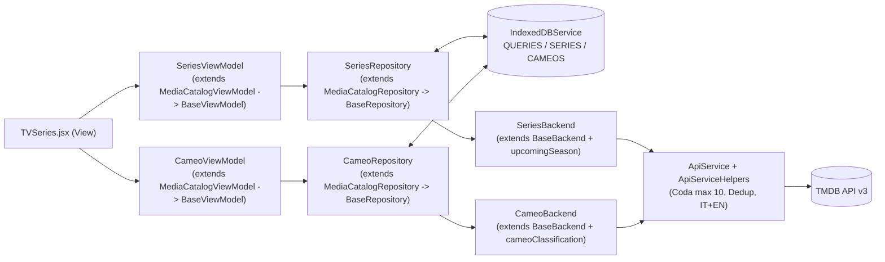
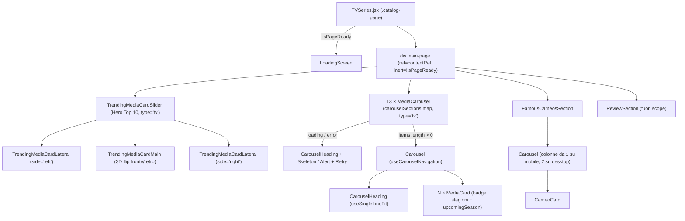

# Documentazione Pagina `TVSeries.jsx`

Documentazione tecnica della pagina [TVSeries.jsx](file:///C:/GitHub_Repositories/Cameos/src/pages/TVSeries.jsx), responsabile del catalogo principale Serie TV (`/tv-series`).

> **Nota di perimetro:** la sezione Recensioni (`ReviewSection` e `INITIAL_COMMUNITY_REVIEWS` da `catalogData.js`) è gestita su un branch separato ed è quindi trattata solo come segnaposto strutturale. `TVSeries.jsx` rispecchia 1:1 la struttura e i contratti di [Movies.jsx](file:///C:/GitHub_Repositories/Cameos/src/pages/Movies.jsx), pur restando un file indipendente per permettere future divergenze progettuali.

---

## Parte 1 — Fetch dei Dati (Architettura, Repository, Backend e Parametri)

### 1.1 Architettura e interazione tra i layer

La pagina applica rigorosamente l'architettura **MVVM unidirezionale** (`View -> ViewModel -> Repository -> Backend -> ApiService / IndexedDB -> Models`): `TVSeries.jsx` non importa né interroga mai Repository, Backend, `ApiService` o `IndexedDBService`. La configurazione statica dei generi TMDB TV è isolata in [mediaCategoryConfig.js](file:///C:/GitHub_Repositories/Cameos/src/utils/media/mediaCategoryConfig.js) (condivisa tra Backend e ViewModel), mentre la mappatura dei titoli/sottotitoli localizzati risiede in [mediaCategoryPresentation.js](file:///C:/GitHub_Repositories/Cameos/src/utils/media/mediaCategoryPresentation.js) (usata esclusivamente dalla View).

Al mount, `TVSeries.jsx` avvia **tre flussi dati indipendenti**:

1. **Serie TV in tendenza (`trendingSeries`)** — orchestrate dentro `SeriesViewModel.loadSeriesFeed()`.
2. **Prossime uscite + 12 categorie di genere (`upcomingSeries`, `categorySeries`)** — orchestrate in parallelo dentro `SeriesViewModel.loadSeriesFeed()` seguendo l'ordine di [SERIES_CATEGORY_CONFIG](file:///C:/GitHub_Repositories/Cameos/src/utils/media/mediaCategoryConfig.js#L62-L115) (allineato 1:1 all'ordine visivo dei 13 caroselli, inclusa la categoria `kids` dopo `family` e prima di `warPolitics`) e paginabili incrementalmente allo scorrimento.
3. **Camei celebri (`famousCameos`)** — archivio storico condiviso con `Movies.jsx` tramite `sharedCatalogCameoVM`: se l'utente ha già visitato `/` (o viceversa), i camei sono già presenti in memoria e non viene eseguito alcun nuovo fetch; il cambio lingua aggiorna i titoli direttamente in memoria tramite `mediaTitles`.

---

### 1.2 Layer ViewModel (`SeriesViewModel`, `CameoViewModel`, `MediaCatalogViewModel`, `BaseViewModel`)

La gerarchia applica il principio di *Single Responsibility*:
- [BaseViewModel.js](file:///C:/GitHub_Repositories/Cameos/src/viewmodel/BaseViewModel.js) gestisce lo stato osservabile immutabile compatibile con `useSyncExternalStore`, la lingua attiva, lo stato di rete e la protezione da race condition `runAsync` ([BaseViewModel.js](file:///C:/GitHub_Repositories/Cameos/src/viewmodel/BaseViewModel.js#L186-L226)).
- [MediaCatalogViewModel.js](file:///C:/GitHub_Repositories/Cameos/src/viewmodel/MediaCatalogViewModel.js) fornisce le primitive di catalogo condivise (`buildCategoryInitialState`, `_loadCategoryList`, `_loadMediaFeed`, `runSearch`, `loadPagination` [MediaCatalogViewModel.js](file:///C:/GitHub_Repositories/Cameos/src/viewmodel/MediaCatalogViewModel.js#L96-L186)).
- [SeriesViewModel.js](file:///C:/GitHub_Repositories/Cameos/src/viewmodel/series/SeriesViewModel.js) estende `MediaCatalogViewModel` esponendo stato e azioni del dominio Serie TV (`trendingSeries`, `upcomingSeries`, `categorySeries`, `categoryPagination`, `feedLoaded`, `loadSeriesFeed`, `loadTrendingSeries`, `loadUpcomingSeries`, `loadSeriesFromCategory`).
- [CameoViewModel.js](file:///C:/GitHub_Repositories/Cameos/src/viewmodel/cameos/CameoViewModel.js) estende `MediaCatalogViewModel` per la sezione camei celebri condivisa.

Meccanismi principali:
- **Istanziazione condivisa**:
  - `useSeriesViewModel({ language: normalizedLang })` restituisce il singleton di sessione `sharedSeriesVM` ([useViewModel.js](file:///C:/GitHub_Repositories/Cameos/src/viewmodel/useViewModel.js#L53-L84)).
  - `useCameoViewModel({ language: normalizedLang, shared: true })` restituisce il medesimo singleton `sharedCatalogCameoVM` ([useViewModel.js](file:///C:/GitHub_Repositories/Cameos/src/viewmodel/useViewModel.js#L55-L99)) utilizzato da `Movies.jsx`.
- **Allineamento con `MovieViewModel`**:
  - `loadTrendingSeries` ([SeriesViewModel.js](file:///C:/GitHub_Repositories/Cameos/src/viewmodel/series/SeriesViewModel.js#L108-L115)) applica `timeWindow: 'month'` e `onlyReleased: true` per default.
  - `loadUpcomingSeries` ([SeriesViewModel.js](file:///C:/GitHub_Repositories/Cameos/src/viewmodel/series/SeriesViewModel.js#L129-L140)) usa `loadPagination` con `paginationMapProp: 'categoryPagination'` e `groupedListProp: 'categorySeries'` senza filtri ridondanti (il filtro `isMediaUpcoming` avviene in Backend e Repository).
- **Paginazione senza flash su rivisita**: `MediaCatalogViewModel.loadPagination` mantiene tutte le pagine già sfogliate (`retainPages: true`) e non riporta `loading: true` quando la lingua non è cambiata e la categoria contiene già elementi in memoria (`hasRetainedItems`). Ogni categoria aggiorna la propria entry isolata in `categoryPagination[key]` tramite `mergeCategoryPatch`.
- **Politica archivio storico per `CameoViewModel.loadFamousCameos`** ([CameoViewModel.js](file:///C:/GitHub_Repositories/Cameos/src/viewmodel/cameos/CameoViewModel.js#L252-L288)): con `onlyIfEmpty: true` salta il fetch se `famousCameos` ha già elementi o una richiesta è in corso (`_pendingOperations`), evitando doppi caricamenti nella navigazione tra `/movies` e `/tv-series`.

---

### 1.3 Snodo Centrale: Layer Repository (`BaseRepository`, `MediaCatalogRepository`, `SeriesRepository`, `CameoRepository`)

La Repository centralizza **TTL, deduplicazione delle richieste concorrenti, persistenza IndexedDB e fallback offline**:
- [BaseRepository.js](file:///C:/GitHub_Repositories/Cameos/src/repository/BaseRepository.js) gestisce `executeCatalogQuery` ([BaseRepository.js](file:///C:/GitHub_Repositories/Cameos/src/repository/BaseRepository.js#L259-L322)), `executeWithFallback` ([BaseRepository.js](file:///C:/GitHub_Repositories/Cameos/src/repository/BaseRepository.js#L106-L137)) e `_cacheEntitiesFromList` ([BaseRepository.js](file:///C:/GitHub_Repositories/Cameos/src/repository/BaseRepository.js#L148-L169)).
- [MediaCatalogRepository.js](file:///C:/GitHub_Repositories/Cameos/src/repository/MediaCatalogRepository.js) fornisce `_executeMediaCatalogPage`, `_getGenres`, `_executeMediaSearch` e `_searchLocalEntities`.
- [SeriesRepository.js](file:///C:/GitHub_Repositories/Cameos/src/repository/series/SeriesRepository.js) e [CameoRepository.js](file:///C:/GitHub_Repositories/Cameos/src/repository/cameos/CameoRepository.js) estendono `MediaCatalogRepository`.

#### Politica di esecuzione (`executeCatalogQuery` + `executeWithFallback`)

1. **Deduplicazione in-flight (`this._catalogRequests`)**: chiamate parallele sulla stessa coppia `storeName:cacheKey` (es. StrictMode in sviluppo) condividono la stessa `Promise`.
2. **Freschezza TTL (`CATALOG_CACHE_TTL_MS = 300_000 ms` = 5 minuti)** ([catalogCache.js](file:///C:/GitHub_Repositories/Cameos/src/repository/catalogCache.js#L1-L7)):
   - Con `force: false`, verifica `Date.now() - timestamp < 300_000`.
   - **TTL Hit**: re-idrata `new Series(...)` / `new Cameo(...)` da IndexedDB senza chiamate di rete e senza estendere il TTL.
   - **Cache Miss / TTL Scaduto / `force: true`**: delega a `executeWithFallback`.
3. **Network-First + Fallback Offline (`executeWithFallback`)**:
   - **Online**: interroga il Backend → salva in IndexedDB → ritorna dati freschi. In caso di errore HTTP/rete, tenta comunque il recupero locale (`getLocal()`) prima di propagare l'errore.
   - **Offline**: salta la rete **anche se `force: true`** e legge da IndexedDB; se la cache locale è vuota solleva un errore esplicito (`Connettività assente e nessun dato locale in cache per: ...`), intercettato da `loadPagination`/`runAsync` per mostrare il pulsante `common.retry`.

#### Store IndexedDB, chiavi di cache e inserimento senza sovrascrittura

Database: `cameos_pwa_db` v3 ([IndexedDBService.js](file:///C:/GitHub_Repositories/Cameos/src/storage/IndexedDBService.js)).

| Repository & Metodo | Store principale | Formato `cacheKey` | Effetti secondari di salvataggio |
| :--- | :--- | :--- | :--- |
| [SeriesRepository.getTrendingSeries](file:///C:/GitHub_Repositories/Cameos/src/repository/series/SeriesRepository.js#L162-L179) | `STORES.QUERIES` | `trending_series:language=<lang>&limit=10&onlyReleased=true&page=1&timeWindow=month` | Inserisce le singole `Series` in `STORES.SERIES` (`series:<id>:<lang>`, `isComplete: false`) **solo se assenti** |
| [SeriesRepository.getUpcomingSeries](file:///C:/GitHub_Repositories/Cameos/src/repository/series/SeriesRepository.js#L108-L123) | `STORES.QUERIES` | `upcoming_series:language=<lang>&page=
` | Inserisce le singole `Series` in `STORES.SERIES` (`isComplete: false`, solo se assenti) e ri-applica `isMediaUpcoming(series, today)` contro la data odierna anche sui risultati da cache (preservando sia premiere future sia stagioni successive con `upcomingSeason.airDate >= today`) |
| [SeriesRepository.getSeriesByCategory](file:///C:/GitHub_Repositories/Cameos/src/repository/series/SeriesRepository.js#L135-L149) | `STORES.QUERIES` | `category_series_<key>:categoryKey=<key>&language=<lang>&page=
` | Inserisce le singole `Series` in `STORES.SERIES` (`isComplete: false`, solo se assenti) |
| [CameoRepository.getFamousCameos](file:///C:/GitHub_Repositories/Cameos/src/repository/cameos/CameoRepository.js#L196-L231) | `STORES.CAMEOS` | `famous_cinema_cameos:language=<lang>&limit=8&page=
` | Salva `{ cacheKey, cachedAt, data }` con `Cameo` (inclusi `mediaTitles` bilingue). Non scrive in `STORES.MOVIES` né in `STORES.SERIES`. |

- **Nessuna sovrascrittura in `STORES.SERIES` ([BaseRepository.js](file:///C:/GitHub_Repositories/Cameos/src/repository/BaseRepository.js#L148-L169))**: `_cacheEntitiesFromList` utilizza `putMany(STORES.SERIES, recordsToPut, { shouldReplace: (existing) => !existing })`. Una serie scaricata in formato sommario da un carosello viene inserita nello store solo se la chiave `series:<id>:<lang>` non esiste ancora, preservando intatti sia i dettagli completi (`isComplete: true`, con stagioni, crediti aggregati, trailer e provider) sia eventuali record già salvati.

---

### 1.4 Layer Backend & Sorgente Remota (`SeriesBackend`, `upcomingSeason`, `CameoBackend`, `ApiService`)

#### `ApiService` e `ApiServiceHelpers` ([ApiService.js](file:///C:/GitHub_Repositories/Cameos/src/service/ApiService.js), [ApiServiceHelpers.js](file:///C:/GitHub_Repositories/Cameos/src/service/ApiServiceHelpers.js))

- **Autenticazione CORS-simple**: invia l'API key v3 via `?api_key=...` (senza header custom → niente preflight `OPTIONS`).
- **Coda FIFO a concorrenza limitata (`MAX_CONCURRENT_REQUESTS = 10`)**: l'ordine di `SERIES_CATEGORY_CONFIG` (`upcoming`, `crime`, `drama`, `comedy`, ..., `kids`, `warPolitics`, `western`, `soap`) rispecchia 1:1 la sequenza visiva così che i caroselli nel viewport iniziale abbiano priorità in coda.
- **Deduplicazione HTTP in-flight + Retry automatico**: condivide fetch identiche, clona i payload e riprova automaticamente su errori di rete (200 ms, con fallback Bearer) e `429`/`5xx` (300 ms).
- **Fetch bilingue tollerante ai guasti parziali (`it-IT` + `en-US`)**: `fetchLanguagesList` e `fetchLanguagesDetail` eseguono entrambe le lingue con `Promise.allSettled` (`allowPartial = true`) e fondono `names`, `overview` (normalizzato in `overviews` dal modello `Series`), `posterUrl`, `backdropUrl`, `taglines`, `videosByLanguage`.

#### Endpoint TMDB e logica di trasformazione per flusso

1. **Trending (`SeriesBackend.getTrendingSeries`)** ([SeriesBackend.js](file:///C:/GitHub_Repositories/Cameos/src/backend/series/SeriesBackend.js#L146-L152), [BaseBackend.js](file:///C:/GitHub_Repositories/Cameos/src/backend/BaseBackend.js#L80-L98)):
   - Endpoint: `GET /discover/tv` con `sort_by=popularity.desc`, `first_air_date.gte=<oggi - 30gg>`, `first_air_date.lte=<oggi>` (finestra mobile ultimi 30 giorni per `timeWindow: 'month'`).
   - Post-processing: filtra `firstAirDate <= oggi` (`onlyReleased: true`), taglia ai primi `limit: 10` e mappa in `new Series(item)`.
2. **Prossime uscite (`SeriesBackend.getUpcomingSeries`)** ([SeriesBackend.js](file:///C:/GitHub_Repositories/Cameos/src/backend/series/SeriesBackend.js#L48-L116)):
   - Esegue **due chiamate bilingue in parallelo**:
     - **Nuove serie (premiere)**: `this.apiService.getUpcomingSeries({ page, language })` → `GET /discover/tv` con `first_air_date.gte=<oggi>`, `sort_by=popularity.desc`.
     - **Serie di ritorno con nuova stagione**: `this.apiService.discoverTv({ sort_by: 'popularity.desc', 'air_date.gte': today, 'first_air_date.lte': today, page, language })` con fallback controllato a pagina vuota se questa sola chiamata fallisce. Essendo bilingue (`discoverTv` invece di `fetch` monolingua), anche le serie di ritorno dispongono di `names` e `posterUrl` in IT+EN.
   - **Merge e arricchimento controllato**: unisce e deduplica i candidati per `id`, quindi esegue `_enrichWithConcurrency(candidates, 4, _enrichUpcomingSeriesItem)` interrogando `GET /tv/{id}` nella lingua corrente per estrarre `status` e `upcomingSeason` tramite [findUpcomingSeason](file:///C:/GitHub_Repositories/Cameos/src/backend/series/upcomingSeason.js#L11-L40):
     - Se `first_air_date > oggi`: restituisce `{ seasonNumber: 1, name, airDate }`.
     - Altrimenti cerca una stagione con `seasonNumber > 1` e `air_date >= oggi`, oppure `next_episode_to_air` con `episode_number === 1`, `season_number > 1` e `air_date >= oggi`.
     - **Normalizzazione del nome stagione (`normalizeSeasonName`)** ([upcomingSeason.js](file:///C:/GitHub_Repositories/Cameos/src/backend/series/upcomingSeason.js#L4-L8)): conserva i titoli personalizzati nella lingua del fetch (es. *"Il Capitolo Finale"*), ma converte etichette generiche come `"Stagione 3"` / `"Season 3"` o stringhe vuote in `null`, delegando a `MediaCard` la formattazione dinamica nella lingua attiva (`t('detail.seasonLabel')`).
   - Calcola `total_pages = Math.max(brandNewData.total_pages || 1, returningData.total_pages || 1)`, filtra con `isMediaUpcoming(item, today)` e mappa in `new Series(item)`.
3. **12 Categorie di genere (`SeriesBackend.getSeriesByCategory`)** ([SeriesBackend.js](file:///C:/GitHub_Repositories/Cameos/src/backend/series/SeriesBackend.js#L127-L134), [BaseBackend.js](file:///C:/GitHub_Repositories/Cameos/src/backend/BaseBackend.js#L55-L77)):
   - Endpoint: `GET /discover/tv` con `page`, `sort_by=popularity.desc`, `first_air_date.lte=<oggi>` (esclude serie non ancora andate in onda), `with_genres=<genreId>`:
     - `crime` (`80`), `drama` (`18`), `comedy` (`35`), `sciFiFantasy` (`10765`), `animation` (`16`), `mystery` (`9648`), `actionAdventure` (`10759`), `family` (`10751`), `kids` (`10762`), `warPolitics` (`10768`), `western` (`37`), `soap` (`10766`).
4. **Camei celebri (`CameoBackend.getFamousCameos`)** ([CameoBackend.js](file:///C:/GitHub_Repositories/Cameos/src/backend/cameos/CameoBackend.js#L121-L209), [cameoClassification.js](file:///C:/GitHub_Repositories/Cameos/src/backend/cameos/cameoClassification.js#L1-L79)):
   - Flusso identico a `Movies.jsx`: seleziona 4 film per pagina da `GET /discover/movie?with_keywords=179430&sort_by=vote_count.desc` (`totalPages = Math.max(1, (heavyRes?.total_pages || 1) * 5)`), analizza i crediti con `cameoClassification.js` (top 2 camei per film, `minPopularity: 4`) e popola `mediaTitles: { it, en }`. `SeriesBackend` è inoltre disaccoppiato da `CameoBackend` importando direttamente il modulo puro `cameoClassification.js`.

---

### 1.5 Giustificazione dei parametri impiegati

| Parametro | Layer / Chiamata | Valore in `TVSeries.jsx` | Motivazione tecnica |
| :--- | :--- | :--- | :--- |
| `language` / `normalizedLang` | Hook → VM → Repo → Backend → API | `'it-IT'` o `'en-US'` | Chiave di fallback/localizzazione e partizionamento cache in `STORES.QUERIES` e `STORES.CAMEOS`. |
| `shared: true` | `useCameoViewModel` | `true` | Collega `TVSeries.jsx` al singleton `sharedCatalogCameoVM` condiviso con `Movies.jsx`, azzerando i re-fetch nella navigazione tra cataloghi. |
| `initialPages` | `loadSeriesFeed`, `retryByCategory` | `2` | Scarica subito 2 pagine in parallelo (~40 serie per carosello, utile soprattutto per `upcoming` che filtra i candidati) garantendo riempimento immediato del viewport desktop. |
| `retainPages` | `loadSeriesFeed` → `loadPagination` | `!force` (`true`) | Al ritorno su `/tv-series` nella stessa lingua preserva le pagine già caricate dall'utente ed evita il flash del loader skeleton. |
| `append` | `loadMoreByCategory`, `loadMoreFamousCameos` | `true` | Richiede `currentPage + 1` accodando i nuovi elementi con `loadingMore: true` senza azzerare la lista visibile. |
| `timeWindow` | `loadTrendingSeries` | `'month'` | Interroga le serie popolari degli ultimi 30 giorni per uno slider Hero stabile e aggiornato. |
| `onlyReleased` | `loadTrendingSeries` | `true` | Esclude dallo slider Hero serie non ancora trasmesse, lasciandole nel carosello `upcoming`. |
| `limit` (Trending) | `SeriesRepository.getTrendingSeries` | `10` (default) | Coerente con lo slider Hero Top 10 e riduce la dimensione dei payload in `STORES.QUERIES`. |
| `limit` (Camei) | `loadFamousCameos` | `16` | Tradotto da `CameoViewModel` in `initialPages = Math.ceil(16 / 8) = 2` pagine (8 colonne × 2 righe su desktop). |
| `onlyIfEmpty` | `loadFamousCameos` (mount) | `true` | Politica archivio storico: impedisce qualsiasi re-fetch durante la navigazione interna o il cambio lingua se lo stato condiviso è già popolato. |
| `force` | `loadFamousCameos` (mount e retry) | `true` | All'apertura iniziale dell'app (stato vuoto) richiede dati aggiornati se online (con fallback IndexedDB automatico se offline); su Retry forza il recupero dopo errore. |
| `first_air_date.lte` | `SeriesBackend.getSeriesByCategory` e ramo returning di `getUpcomingSeries` | data odierna (`YYYY-MM-DD`) | Nei generi esclude serie mai uscite; nel ramo returning di `upcoming` seleziona solo serie già esordite che stanno per trasmettere nuovi episodi (`air_date.gte = oggi`). |
| `air_date.gte` | `SeriesBackend.getUpcomingSeries` (ramo returning) | data odierna (`YYYY-MM-DD`) | Individua le serie di ritorno con episodi/stagioni in onda da oggi in avanti, da validare poi con `findUpcomingSeason`. |
| `concurrency` | `SeriesBackend._enrichWithConcurrency` | `4` | Limita a 4 le chiamate `GET /tv/{id}` simultanee per pagina di `upcoming`, lasciando almeno 6 dei 10 slot di `ApiService` liberi per Trending e caroselli sopra la piega. |
| `with_genres` | `SERIES_CATEGORY_CONFIG` | ID genere TMDB TV (es. `10762` per `kids`, `10765` per `sciFiFantasy`) | Mappa ogni sezione visuale sul genere ufficiale TMDB TV corrispondente (`kids` distinto da `family` `10751` e `animation` `16`). |

---

## Parte 2 — Visualizzazione (Struttura, Componenti, Hooks e Props)

### 2.1 Struttura della pagina e meccanismo di rivelazione (`LoadingScreen` + `usePageReady`)

Come `Movies.jsx`, anche `TVSeries.jsx` mantiene il contenuto montato ma nascosto (`visibility: hidden`, `inert`, `aria-hidden="true"`) dietro `LoadingScreen` finché `isPageReady` non diventa `true`. In questo modo `usePageReady` misura i soli elementi visibili nel viewport iniziale (`getBoundingClientRect()`), attende il completamento dei loro loader e decodifica le immagini visibili prima di rivelare la pagina senza layout shift.

#### Ordine dei 13 caroselli di categoria (`SERIES_CATEGORY_CONFIG` + `getSeriesCarouselSections`)

1. `upcoming` (*Prossime Uscite* — nuove serie e nuove stagioni in arrivo)
2. `crime` (*Crime*)
3. `drama` (*Drama*)
4. `comedy` (*Commedia*)
5. `sciFiFantasy` (*Sci-Fi & Fantasy*)
6. `animation` (*Animazione*)
7. `mystery` (*Mistero & Thriller*)
8. `actionAdventure` (*Azione & Avventura*)
9. `family` (*Famiglia*)
10. `kids` (*Kids*)
11. `warPolitics` (*Guerra & Dramma Politico*)
12. `western` (*Western*)
13. `soap` (*Soap*)

#### Gestione degli stati UI per sezione

| Stato | `TrendingMediaCardSlider` | `MediaCarousel` (13 categorie) | `FamousCameosSection` |
| :--- | :--- | :--- | :--- |
| **Loading iniziale** (`items=[]`, `loading=true`) | Box Hero shimmer con `data-catalog-loading="true"` e `role="status"` | `CarouselHeading` + 8 skeleton poster (`catalog-placeholder-track`) con `data-catalog-loading="true"` | Card vetro con header + spinner centrato e `data-catalog-loading="true"` |
| **Successo** (`items.length > 0`) | Card centrale + 2 anteprime laterali (desktop) + controlli/dot + swipe | `Carousel` scrollabile orizzontalmente con `MediaCard` (`type="tv"`) + auto-fill viewport | `Carousel` a 2 righe (desktop) o 1 riga 84% (mobile) con `CameoCard` |
| **Caricamento pagina successiva** (`isLoadingMore=true`) | N/A | Spinner compatto in coda alla track (`.carousel-loading`) | Spinner compatto in coda alla track (`.carousel-loading`) |
| **Errore senza dati** (`items=[]`, `error!=null`) | Box errore `role="alert"` + pulsante `common.retry` (`onRetry`) | `CarouselHeading` + alert `role="alert"` + pulsante `common.retry` (`onRetry`) | Header + alert centrato `role="alert"` + pulsante `common.retry` (`onRetry`) |
| **Vuoto senza errori** (`items=[]`, `loading=false`, `error=null`) | Ritorna `null` | Ritorna `null` | Ritorna `null` |

---

### 2.2 Utilizzo degli Hooks e motivazioni

#### Hook usati direttamente in [TVSeries.jsx](file:///C:/GitHub_Repositories/Cameos/src/pages/TVSeries.jsx)

| Hook | Codice / Dipendenze | Come funziona e perché viene usato |
| :--- | :--- | :--- |
| `useTranslation()` | `const { t, normalizedLang } = useTranslation()` | Legge lingua attiva (`'it-IT'` / `'en-US'`) e traduttore da `LanguageContext`. |
| `useSeriesViewModel({ language })` | Wrapper di `useViewModel` (`useState` + `useSyncExternalStore` + `useEffect` lingua/rete) | Sottoscrive la pagina allo snapshot immutabile di `sharedSeriesVM` (tearing-safe in React 19). `TVSeries.jsx` destruttura solo slice e azioni usate evitando di mettere l'oggetto `seriesViewModel` nelle dipendenze di memo/effetti. |
| `useCameoViewModel({ language, shared: true })` | Wrapper di `useViewModel` su `sharedCatalogCameoVM` | Condivide stato e paginazione dei camei celebri con `Movies.jsx` senza duplicare fetch. |
| `useRef(null)` | `contentRef` | Riferimento al contenitore `.main-page` passato a `usePageReady` per limitare l'attesa ai soli caroselli nel viewport iniziale. |
| `usePageReady(contentRef, seriesState, cameoState)` | [usePageReady.js](file:///C:/GitHub_Repositories/Cameos/src/utils/use/usePageReady.js) (`useState` + `useEffect` + `requestAnimationFrame` + `preloadImages`) | Attende il completamento dei loader `[data-catalog-loading="true"]` e `.carousel-loading` nel viewport iniziale, pre-decodifica le relative immagini (`timeoutMs: 1200`) e `document.fonts.ready`, poi rivela la pagina. |
| `useScrollToTop('tv-series', isPageReady)` | [domUtils.js](file:///C:/GitHub_Repositories/Cameos/src/utils/domUtils.js#L71-L86) | Disabilita il ripristino automatico dello scroll del browser (con cleanup allo smontaggio) e porta la vista a `(0, 0)` quando `isPageReady` diventa `true`. |
| `useEffect` (fetch iniziale) | Deps: `[loadSeriesFeed, loadFamousCameos, normalizedLang]` | Avvia il caricamento del feed Serie TV e (solo se vuoto) dei camei al mount e al cambio lingua. Le azioni sono metodi bound del ViewModel e restano stabili tra render. |
| `useMemo` (`carouselSections`) | Deps: `[upcomingSeries, categorySeries, t]` | Costruisce le 13 sezioni ordinate tramite [getSeriesCarouselSections](file:///C:/GitHub_Repositories/Cameos/src/utils/media/mediaCategoryPresentation.js#L95-L177) passando solo `{ upcomingSeries, categorySeries }`, evitando ricalcoli quando variano `trendingSeries`, `categoryPagination` o `loading`. |
| `useMemo` (`loadMoreByCategory`) | Deps: `[loadSeriesFromCategory, loadUpcomingSeries]` | Genera una mappa referenzialmente stabile `{ [key]: () => void }` per le 13 chiavi statiche `SERIES_CATEGORY_KEYS`. Usa `useMemo` invece di `useCallback` perché produce un dizionario di callback fuori dal ciclo `.map()` nel rispetto delle Rules of Hooks. |
| `useMemo` (`retryByCategory`) | Deps: `[loadSeriesFromCategory, loadUpcomingSeries, normalizedLang]` | Genera la mappa di retry per tutte le 13 categorie, coerente con `loadMoreByCategory`, aggiornandosi solo al cambio lingua. |
| `useCallback` (`handleRetryTrending`, `handleRetryFamousCameos`) | Deps: `[loadTrendingSeries, normalizedLang]` / `[loadFamousCameos, normalizedLang]` | Callback singole stabili passate come `onRetry` allo slider Hero e alla sezione camei celebri. |

#### Hook chiave nei componenti figli di `TVSeries.jsx`

- **`useCarouselNavigation`** ([useCarouselNavigation.js](file:///C:/GitHub_Repositories/Cameos/src/utils/use/useCarouselNavigation.js)): gestisce navigazione a frecce, `ResizeObserver`, prefetch allo scroll (`shouldTriggerLoadMore`), click rapidi con destinazione unica e auto-fill controllato delle righe sparse usando `useEffectEvent` (React 19).
- **`useSingleLineFit`** ([domUtils.js](file:///C:/GitHub_Repositories/Cameos/src/utils/domUtils.js#L137-L161)): scala i titoli dei caroselli su una riga singola in `useLayoutEffect` + `ResizeObserver` prima del paint.
- **`useDevice`** (`DeviceContext`): adatta il layout di `TrendingMediaCardMain` e `FamousCameosSection` tra mobile e desktop.

---

### 2.3 Componenti e Parametri (Props)

#### 1. `LoadingScreen` ([LoadingScreen.jsx](file:///C:/GitHub_Repositories/Cameos/src/components/LoadingScreen.jsx))
| Prop | Tipo | Default | Ruolo |
| :--- | :--- | :--- | :--- |
| `message` | `string` | `t('common.loading')` | Testo mostrato sotto lo spinner |
| `className` | `string` | `''` | Classi extra (`"catalog-loading-screen"` in `TVSeries.jsx`) |

#### 2. `TrendingMediaCardSlider` ([TrendingMediaCardSlider.jsx](file:///C:/GitHub_Repositories/Cameos/src/components/media/TrendingMediaCardSlider.jsx))
Slider Hero con rotazione automatica ogni 7 s (pausa su hover, `onFocus`/`onBlur` e mentre la card è girata sul retro), swipe touch orizzontale e `safeCurrentIndex`. Con `type="tv"` apre le rotte `/tv-series/:id` e mostra il badge numero stagioni o anno di debutto.

| Prop | Tipo | Default | Ruolo |
| :--- | :--- | :--- | :--- |
| `items` | `Array<Movie\|Series>` | `[]` | Lista serie trending (max 10) |
| `type` | `'movie' \| 'tv'` | `'movie'` | Passato come `'tv'` in `TVSeries.jsx` |
| `className` | `string` | `''` | Classi extra (`"mb-3"`) |
| `loading` | `boolean` | `false` | Mostra shimmer con `data-catalog-loading` quando `items` è vuoto (`!feedLoaded`) |
| `error` | `Error \| string \| object \| null` | `null` | Mostra stato errore `role="alert"` quando `items` è vuoto (`seriesError`) |
| `onRetry` | `() => void` | `undefined` | Azione del pulsante `common.retry` (`handleRetryTrending`) |

- **Figli interni**:
  - `TrendingMediaCardMain` ([TrendingMediaCardMain.jsx](file:///C:/GitHub_Repositories/Cameos/src/components/media/TrendingMediaCardMain.jsx)): props `{ media, rank, slideDirection='', isFlipped=false, onToggleFlip, onAnimationEnd }`. Flip 3D spring con `motion/react` (`rotateY(0 ↔ 180)`, `useReducedMotion`) fronte (badge, titolo sotto i badge, pulsante dettagli) / retro scuro (titolo in accento, trama, text-button dettagli); reset automatico al fronte al cambio slide o al rientro nella pagina; nessun `key={currentIndex}` per preservare il focus tastiera.
  - `TrendingMediaCardLateral` ([TrendingMediaCardLateral.jsx](file:///C:/GitHub_Repositories/Cameos/src/components/media/TrendingMediaCardLateral.jsx)): props `{ media, rank, side: 'left'|'right', animationClass='', onSelect }`. Anteprima laterale interattiva su desktop (`d-none d-lg-block`).

#### 3. `MediaCarousel` ([MediaCarousel.jsx](file:///C:/GitHub_Repositories/Cameos/src/components/media/MediaCarousel.jsx))
| Prop | Tipo | Default | Ruolo |
| :--- | :--- | :--- | :--- |
| `title` | `string` *(req)* | — | Titolo localizzato della sezione |
| `subtitle` | `string` | `undefined` | Sottotitolo descrittivo localizzato (presente su tutte le 13 categorie, incluse `family`, `kids`, `western` e `soap`) |
| `categoryKey` | `string` | `undefined` | Genera il link alla pagina categoria (`APP_ROUTES.category('tv', categoryKey)`) |
| `titleLink` | `string` | `undefined` | Link personalizzato alternativo |
| `items` | `Array<Object>` | `[]` | Lista `Series` da visualizzare |
| `type` | `'movie' \| 'tv' \| 'mixed'` | `'movie'` | Passato come `'tv'` in `TVSeries.jsx` |
| `rows` | `1 \| 2` | `1` | Layout a 1 o 2 righe |
| `upcoming` | `boolean` | `false` | Nasconde il badge rating sulle card (`section.key === 'upcoming'`) |
| `onLoadMore` | `() => any` | `undefined` | Callback `loadMoreByCategory[section.key]` |
| `onRetry` | `() => void` | `undefined` | Callback `retryByCategory[section.key]` per il pulsante `common.retry` |
| `hasMore` | `boolean` | `false` | Abilita il caricamento progressivo delle pagine successive |
| `isLoadingMore` | `boolean` | `false` | Mostra `.carousel-loading` in coda e blocca duplicati |
| `loading` | `boolean` | `false` | Mostra 8 card skeleton con `data-catalog-loading` quando `items` è vuoto |
| `error` | `Error \| string \| object \| null` | `null` | Mostra blocco errore `role="alert"` quando `items` è vuoto |

- **Figli interni**:
  - `Carousel` ([Carousel.jsx](file:///C:/GitHub_Repositories/Cameos/src/components/Carousel.jsx)): props `{ header, children, itemCount, className, headerClassName, trackClassName, previousLabel, nextLabel, scrollDistance='page', onLoadMore, hasMore, isLoadingMore }`.
  - `CarouselHeading` ([CarouselHeading.jsx](file:///C:/GitHub_Repositories/Cameos/src/components/CarouselHeading.jsx)): props `{ title, subtitle, as='h3', className, subtitleClassName='text-success', titleLink }`.
  - `MediaCard` ([MediaCard.jsx](file:///C:/GitHub_Repositories/Cameos/src/components/media/MediaCard.jsx)): props `{ item, type='movie', upcoming=false, showType=false, variant='default', role=null }`. Con `type="tv"` risolve `names`/`posterUrl` nella lingua attiva, mostra `numberOfSeasons` o anno di `firstAirDate` e — per le serie di ritorno nel carosello `upcoming` (`upcomingSeason.seasonNumber > 1`) — renderizza il badge `.media-card-upcoming-season` usando il titolo stagione personalizzato se presente oppure `formatTranslation(t('detail.seasonLabel'), { number: upcomingSeason.seasonNumber })` quando `upcomingSeason.name` è `null`.

#### 4. `FamousCameosSection` ([FamousCameosSection.jsx](file:///C:/GitHub_Repositories/Cameos/src/components/cameo/FamousCameosSection.jsx))
Deduplica i camei per chiave composta (`id_mediaType_mediaId_character`) e organizza la track in colonne da 1 card su mobile o 2 card su desktop/tablet.

| Prop | Tipo | Default | Ruolo |
| :--- | :--- | :--- | :--- |
| `cameos` | `Array<Cameo>` | `[]` | Lista camei celebri condivisa dalla sessione |
| `loading` | `boolean` | `false` | Usa `famousCameosPagination.loading` (allineato a `Movies.jsx`) |
| `error` | `Error \| string \| object \| null` | `null` | Usa `famousCameosPagination.error` |
| `onLoadMore` | `() => any` | `undefined` | Callback `loadMoreFamousCameos` |
| `onRetry` | `() => void` | `undefined` | Callback `handleRetryFamousCameos` |
| `hasMore` | `boolean` | `false` | Usa `famousCameosPagination.hasMore` |
| `isLoadingMore` | `boolean` | `false` | Usa `famousCameosPagination.loadingMore` |

- **Figlio interno**:
  - `CameoCard` ([CameoCard.jsx](file:///C:/GitHub_Repositories/Cameos/src/components/cameo/CameoCard.jsx)): props `{ cameo, className='', variant='default' }`. Mostra foto profilo attore, nome linkato a `/person/:id`, eventuale pill `uncredited`, ruolo, titolo del film tradotto dinamicamente con `cameo.getMediaTitle(langKey)` e link alla scheda attore.
